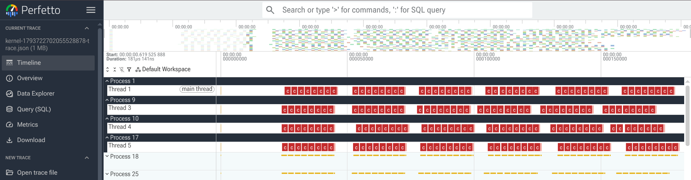
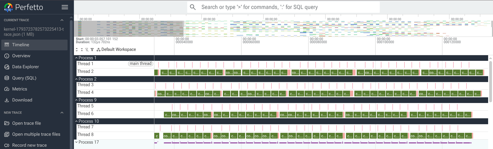

# Writing matrix multiplication kernels for consumer-grade Blackwell

This guide walks through implementing matrix multiplication kernels for compute capability 12.0+ Blackwell GPUs (e.g., RTX PRO, DGX Spark). In contrast to datacenter Blackwell GPUs (SM10x), SM12x devices do not support Tensor Memory (TMEM) or `tcgen05.mma` instructions. Instead, they rely on a hybrid programming model that brings together SM8x-style warp-level `mma.sync` primitives and the Tensor Memory Accelerator (TMA).

We start with a simple and slow implementation using the pipeline.
Next, we can use the following techniques to improve the performance:
- Persistent kernel
- Grid tiling
- Warpgroup specialization

Benchmarks on [DGX Spark (GB10)](https://www.techpowerup.com/gpu-specs/gb10.c4342)(SM count: 48, SMEM: 128KB)

| Implementation                  | TensorCore utilization | Runtime µs | % of cuBLAS utilization |
|---------------------------------|------------------------|------------|-------------------------|
| 0. Basic kernel (matmul0)       | 25.09%                 | 9131.17    | 32.64%                  |
| 1. Persistent kernel            | 36.63%                 | 6253.74    | 47.64%                  |
|    and tiled epilogue (matmul2) |                        |            |                         |
| 2. Grid tiling (matmul3)        | 69.90%                 | 3276.95    | 90.91%                  |
| 3. Warpgroup specialization     | 76.73%                 | 2985.25    | 99.79%                  |
|    (matmul5)                    |                        |            |                         |
| 4. Warpgroup specialization,    | 77.79%                 | 2944.84    | 101.17%                 |
|    2 consumer threads (matmul6) |                        |            |                         |
|                                 |                        |            |                         |
| cuBLAS                          | 76.89%                 | 2979.24    | 100.0%                  |


Benchmarks on [RTX PRO 6000 Server](https://www.techpowerup.com/gpu-specs/rtx-pro-6000-blackwell-server.c4274)(SM count: 188, SMEM: 128KB)

| Implementation                  | TensorCore utilization | Runtime µs | % of cuBLAS utilization |
|---------------------------------|------------------------|------------|-------------------------|
| 0. Basic kernel (matmul0)       | 70.88%                 | 828.64     | 88.79%                  |
| 1. Persistent kernel            | 79.07%                 | 742.85     | 99.05%                  |
|    and tiled epilogue (matmul2) |                        |            |                         |
| 2. Grid tiling (matmul3)        | 79.80%                 | 736.03     | 99.96%                  |
| 3. Warpgroup specialization     | 81.57%                 | 720.06     | 102.18%                 |
|    (matmul5)                    |                        |            |                         |
| 4. Warpgroup specialization,    | 79.85%                 | 735.60     | 100.02%                 |
|    2 consumer threads           |                        |            |                         |
|    (matmul6)                    |                        |            |                         |
|                                 |                        |            |                         |
| cuBLAS                          | 79.83%                 | 735.74     | 100.0%                  |


The cuBLAS baseline is obtained by measuring the performance of `jax.dot`.

```{note}
At the time of writing this guide, CUTLASS does not provide optimized SM120 GEMM kernels for float16 inputs, so we could not compare our results with it.
```

At each step, we will showcase either the full implementation of the kernel or
the differences between the code listings shown in the previous and current steps.

Full implementations can be found in [our test file](https://github.com/jax-ml/jax/blob/main/tests/pallas/mgpu_examples_test_sm12.py).
We can use the following commands to reproduce the results:
```bash
# All matmuls
MATMULTUTORIAL_BENCHMARK=1 python -u tests/pallas/mgpu_examples_test_sm12.py

# Single matmul0
MATMULTUTORIAL_BENCHMARK=1 python -u tests/pallas/mgpu_examples_test_sm12.py MatmulTutorialSM12XTest.test_matmul0
```

## 0. Basic kernel

Let's start with a single-warpgroup `matmul` kernel using `plgpu.emit_pipeline <jax.experimental.pallas.mosaic_gpu.emit_pipeline>`.
For convenience, we split the tuning parameters of the kernel into a separate class:

```python
@dataclasses.dataclass(frozen=True)
class TuningConfig:
  tile_m: int
  tile_n: int
  tile_k: int
  max_concurrent_steps: int
```

`tile_m`, `tile_n`, and `tile_k` specify the size of the matmul performed at
every step of the pipeline. In general, `tile_k` should ideally be equal to
128 divided by the bytewidth of the input element type. `max_concurrent_steps`
specifies the depth of memory prefetch in the compute/memory pipeline, which is
frequently called the number of stages in other implementations.

The kernel implementation begins with a bit of setup:

```python
def matmul0(a, b, config: TuningConfig):
  dtype = a.dtype
  m, k = a.shape
  _, n = b.shape
  tile_m, tile_n, tile_k = config.tile_m, config.tile_n, config.tile_k

  if m % tile_m != 0:
    raise ValueError(f"{m=} must be divisible by {tile_m=}")
  if n % tile_n != 0:
    raise ValueError(f"{n=} must be divisible by {tile_n=}")
  if k % tile_k != 0:
    raise ValueError(f"{k=} must be divisible by {tile_k=}")
  m_iters = m // tile_m
  n_iters = n // tile_n
  k_iters = k // tile_k
  max_concurrent_steps = config.max_concurrent_steps
```

Let's walk through the kernel implementation itself. We set up
a [compute/memory pipeline](./pipelining.md) using {py:func}`plgpu.emit_pipeline <jax.experimental.pallas.mosaic_gpu.emit_pipeline>` in the first part. At each step, the compute function (`do_mma`) consumes a
`(tile_m, tile_k)` slice of the LHS and a `(tile_k, tile_n)` slice of the RHS. We specify `delay_release=1` to ensure that the input windows (`a_smem`, `b_smem`) passed into `do_mma` will not
be overwritten at least until the next invocation of `do_mma` completes. This is
necessary because we only await the completion of the MMA from the previous step
in the following step, which is why `arrive_barrier_slot` and `wait_barrier_slot`
flip between 0 and 1 at each invocation.

The MMA instruction for SM12x is a warp-level `mma.sync` instruction
working on the registers. The accumulators per block are initialized
in the registers and A and B tiles are loaded from SMEM into the registers.


```python
  def kernel(a_gmem, b_gmem, out_gmem, out_smem):
    mi = lax.axis_index("m")
    ni = lax.axis_index("n")
    m_slice = pl.ds(mi * tile_m, tile_m)
    n_slice = pl.ds(ni * tile_n, tile_n)

    # Allocate accumulators in register and in required layout
    acc = plgpu.layout_cast(
        jnp.zeros((tile_m, tile_n), jnp.float32), plgpu.Layout.MMA_ACC(dtype)
    )

    def do_mma(_, a_smem, b_smem, acc):
      with jax.named_scope("load and mma"):
        # Load A tile from SMEM to registers
        # and in required layout
        a = plgpu.load(
            a_smem, layout=plgpu.Layout.MMA_LHS(dtype), optimized=True
        )
        # Load B tile from SMEM to registers
        b = plgpu.load(
            b_smem, layout=plgpu.Layout.MMA_RHS(dtype), optimized=True
        )
        return plgpu.mma(acc, a, b)

    acc = plgpu.emit_pipeline(
      do_mma,
      grid=(k_iters,),
      in_specs=[
          plgpu.BlockSpec(
              (tile_m, tile_k), lambda ki: (mi, ki), delay_release=1
          ),
          plgpu.BlockSpec(
              (tile_k, tile_n), lambda ki: (ki, ni), delay_release=1
          ),
      ],
      max_concurrent_steps=max_concurrent_steps,
      init_carry=acc,
    )(a_gmem, b_gmem)
```

The kernel epilogue is very simple. We write the accumulator to
SMEM ([remembering to call `plgpu.commit_smem`](#commit-smem)) and then
copy it to GMEM using TMA.

```python
  def kernel(...):
    ...  # compute pipeline as above
    with jax.named_scope("epilogue"):
      out_smem[...] = acc.astype(dtype)
      plgpu.commit_smem()
      plgpu.copy_smem_to_gmem(out_smem, out_gmem.at[m_slice, n_slice])
      plgpu.wait_smem_to_gmem(0)
```

Finally, we turn the kernel into a function that can be called
with JAX arrays using {py:func}`plgpu.kernel <jax.experimental.pallas.mosaic_gpu.kernel>`.
We define a 2D grid to iterate over the output tiles and allocate the intermediates used by the kernel, such as the SMEM buffer used to stage the accumulator before copying it to GMEM.


```python
def matmul0(a, b, config):
  ... # Setup code from the first snippet
  @plgpu.kernel(
      out_type=jax.ShapeDtypeStruct((m, n), dtype),
      grid=(m_iters, n_iters),
      grid_names=("m", "n"),
      scratch_types=[
          plgpu.SMEM((tile_m, tile_n), dtype),  # output
      ],
  )
  def kernel(...):
    ... # The whole kernel body

  return kernel(a, b)
```

The kernel is simple and takes around 50 lines omitting the setup part.
Unfortunately, it's not very fast just yet, but it achieves
around 33% of cuBLAS for DGX Spark and around 80% for RTX PRO 6000!

To inspect the kernel's performance in detail,
we can use the following tools: 1) the kernel profiler, 2) PTXAS compilation info (e.g. register spilling), or 3)
[NVIDIA Nsight Compute](https://developer.nvidia.com/nsight-compute).

To run the kernel profiler we can follow [this guide](https://docs.jax.dev/en/latest/pallas/gpu/reference.html#profiling) and add the following in the kernel:
```python
  @plgpu.kernel(
      ...
      compiler_params=plgpu.CompilerParams(
          profile_space=100,
          profile_dir="./matmul0_profile",
      ),
  )
```
The ``profile_space`` value (e.g. 100 as set above) defines the number of profiling events
we can record in SMEM. It should be larger than twice the number of `jax.named_scope()`
invocations in the kernel. We can reduce the size of the input matrices (e.g. K dimension) to fulfill this requirement.
For more information, please check {py:class}`plgpu.CompilerParams <jax.experimental.pallas.mosaic_gpu.CompilerParams>`.
The output trace can be opened in [https://ui.perfetto.dev/](https://ui.perfetto.dev/).

We can get PTXAS information about the kernel compilation:
```bash
# Assuming the Python script is named matmul_test.py
MOSAIC_GPU_DUMP_PTXAS=1 python matmul_test.py
# Or if we use our test file
# MOSAIC_GPU_DUMP_PTXAS=1 python -u tests/pallas/mgpu_examples_test_sm12.py MatmulTutorialSM12XTest.test_matmul0

ptxas info    : 0 bytes gmem
ptxas info    : Compiling entry function 'kernel_mosaic_gpu_kernel' for 'sm_121a'
ptxas info    : Function properties for kernel_mosaic_gpu_kernel
    0 bytes stack frame, 0 bytes spill stores, 0 bytes spill loads
ptxas info    : Used 151 registers, used 2 barriers, 1 bytes smem
ptxas info    : Compile time = 45.797 ms
```


## 1. Persistent kernel and tiled epilogue

In this step, we implement a persistent kernel. The idea is that
we launch as many blocks as we can run concurrently on the GPU
(e.g. SM count multiplied by a factor) and each block will loop over
a fixed number of output tiles. This technique allows us to better
amortize block (de)initialization costs (since they are only
performed once per SM) and achieve a small degree of overlap
between the SMEM-to-GMEM copy in the epilogue and the compute on
the next output tile.

Additionally, we rewrite the epilogue by pipelining the copy
from SMEM to GMEM to improve its efficiency.
To do this, we change our `scratch_types` to allocate two smaller
buffers instead of an SMEM window that can hold the entire output
of size ``(tile_n, tile_m)`` (which also decreases our SMEM usage).

Let's first see how the ``plgpu.kernel`` configuration is updated:

```python
def matmul2(a, b, config: TuningConfig):
  ...

  num_sms = backend.get_default_device().core_count
  grid_size = min(num_sms * config.gs_num_sms_factor, m_iters * n_iters)
  @plgpu.kernel(
      ...
      grid=(grid_size,),
      grid_names=("sm",),
      scratch_types=dict(
          a_smem=plgpu.SMEM((max_concurrent_steps, tile_m, tile_k), dtype),
          b_smem=plgpu.SMEM((max_concurrent_steps, tile_k, tile_n), dtype),
          out_smem=plgpu.SMEM((2, tile_m, config.epilogue_tile_n), dtype),
          load_barriers=plgpu.Barrier(num_arrivals=2, num_barriers=max_concurrent_steps),
      ),
  )
```
We allocate ``max_concurrent_steps`` buffers in SMEM for A and B tiles and
two buffers for the output. We use ``max_concurrent_steps`` buffers to overlap
asynchronous data copy and MMA computations. Two output buffers of
size ``(tile_m, epilogue_tile_n)`` are used in the tiled epilogue.
We use ``load_barriers`` to wait until TMA finishes the data copy into
one of the ``max_concurrent_steps`` buffers and the buffer can be used for
MMA computation.

Next, let's consider the persistent kernel implementation in Mosaic GPU.
We utilize the {py:func}`plgpu.nd_loop <jax.experimental.pallas.mosaic_gpu.nd_loop>`
helper to specify that our iteration space is `(m_iters, n_iters)`, but we also
request that it should be split across the grid using the `collective_axes=`
argument. We also replace ``plgpu.emit_pipeline`` and implement data copy and MMA computation
in two separate functions, which we call in the inner loop over
the contracting ``k`` dimension.


```python
def matmul2(a, b, config: TuningConfig):
  ...
  def kernel(
      a_gmem,
      b_gmem,
      out_gmem,
      a_smem,
      b_smem,
      out_smem,
      load_barriers,
  ):
    @plgpu.nd_loop((m_iters, n_iters), collective_axes="sm")
    def _mn_loop(loop_info: plgpu.NDLoopInfo):
      mi, ni = loop_info.index
      m_slice = ...
      n_slice = ...

      acc = plgpu.layout_cast(
          jnp.zeros((tile_m, tile_n), jnp.float32), plgpu.Layout.MMA_ACC(dtype)
      )

      # Copy A and B tiles from GMEM to SMEM
      # using multiple buffers (indexed with slot)
      # for memory prefetch in the compute/memory pipeline
      def _data_copy(ki, slot):
        k_slice = pl.ds(ki * tile_k, tile_k)
        plgpu.copy_gmem_to_smem(
            a_gmem.at[m_slice, k_slice],
            a_smem.at[slot],
            load_barriers.at[slot],
            oob_mode=plgpu.OOBFillMode.PROMISE_IN_BOUNDS,
        )
        plgpu.copy_gmem_to_smem(
            b_gmem.at[k_slice, n_slice],
            b_smem.at[slot],
            load_barriers.at[slot],
            oob_mode=plgpu.OOBFillMode.PROMISE_IN_BOUNDS,
        )

      # MMA computation similar to do_mma method from matmul0
      def _compute(slot, acc):
        # Wait until GMEM-to-SMEM copy finishes
        # before loading SMEM to registers
        plgpu.barrier_wait(load_barriers.at[slot])
        with jax.named_scope("compute:load and mma"):
          a = plgpu.load(
              a_smem.at[slot], layout=plgpu.Layout.MMA_LHS(dtype), optimized=True
          )
          b = plgpu.load(
              b_smem.at[slot], layout=plgpu.Layout.MMA_RHS(dtype), optimized=True
          )
          return plgpu.mma(acc, a, b)

      # Memory prefetch steps
      prefetch = max_concurrent_steps - 1
      for j in range(min(prefetch, k_iters)):
        _data_copy(j, j % max_concurrent_steps)

      # Compute and memory loop
      def body(ki, acc):
        _data_copy(ki + prefetch, (ki + prefetch) % max_concurrent_steps)
        return _compute(ki % max_concurrent_steps, acc)

      steady_end = max(0, k_iters - prefetch)
      acc = lax.fori_loop(0, steady_end, body, acc)

      # Compute remaining sub-tiles
      for ki in range(steady_end, k_iters):
        acc = _compute(ki % max_concurrent_steps, acc)
```

Finally, the tiled epilogue is as follows:

```python
  def kernel(...):
    @plgpu.nd_loop(...)
    def _mn_loop(...):
      ...
      with jax.named_scope("epilogue"):
        out_gmem_window = out_gmem.at[m_slice, n_slice]
        for ni in range(tile_n // config.epilogue_tile_n):
          ni_slice = slice(
              ni * config.epilogue_tile_n,
              (ni + 1) * config.epilogue_tile_n
          )
          # As we use two out_smem buffers for SMEM to GMEM copy
          # we should wait in the loop until the same buffer
          # becomes available to be written with values from registers
          plgpu.wait_smem_to_gmem(1, wait_read_only=True)
          out_smem_ni = out_smem.at[ni % 2]
          out_smem_ni[...] = acc[:, ni_slice].astype(dtype)
          plgpu.commit_smem()
          plgpu.copy_smem_to_gmem(out_smem_ni, out_gmem_window.at[:, ni_slice])

    plgpu.wait_smem_to_gmem(0, wait_read_only=True)
```

This modification already gives us a meaningful performance boost,
especially on RTX PRO 6000, getting us up to 99% of cuBLAS performance
for RTX PRO 6000 and 48% for DGX Spark.

## 2. Grid tiling

Further improvement to this kernel is to apply the "grid tiling" technique
to better utilize the L2 cache. To read more on it, we suggest checking the
[Grid tiling](blackwell_matmul.md#6-grid-tiling) part of the data-center Blackwell
Matrix Multiplication tutorial.

This strategy is implemented in the
{py:func}`plgpu.planar_snake <jax.experimental.pallas.mosaic_gpu.planar_snake>`
helper function.
When using the helper, the changes to the kernel are quite trivial:

```python
def matmul3(a, b, config):
  ...
  def kernel(...):
    ...
    # We now only iterate over a 1D loop (but we still split it across clusters).
    @plgpu.nd_loop((m_iters * n_iters,), collective_axes="sm")
    def _mn_loop(loop_info: plgpu.NDLoopInfo):
      (lin_idx,) = loop_info.index
      m_index, n_index = plgpu.planar_snake(
          lin_idx,  # Linear index.
          (m_iters, n_iters),  # The 2D iteration space.
          config.grid_minor_dim,  # 0 or 1, indicates the fastest changing dim.
          config.grid_tile_width,  # The width of tiles along the fastest changing dim.
      )
      ... # Rest of the code remains unmodified
```

With this simple trick we achieve 99% of cuBLAS performance
for RTX PRO 6000 and 90% for DGX Spark.

However, checking the PTXAS information, we can see that the most optimal configuration has register spilling:
```bash
# We use our test file:
MOSAIC_GPU_DUMP_PTXAS=1 python -u tests/pallas/mgpu_examples_test_sm12.py MatmulTutorialSM12XTest.test_matmul3

ptxas warning : Registers are spilled to local memory in function 'kernel_mosaic_gpu_kernel', 64 bytes spill stores, 64 bytes spill loads
ptxas info    : 0 bytes gmem
ptxas info    : Compiling entry function 'kernel_mosaic_gpu_kernel' for 'sm_121a'
ptxas info    : Function properties for kernel_mosaic_gpu_kernel
    64 bytes stack frame, 64 bytes spill stores, 64 bytes spill loads
ptxas info    : Used 255 registers, used 2 barriers, 64 bytes cumulative stack size, 1 bytes smem
ptxas info    : Compile time = 39.313 ms
```

We can also inspect the profiling trace and used GPU resources to see if there is room for other improvements.
```bash
MOSAIC_GPU_DUMP_RESOURCES=1 python -u tests/pallas/mgpu_examples_test_sm12.py MatmulTutorialSM12XTest.test_matmul3

Resources(smem_scratch_bytes=98304, tmem_scratch_cols=0, tmem_collective_scratch_cols=0, barrier_counts=Counter({Barrier(arrival_count=2, num_barriers=2, orders_tensor_core=False): 1}), scoped_gmem_semaphores={}, use_barrier_semaphore=False)
```

To get the profiling trace, we add the following to the ``plgpu.kernel`` function:
```python
compiler_params=plgpu.CompilerParams(
    profile_space=190,
    profile_dir="./matmul_profile",
),
```
and reduce the input matrix size.
```bash
MATMULTUTORIAL_PROFILE=1 python -u tests/pallas/mgpu_examples_test_sm12.py MatmulTutorialSM12XTest.test_matmul3
```

The profiler trace for DGX Spark is as follows:
<center></center>

We can observe that when a warpgroup starts working on a tile, it performs data prefetch, loading/compute pipelining, and the epilogue.
However, we can potentially better overlap the current tile epilogue and the next tile data prefetch such that after the epilogue,
the warpgroup could start the MMA computation without waiting.

## 3. Warpgroup specialization

```{note}
Recall that a single Pallas:MGPU thread of execution corresponds to
a warpgroup of CUDA lanes/threads.
```

The previous kernel uses a single warpgroup for everything; however,
we can schedule multiple warpgroups and specialize their roles
such that one warpgroup is responsible for data loading and
other warpgroups perform the MMA computation and the epilogue.
This allows us to better overlap the epilogue part of the current tile
and the data loading of the next tile.

In Pallas terms, ``plgpu.kernel`` can be called with
``num_threads=2``, meaning that each program in the grid would result in two calls
to the body. The thread index is then often queried using ``lax.axis_index`` and
used to select one of multiple different roles, such as _only_ issuing async
copies or _only_ running the MMA operations.

We update the previous kernel as follows:
```python
def matmul5(...):
  ...
  # We apply transformations to SMEM to reduce memory bank conflicts
  itemsize = jnp.dtype(dtype).itemsize  # in bytes
  swizzle = plgpu.find_swizzle(tile_k * itemsize * 8)
  a_transforms = (
      plgpu.TilingTransform((8, swizzle // itemsize)),
      plgpu.SwizzleTransform(swizzle),
  )
  swizzle = plgpu.find_swizzle(tile_n * itemsize * 8)
  b_transforms = (
      plgpu.TilingTransform((8, swizzle // itemsize)),
      plgpu.SwizzleTransform(swizzle),
  )

  @plgpu.kernel(
      ...
      scratch_types=dict(
          a_smem=plgpu.SMEM((max_concurrent_steps, tile_m, tile_k), dtype, transforms=a_transforms),
          b_smem=plgpu.SMEM((max_concurrent_steps, tile_k, tile_n), dtype, transforms=b_transforms),
          out_smem=plgpu.SMEM((tile_m, tile_n), dtype, transforms=b_transforms),
          # Producer/Consumer synchronization barriers
          load_barriers=plgpu.Barrier(num_arrivals=2, num_barriers=max_concurrent_steps),
          consumed_barriers=plgpu.Barrier(num_arrivals=1, num_barriers=max_concurrent_steps),
      ),
      num_threads=2, # Two warpgroups (256 threads) per block: producer and consumer
      thread_name="wg",
  )
  def kernel(
      ...
      a_smem,
      b_smem,
      out_smem,
      load_barriers,
      consumed_barriers,
  ):
    @plgpu.nd_loop(...)
    def _mn_loop(...):
      ...
      # Fetch the warpgroup index
      wg_idx = lax.axis_index("wg")

      # Warpgroup 0: Dedicated Memory Prefetcher
      @pl.when(wg_idx == 0)
      def _memory_wg():
        def _loop_body_mem(ki, _):
          slot = lax.rem(ki, max_concurrent_steps)

          # Wait for the Compute Warpgroup to complete its read cycle before overwriting
          @pl.when(jnp.logical_or(ki >= max_concurrent_steps, loop_info.local_index > 0))
          def _await_consumed():
            plgpu.barrier_wait(consumed_barriers.at[slot])

          @pl.when(ki < k_iters)
          def _produce():
            k_slice = pl.ds(ki * tile_k, tile_k)
            with jax.named_scope("produce:copy g2s"):
              plgpu.copy_gmem_to_smem(
                  a_gmem.at[m_slice, k_slice],
                  a_smem.at[slot],
                  load_barriers.at[slot],
                  oob_mode=plgpu.OOBFillMode.PROMISE_IN_BOUNDS,
              )
              plgpu.copy_gmem_to_smem(
                  b_gmem.at[k_slice, n_slice],
                  b_smem.at[slot],
                  load_barriers.at[slot],
                  oob_mode=plgpu.OOBFillMode.PROMISE_IN_BOUNDS,
              )

        lax.fori_loop(0, k_iters, _loop_body_mem, None)

      # Warpgroup 1: Dedicated Compute Engine
      @pl.when(wg_idx == 1)
      def _compute_wg():
        def _loop_body_comp(ki, acc):
          slot = lax.rem(ki, max_concurrent_steps)

          # Wait for the Memory Warpgroup to populate the SMEM buffers
          plgpu.barrier_wait(load_barriers.at[slot])

          with jax.named_scope("compute:load and mma"):
            a = plgpu.load(
                a_smem.at[slot], layout=plgpu.Layout.MMA_LHS(dtype), optimized=True
            )
            b = plgpu.load(
                b_smem.at[slot], layout=plgpu.Layout.MMA_RHS(dtype), optimized=True
            )
            acc = plgpu.mma(acc, a, b)

          # Signal to Warpgroup 0 that the SMEM read is complete
          plgpu.barrier_arrive(consumed_barriers.at[slot])
          return acc

        # Initialize local registers
        acc = plgpu.layout_cast(
            jnp.zeros((tile_m, tile_n), jnp.float32), plgpu.Layout.MMA_ACC(dtype)
        )
        acc = lax.fori_loop(0, k_iters, _loop_body_comp, acc)

        # Write out epilogue from Warpgroup 1
        with jax.named_scope("epilogue"):
          out_smem[...] = acc.astype(dtype)
          plgpu.commit_smem()
          plgpu.copy_smem_to_gmem(out_smem, out_gmem.at[m_slice, n_slice])
    plgpu.wait_smem_to_gmem(0, wait_read_only=True)

  return kernel(a, b)
```

One interesting aspect is the synchronization: we keep an array of
`load_barriers`, each tracking progress of an outstanding GMEM->SMEM copy.
The compute thread must await their completion before feeding the respective
operands to the MMA operation. Conversely, the thread responsible
for async copies must await the completion of MMAs that consume operands before
it can overwrite the memory by issuing another async copy. This is tracked through
`consumed_barriers`.

This modification achieves around 100% of cuBLAS performance on DGX Spark and 102% on RTX PRO 6000.
The best configuration is
```
TuningConfig(tile_m=128, tile_n=128, tile_k=64, max_concurrent_steps=2, epilogue_tile_n=None, grid_minor_dim=0, grid_tile_width=8, gs_num_sms_factor=1)
```

We can also confirm that this version does not have registers spilling:
```bash
MOSAIC_GPU_DUMP_PTXAS=1 python -u tests/pallas/mgpu_examples_test_sm12.py MatmulTutorialSM12XTest.test_matmul5

  ptxas info    : 0 bytes gmem
  ptxas info    : Compiling entry function 'kernel_mosaic_gpu_kernel' for 'sm_121a'
  ptxas info    : Function properties for kernel_mosaic_gpu_kernel
      0 bytes stack frame, 0 bytes spill stores, 0 bytes spill loads
  ptxas info    : Used 250 registers, used 16 barriers, 1 bytes smem
  ptxas info    : Compile time = 24.983 ms
```

Let's also produce the profiler trace and on DGX Spark it looks as follows:
<center></center>

We can observe a better overlap between the current tile epilogue and the next tile data prefetch such that after the epilogue,
the consumer warpgroup starts the MMA computation almost without waiting.

Looking closely at the MMA computation blocks for a single tile, we see small gaps between two consecutive blocks.
This may be because the producer warpgroup takes more time to load the data compared
to the consumer warpgroup using it for computation and the number of used buffers
for A and B tiles is not enough to fully overlap the data loading.
Indeed, in this kernel we use `max_concurrent_steps=2` buffers and
we cannot increase it due to available SMEM size.

In terms of SMEM usage, the kernel is using almost all available memory: 98304 of 101376 bytes.
```bash
MOSAIC_GPU_DUMP_RESOURCES=1 python -u tests/pallas/mgpu_examples_test_sm12.py MatmulTutorialSM12XTest.test_matmul5

  Resources(smem_scratch_bytes=98304, tmem_scratch_cols=0, tmem_collective_scratch_cols=0, barrier_counts=Counter({Barrier(arrival_count=1, num_barriers=2, orders
  _tensor_core=False): 1, Barrier(arrival_count=2, num_barriers=2, orders_tensor_core=False): 1}), scoped_gmem_semaphores={}, use_barrier_semaphore=False)
```
Setting `max_concurrent_steps=3` would require an additional `SizeOfFP16 * (tile_m * tile_k + tile_n * tile_k) = 32768` bytes of SMEM, leading to an out-of-memory error.
On the other hand, the configurations with smaller tile sizes (e.g. `tile_k=32`) and
larger `max_concurrent_steps>2` have worse performance.

In the next section, we explore the idea of increasing `max_concurrent_steps` and reducing `tile_k` together
with increasing the number of consumer threads.


## 4. Warpgroup specialization, two consumer threads

In this version of the matmul kernel we apply the following changes:
1) Increase the number of consumer warpgroups from 1 to 2
2) Manually decrease the number of registers for the producer warpgroup and increase it for the consumer warpgroups

Let's detail each update. Previously, we had one consumer warpgroup computing the
accumulators of size `tile_m * tile_n`. Now, we have two consumer warpgroups
splitting the computation over the M dimension, i.e. each warpgroup computes MMA
on half of `tile_m`.

On the other hand, when we increase the total number of warpgroups in the CTA, this reduces
the number of available registers per warpgroup and can lead to register spilling.
For two warpgroups (as in the previous `matmul5` kernel) we have 255 available registers per thread,
65536 registers per SM / 2 warpgroups / 4 warps in warpgroup / 32 threads in warp.
For three warpgroups, we will have around 170 available registers per thread and the kernel may have register pressure.
However, the roles of our three warpgroups are different: one producer and two consumers.
The producer warpgroup schedules data loading using TMA and does not need many registers.
Consumer warpgroups require registers for the MMA computation and may have register pressure.
We can use {py:func}`plgpu.set_max_registers <jax.experimental.pallas.mosaic_gpu.set_max_registers>`
to dynamically increase or decrease the number of registers per warpgroup.

We update the previous kernel as follows:
```python
def matmul6(...):
  ...
  comp_m = tile_m // 2

  @plgpu.kernel(
      ...
      scratch_types=dict(
          ...
          out_smem=plgpu.SMEM((2, comp_m, tile_n), dtype, transforms=b_transforms),
          ...
      ),
      num_threads=3, # Three warpgroups per block
      ...
  )
  def kernel(...):
    @plgpu.nd_loop(...)
    def _mn_loop(...):
      ...
      m_subslice = pl.ds((wg_idx - 1) * comp_m, comp_m)
      out_m_slice = pl.ds(mi * tile_m + (wg_idx - 1) * comp_m, comp_m)

      # Warpgroup 0: Dedicated Memory Prefetcher
      @pl.when(wg_idx == 0)
      def _memory_wg():
        plgpu.set_max_registers(40, action="decrease")
        ...

      # Warpgroups 1, 2: Dedicated Compute Engine
      @pl.when(wg_idx > 0)
      def _compute_wg():
        plgpu.set_max_registers(232, action="increase")

        def _loop_body_comp(...):
          ...
          with jax.named_scope("compute:load and mma"):
            a = plgpu.load(
                a_smem.at[slot, m_subslice], layout=plgpu.Layout.MMA_LHS(dtype), optimized=True
            )
            ...
          ...

        # Initialize local register tiles
        acc = plgpu.layout_cast(
            jnp.zeros((comp_m, tile_n), jnp.float32), plgpu.Layout.MMA_ACC(dtype)
        )
        ...

        # Write out epilogue from Warpgroups 1, 2 (where registers are active)
        with jax.named_scope("epilogue"):
          out_smem.at[wg_idx - 1][...] = acc.astype(dtype)
          plgpu.commit_smem()
          plgpu.copy_smem_to_gmem(
              out_smem.at[wg_idx - 1],
              out_gmem.at[out_m_slice, n_slice]
          )
    ...
```
This modification achieves around 101% of cuBLAS performance on DGX Spark and remains at 100% on RTX PRO 6000.
The best configurations are
```
# DGX Spark
TuningConfig(tile_m=128, tile_n=128, tile_k=32, max_concurrent_steps=4, epilogue_tile_n=None, grid_minor_dim=0, grid_tile_width=8, gs_num_sms_factor=1)

# RTX PRO 6000
TuningConfig(tile_m=128, tile_n=128, tile_k=32, max_concurrent_steps=4, epilogue_tile_n=None, grid_minor_dim=1, grid_tile_width=12, gs_num_sms_factor=2)
```

## Final kernel

Congratulations, you've reached the end of this tutorial! In the previous
sections, we focused only on the differences between the kernels and
rarely listed the complete source. While this hides the irrelevant details
when extending the implementation, it can also be helpful to see the full
source. So here it is! The complete implementation is less than 150 lines and
reaches SOTA performance (at least on the shape used in our benchmarks).

```python
def matmul6(a, b, config: TuningConfig):
  # use persistent kernel, grid tiling
  # and warpgroup specialization: 1 producer warpgroup and 2 consumer warpgroups
  num_sms = backend.get_default_device().core_count

  dtype = a.dtype
  m, k = a.shape
  _, n = b.shape
  tile_m, tile_n, tile_k = config.tile_m, config.tile_n, config.tile_k

  if m % tile_m != 0:
    raise ValueError(f"{m=} must be divisible by {tile_m=}")
  if n % tile_n != 0:
    raise ValueError(f"{n=} must be divisible by {tile_n=}")
  if k % tile_k != 0:
    raise ValueError(f"{k=} must be divisible by {tile_k=}")

  comp_m = tile_m // 2
  m_iters = m // tile_m
  n_iters = n // tile_n
  k_iters = k // tile_k
  max_concurrent_steps = config.max_concurrent_steps

  grid_size = min(num_sms * config.gs_num_sms_factor, m_iters * n_iters)

  itemsize = jnp.dtype(dtype).itemsize  # in bytes
  swizzle = plgpu.find_swizzle(tile_k * itemsize * 8)
  a_transforms = (
      plgpu.TilingTransform((8, swizzle // itemsize)),
      plgpu.SwizzleTransform(swizzle),
  )
  swizzle = plgpu.find_swizzle(tile_n * itemsize * 8)
  b_transforms = (
      plgpu.TilingTransform((8, swizzle // itemsize)),
      plgpu.SwizzleTransform(swizzle),
  )

  @plgpu.kernel(
      out_type=jax.ShapeDtypeStruct((m, n), dtype),
      grid=(grid_size,),
      grid_names=("sm",),
      scratch_types=dict(
          a_smem=plgpu.SMEM((max_concurrent_steps, tile_m, tile_k), dtype, transforms=a_transforms),
          b_smem=plgpu.SMEM((max_concurrent_steps, tile_k, tile_n), dtype, transforms=b_transforms),
          out_smem=plgpu.SMEM((2, comp_m, tile_n), dtype, transforms=b_transforms),
          load_barriers=plgpu.Barrier(num_arrivals=2, num_barriers=max_concurrent_steps),
          consumed_barriers=plgpu.Barrier(num_arrivals=2, num_barriers=max_concurrent_steps),
      ),
      num_threads=3, # Three warpgroups per block
      thread_name="wg",
  )
  def kernel(
      a_gmem,
      b_gmem,
      out_gmem,
      a_smem,
      b_smem,
      out_smem,
      load_barriers,
      consumed_barriers,
  ):
    @plgpu.nd_loop((m_iters * n_iters,), collective_axes="sm")
    def _mn_loop(loop_info: plgpu.NDLoopInfo):
      (lin_idx,) = loop_info.index
      mi, ni = plgpu.planar_snake(
          lin_idx,  # Linear index.
          (m_iters, n_iters),  # The 2D iteration space.
          config.grid_minor_dim,  # 0 or 1, indicates the fastest changing dim.
          config.grid_tile_width,  # The width of tiles along the fastest changing dim.
      )
      m_slice = pl.ds(mi * tile_m, tile_m)
      n_slice = pl.ds(ni * tile_n, tile_n)

      wg_idx = lax.axis_index("wg")
      m_subslice = pl.ds((wg_idx - 1) * comp_m, comp_m)
      out_m_slice = pl.ds(mi * tile_m + (wg_idx - 1) * comp_m, comp_m)

      # Warpgroup 0: Dedicated Memory Prefetcher
      @pl.when(wg_idx == 0)
      def _memory_wg():
        plgpu.set_max_registers(40, action="decrease")

        def _loop_body_mem(ki, _):
          slot = lax.rem(ki, max_concurrent_steps)

          # Wait for the Compute Warpgroup to complete its read cycle before overwriting
          @pl.when(jnp.logical_or(ki >= max_concurrent_steps, loop_info.local_index > 0))
          def _await_consumed():
            plgpu.barrier_wait(consumed_barriers.at[slot])

          k_slice = pl.ds(ki * tile_k, tile_k)
          with jax.named_scope("produce:copy g2s"):
            plgpu.copy_gmem_to_smem(
                a_gmem.at[m_slice, k_slice],
                a_smem.at[slot],
                load_barriers.at[slot],
                oob_mode=plgpu.OOBFillMode.PROMISE_IN_BOUNDS,
            )
            plgpu.copy_gmem_to_smem(
                b_gmem.at[k_slice, n_slice],
                b_smem.at[slot],
                load_barriers.at[slot],
                oob_mode=plgpu.OOBFillMode.PROMISE_IN_BOUNDS,
            )

        lax.fori_loop(0, k_iters, _loop_body_mem, None)

      # Warpgroups 1, 2: Dedicated Compute Engine
      @pl.when(wg_idx > 0)
      def _compute_wg():
        plgpu.set_max_registers(232, action="increase")

        def _loop_body_comp(ki, acc):
          slot = lax.rem(ki, max_concurrent_steps)

          # Wait for the Memory Warpgroup to populate the SMEM buffers
          plgpu.barrier_wait(load_barriers.at[slot])

          with jax.named_scope("compute:load and mma"):
            a = plgpu.load(
                a_smem.at[slot, m_subslice], layout=plgpu.Layout.MMA_LHS(dtype), optimized=True
            )
            b = plgpu.load(
                b_smem.at[slot], layout=plgpu.Layout.MMA_RHS(dtype), optimized=True
            )
            acc = plgpu.mma(acc, a, b)
            # Signal to Warpgroup 0 that the SMEM read is complete
            plgpu.barrier_arrive(consumed_barriers.at[slot])

          return acc

        # Initialize local register tiles
        acc = plgpu.layout_cast(
            jnp.zeros((comp_m, tile_n), jnp.float32), plgpu.Layout.MMA_ACC(dtype)
        )
        acc = lax.fori_loop(0, k_iters, _loop_body_comp, acc)

        # Write out epilogue from Warpgroups 1, 2 (where registers are active)
        with jax.named_scope("epilogue"):
          out_smem.at[wg_idx - 1][...] = acc.astype(dtype)
          plgpu.commit_smem()
          plgpu.copy_smem_to_gmem(
              out_smem.at[wg_idx - 1],
              out_gmem.at[out_m_slice, n_slice]
          )
    plgpu.wait_smem_to_gmem(0, wait_read_only=True)

  return kernel(a, b)
```
