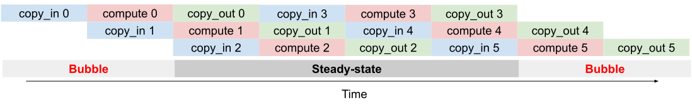
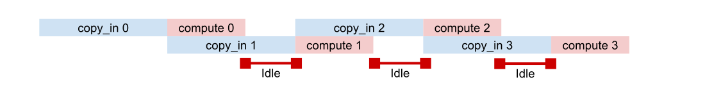
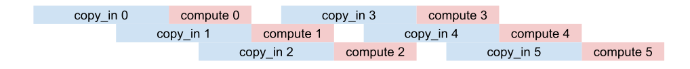

---
jupyter:
  jupytext:
    formats: ipynb,md
    main_language: python
    text_representation:
      extension: .md
      format_name: markdown
      format_version: '1.3'
      jupytext_version: 1.16.4
  kernelspec:
    display_name: Python 3
    name: python3
---

<!-- #region id="C93Xlf0DRW9H" -->

(pallas_software_pipelining)=

# Software Pipelining

<!--* freshness: { reviewed: '2026-11-11' } *-->

Software pipelining is an important technique in performance optimization by overlapping multiple asynchronous operations even if there are data dependencies between them. In the context of kernel writing, the most common form of pipelining involves overlapping communication and memory transfers with compute such that the hardware accelerator never stalls while waiting for data to arrive. Therefore, we will solely focus on the problem of communication-compute pipelining in this tutorial. We will begin by covering the problem conceptually, outlining the Pallas API for writing pipelines, and going over some realistic examples using the API.

This tutorial covers the conceptual foundations of pipelining. For platform-specific references, please see {ref}`pallas_tpu_pipelining` or {ref}`pallas_mgpu_pipelining`.

<!-- #endregion -->

```python id="YkOjspo5BKPD"
import jax
from jax import numpy as jnp
from jax.experimental import pallas as pl
from jax.experimental.pallas import tpu as pltpu
import numpy as np
```

<!-- #region id="shnVghWUSvpx" -->
## Memory Hierarchies

The first step in understanding pipelining conceptually involves understanding the different forms of memory available and the tradeoffs between them. Most hardware architectures (including CPUs, GPUs, and TPUs) utilize a wide variety of memory spaces that tradeoff capacity vs latency/bandwidth. For the purpose of Pallas, we are typically interested in registers, SRAM, DRAM, and potentially network communication:
- **Registers** are the memory physically closest to the processor, and typically values must be loaded directly into registers before doing any compute on them.
- **SRAM** (also known as Shared Memory/SMEM on GPUs, or VMEM on TPUs) also lives fairly close to the processor, but has larger capacity than registers.
SRAM on modern ML accelerators typically ranges in the 10–100MB range (for example, TPU v5p provides 128MB of VMEM across two TensorCores per chip, and Hopper/Blackwell GPUs provide up to 228KB of SMEM per SM plus ~50MB of L2 cache).
It's reasonable to expect the latency to access SRAM to be on the order of 10x longer than accessing a register.
- **DRAM** (also known as GMEM on GPUs or HBM on TPUs) has much higher capacity than SRAM, typically in the 10–200GB range for modern ML accelerators. However, the latency is roughly an order of magnitude longer to access compared to SRAM.
- **Network** communication becomes crucial for larger workloads when the size of DRAM on a single device becomes insufficient or when we'd like to take advantage of parallel computations. We do not cover distributed pipelining in this tutorial, but see {doc}`/pallas/tpu/distributed` for writing pipelines across multiple devices.

<!-- d1eabbb4e925d283 -->


<!-- #endregion -->

<!-- #region id="WvW6Lo7d2jfb" -->

In order to perform computation on values `X` and `Y` that live in DRAM/HBM, we need to:

1. Copy the values `x` and `y` from HBM into SRAM.
2. Load the values from SRAM into registers.
3. Execute the computation and store the result into registers.
4. Store the values in the output registers into SRAM.
5. Copy the output values in SRAM back to HBM.

Let's implement a Pallas TPU function using {func}`pl.kernel <jax.experimental.pallas.kernel>` that performs those steps explicitly on a single block!
<!-- #endregion -->

```python id="IrPhDFnT3Nvw"
# Note: This is a TPU example.

def add_matrices_body(x_sram_ref, y_sram_ref, z_sram_ref):
  # Load x and y from SRAM (VMEM) into registers
  x_regs = x_sram_ref[:, :]
  y_regs = y_sram_ref[:, :]
  # Execute a vectorized add
  z_regs = x_regs + y_regs
  # Store the output values in registers back into SRAM
  z_sram_ref[:, :] = z_regs


def add_matrices(x: jax.Array, y: jax.Array) -> jax.Array:
  def kernel(x_hbm_ref, y_hbm_ref, z_hbm_ref, x_sram_ref, y_sram_ref, z_sram_ref):
    # Copy inputs from HBM into SRAM
    pltpu.sync_copy(x_hbm_ref, x_sram_ref)
    pltpu.sync_copy(y_hbm_ref, y_sram_ref)
    add_matrices_body(x_sram_ref, y_sram_ref, z_sram_ref)
    # Copy output from SRAM back into HBM
    pltpu.sync_copy(z_sram_ref, z_hbm_ref)

  mesh = pltpu.TensorCoreMesh(axis_name='core', num_cores=1)
  return pl.kernel(
      kernel,
      out_type=jax.ShapeDtypeStruct.like(x),
      mesh=mesh,
      scratch_types=[
          pltpu.VMEM.like(x),
          pltpu.VMEM.like(y),
          pltpu.VMEM.like(x),
      ],
  )(x, y)


x, y = jnp.ones((512, 512)), jnp.ones((512, 512))
add_matrices(x, y)
```

<!-- #region id="gGjtwv9u3UNK" -->
Inside `kernel`, input and output `Ref`s (`x_hbm_ref`, `y_hbm_ref`, `z_hbm_ref`) live in HBM, while `scratch_types` allocates SRAM (`pltpu.VMEM`) buffers (`x_sram_ref`, `y_sram_ref`, `z_sram_ref`). Loading from an SRAM `Ref` produces a value in registers (`jax.Array`), which we can operate on with `jnp` and `jax.lax` primitives before storing back into `z_sram_ref` and copying to HBM.

Exposing lower-level memory spaces gives us fine-grained control, but writing performant kernels requires careful attention to two hardware constraints:

- **Memory capacity**. SRAM is small! If our arrays are too big, a single-shot copy into SRAM will run out of memory. For reference, an `f32[2048, 2048]` array is 16MiB, so copying whole arrays into SRAM won't scale beyond moderately sized inputs.

- **Memory bandwidth and latency**. Copying between HBM and SRAM takes much longer than most compute instructions. Using blocking `sync_copy` calls forces the compute units to sit idle during transfers and the memory system to sit idle during compute.

With these two constraints in mind, we'll have to rethink our strategy for getting performance out of our accelerators.

<!-- #endregion -->

<!-- #region id="0Ebs2pCDgsEW" -->
## Pipelining Basics

How can we take advantage of the strengths of each memory space in the hierarchy—operating on large arrays stored in HBM while still utilizing fast SRAM for compute? Pipelining is a general programming pattern that allows us to do this by transforming our problem into smaller sub-problems (blocks) whose transfers and compute stages can be overlapped in parallel.

For example, an elementwise operation can be transformed by operating on one slice of the source array at a time in 3 stages:

1. **copy_in**: Copy a slice `A[i]` from HBM to SRAM `X`.
2. **compute**: Load `X` into registers, compute a result, and store in SRAM `Y`.
3. **copy_out**: Copy result `Y` back into HBM `A[i]`.

Although steps 1–3 for the *same* block `i` depend on each other sequentially, there is no data dependence across *different* blocks—we can execute step (1) for block `A[i+1]` while executing step (2) for block `A[i]` and step (3) for block `A[i-1]`.

<!-- #endregion -->

<!-- #region id="8vCtShhBjzTd" -->



<!-- #endregion -->

<!-- #region id="Qs3F--kwiOJm" -->
The diagram above depicts how an idealized pipelined program can be scheduled across time. In the majority of the kernel, copy operations execute in parallel with compute operations, hiding the cost of transferring between HBM and SRAM so the processor stays busy.

The initial startup time and final teardown time are known as "bubbles", where only a subset of stages are active while the pipeline is being filled (prologue) or drained (epilogue). The bulk of execution is spent in the "steady-state" phase, where all stages run concurrently on adjacent iterations. Our goal with kernel pipelining is typically to saturate the processor's compute units—keeping a `compute` block active in every steady-state timeslot.
<!-- #endregion -->

<!-- #region id="ZcSzl4N6pPbG" -->
### Deriving a Double-Buffered Pipeline

Let's look at how to derive a pipelined loop in pseudocode. Consider loading blocks `A[i]` from HBM with `copy_in`, adding `1`, and storing back to HBM with `copy_out`:

<pre>
for i in range(N):
  copy_in(A[i], X)
  Y = X + 1
  copy_out(Y, A[i])
</pre>
Because `copy_in` and `copy_out` are blocking, the accelerator stalls during transfers. Instead, we decompose each transfer into asynchronous `copy_start` and `copy_wait` operations and allocate **2 SRAM buffers** (`X[0], X[1]` and `Y[0], Y[1]`, i.e., **double buffering**) so that prefetching `A[i+1]` into `X[(i+1)%2]` never races with computing on `X[i%2]`. Unrolling for `N=4` and scheduling `copy_in_start` one iteration ahead and `copy_out_wait` one iteration behind gives:

<pre>
  # Prologue
  copy_in_start(A[0], X[0])
  
  # Itr 1
  copy_in_start(A[1], X[1])
  copy_in_wait(X[0])
  Y[0] = X[0] + 1
  copy_out_start(Y[0], A[0])

  # Itr 2 - Steady state
  copy_in_start(A[2], X[0])
  copy_in_wait(X[1])
  Y[1] = X[1] + 1
  copy_out_start(Y[1], A[1])
  <b>copy_out_wait(Y[0])</b>

  # Itr 3 - Steady state
  copy_in_start(A[3], X[1])
  copy_in_wait(X[0])
  Y[0] = X[0] + 1
  copy_out_start(Y[0], A[2])
  <b>copy_out_wait(Y[1])</b>

  # Itr 4 - No copy-in
  copy_in_wait(X[1])
  Y[1] = X[1] + 1
  copy_out_start(Y[1], A[3])
  <b>copy_out_wait(Y[0])</b>

  # Epilogue
  <b>copy_out_wait(Y[1])</b>
</pre>

Re-rolling this schedule back into a loop parameterized by `grid`, `body`, `in_slices`, and `out_slices` yields the general double-buffered pipeline structure:
```python
def double_buffered_pipeline(
    grid: tuple[int, ...],
    body: Callable,
    in_slices: Callable,
    out_slices: Callable):
  # Prologue
  copy_in_start(in_hbm[in_slices(0)], in_sram[0])

  # Main loop
  grid_size = prod(grid)
  for i in range(grid_size):
    cur_slot = i % 2
    next_slot = (i + 1) % 2
    if (i + 1) < grid_size:
      copy_in_start(in_hbm[in_slices(i + 1)], in_sram[next_slot])
    copy_in_wait(in_sram[cur_slot])

    body(in_sram[cur_slot], out_sram[cur_slot])

    copy_out_start(out_sram[cur_slot], out_hbm[out_slices(i)])
    if i > 0:
      copy_out_wait(out_sram[next_slot])

  # Epilogue
  last_slot = (grid_size - 1) % 2
  copy_out_wait(out_sram[last_slot])
```
<!-- #endregion -->

<!-- #region id="niMr39cPkJ2m" -->
## Pallas Pipelining API

Pallas provides `emit_pipeline` helpers—`pltpu.emit_pipeline` on TPU (used inside `pl.kernel`) and `plgpu.emit_pipeline` on Mosaic GPU (used inside `plgpu.kernel`)—that automate multi-buffering, DMA/TMA scheduling, and synchronization. The core building blocks are covered in {ref}`pallas_grids_and_blockspecs`:

### Grid

The program **grid** is a tuple of integers specifying the iteration space of subproblems, structured like nested loops:

```
# For grid (N, M, K)
for n in range(N):
  for m in range(M):
    for k in range(K):
      body(...)
```

The pipeline body runs `prod(grid)` times. See {ref}`pallas_grid` for details.

### BlockSpecs

A {class}`pl.BlockSpec <jax.experimental.pallas.BlockSpec>` specifies the block shape and slice of data transferred on each iteration:

```python
pl.BlockSpec(
    block_shape: tuple[int | None, ...],
    index_map: Callable,
    memory_space: Any = None,
)
```
`index_map` maps the current grid indices (`pl.program_id(axis)`) to *blocked* indices in the HBM/GMEM buffer. Provide one `BlockSpec` per pipelined input (`in_specs`) and output (`out_specs`). See {ref}`pallas_blockspec` for details.

### Pipeline Body and `emit_pipeline`

The body function computes on a single block of SRAM `Ref`s and writes results into its output SRAM `Ref`s (returning `None`):

```python
def body(*input_sram_refs, *output_sram_refs):
  # ... compute in registers and store into output_sram_refs
```

Inside a top-level kernel (`@pl.kernel` on TPU or `@plgpu.kernel` on GPU), invoke `emit_pipeline` on the HBM/GMEM `Ref`s:

```python
# On TPU (inside @pl.kernel):
pltpu.emit_pipeline(
    body,
    grid=grid,
    in_specs=in_specs,
    out_specs=out_specs,
)(*in_hbm_refs, *out_hbm_refs)

# On Mosaic GPU (inside @plgpu.kernel):
plgpu.emit_pipeline(
    body,
    grid=grid,
    in_specs=in_specs,
    out_specs=out_specs,
    max_concurrent_steps=2,
)(*in_gmem_refs, *out_gmem_refs)
```

<!-- #endregion -->

<!-- #region id="0mHZ63eAq_8j" -->
### Example - Elementwise Kernel Revisited

Let's revisit `add_matrices` using `pl.kernel` and `pltpu.emit_pipeline`. We add two `f32[4096, 4096]` arrays in HBM by carving them into `block_shape = (512, 512)` tiles in VMEM:
<!-- #endregion -->

```python id="iqr_qjONAHN9"
# Note: This is a TPU example.

total_shape = (4096, 4096)
block_shape = (512, 512)


def add_matrices_pipelined_body(x_vmem_ref, y_vmem_ref, o_vmem_ref):
  o_vmem_ref[...] = x_vmem_ref[...] + y_vmem_ref[...]


def add_matrices_pipelined(x: jax.Array, y: jax.Array) -> jax.Array:
  def kernel(x_hbm_ref, y_hbm_ref, o_hbm_ref):
    pltpu.emit_pipeline(
        add_matrices_pipelined_body,
        grid=tuple(
            total // block for total, block in zip(total_shape, block_shape)
        ),
        in_specs=[
            pl.BlockSpec(block_shape, index_map=lambda i, j: (i, j)),
            pl.BlockSpec(block_shape, index_map=lambda i, j: (i, j)),
        ],
        out_specs=pl.BlockSpec(block_shape, index_map=lambda i, j: (i, j)),
        core_axis_name='core',
        dimension_semantics=(pltpu.PARALLEL, pltpu.ARBITRARY),
    )(x_hbm_ref, y_hbm_ref, o_hbm_ref)

  mesh = pltpu.TensorCoreMesh(axis_name='core')
  return pl.kernel(
      kernel,
      out_type=jax.ShapeDtypeStruct(total_shape, dtype=jnp.float32),
      mesh=mesh,
  )(x, y)


x = jax.random.uniform(jax.random.key(0), total_shape, dtype=jnp.float32)
y = jax.random.uniform(jax.random.key(1), total_shape, dtype=jnp.float32)
result = add_matrices_pipelined(x, y)
np.testing.assert_array_equal(result, x + y)
```

<!-- #region id="BZ-4U6Cv6cvU" -->
### Parameterizing a Kernel

Block sizes are one of the most important tuning knobs when optimizing Pallas kernels—smaller blocks increase the number of pipeline iterations (shrinking bubble overhead), while larger blocks increase per-step work and arithmetic intensity:
<!-- #endregion -->

```python id="RZTAiwrZ6srD"
def add_matrices_pipelined_param(
    x: jax.Array, y: jax.Array, *, bm: int = 256, bn: int = 256
) -> jax.Array:
  m, n = x.shape
  block_spec = pl.BlockSpec((bm, bn), lambda i, j: (i, j))

  def kernel(x_hbm_ref, y_hbm_ref, o_hbm_ref):
    pltpu.emit_pipeline(
        add_matrices_body,
        grid=(m // bm, n // bn),
        in_specs=[block_spec, block_spec],
        out_specs=block_spec,
        core_axis_name='core',
        dimension_semantics=(pltpu.PARALLEL, pltpu.ARBITRARY),
    )(x_hbm_ref, y_hbm_ref, o_hbm_ref)

  mesh = pltpu.TensorCoreMesh(axis_name='core')
  return pl.kernel(kernel, out_type=jax.typeof(x), mesh=mesh)(x, y)


np.testing.assert_array_equal(
    add_matrices_pipelined_param(x, y, bm=256, bn=256), x + y
)
np.testing.assert_array_equal(
    add_matrices_pipelined_param(x, y, bm=128, bn=128), x + y
)
np.testing.assert_array_equal(
    add_matrices_pipelined_param(x, y, bm=512, bn=512), x + y
)
```

<!-- #region id="vO8VkbYj_ral" -->
## Sharp Edges

While pipelining approximates calling a block body in a loop, intermediate SRAM staging buffers introduce important rules to keep in mind.

### Buffer Revisiting

As a general rule, **treat input SRAM buffers in the pipeline body as read-only and output SRAM buffers as write-only**.

SRAM buffers inside the body hold staged copies of HBM slices: mutating an input SRAM buffer is never written back to HBM, and reading from an uninitialized output SRAM buffer reads stale/uninitialized SRAM contents rather than HBM.

The two main patterns where you read and write a staged or underlying buffer are:
1. **In-SRAM accumulation** across consecutive grid steps (discussed next), or allocating an explicit SRAM accumulator via `scratch_types`.
2. **In-place HBM mutation**, by wrapping an array with `jax.new_ref(x)` (see {ref}`pallas_refs`) and passing that HBM `Ref` as both an input and output to `emit_pipeline` (note that `emit_pipeline` still stages separate input and output buffers in SRAM).

### Reductions and Accumulation

**Perform reductions over the last (innermost) dimensions of the grid, and initialize the accumulator on the first reduction step.**

`emit_pipeline` optimizes consecutive iterations whose `index_map` selects the exact same slice by skipping redundant `copy_in`/`copy_out` transfers and keeping the SRAM buffer live across iterations. Once the output block index changes, the accumulated SRAM buffer is written out to HBM. Putting the reduction axis last guarantees that all accumulation into an output block finishes in SRAM before moving on.

Consider reducing an `(8, 1024, 1024)` array along axis `0` into `(1024, 1024)`:
<!-- #endregion -->

```python id="4qz1ET-_f9fJ"
x = jnp.ones((8, 1024, 1024))
jnp.sum(x, axis=0)
```

<!-- #region id="yX762DRrgCOG" -->
First, look at a **broken** version that puts the reduction axis first in `grid` and forgets to zero-initialize `o_ref`:
<!-- #endregion -->

```python id="ZEi1_vQVf-81"
# Note: This is a TPU example.

# Warning: this implementation is incorrect!
def incorrect_sum_body(x_ref, o_ref):
  o_ref[...] += x_ref[...]


def incorrect_sum(
    x: jax.Array, block_size: tuple[int, int] = (256, 256)
) -> jax.Array:
  reduction_size, *out_shape = x.shape
  grid = (
      reduction_size,
      *(out // blk for out, blk in zip(out_shape, block_size)),
  )

  def kernel(x_hbm_ref, o_hbm_ref):
    pltpu.emit_pipeline(
        incorrect_sum_body,
        grid=grid,
        # None in `block_shape` picks a size of 1 and squeezes that axis away
        in_specs=[pl.BlockSpec((None, *block_size), lambda i, j, k: (i, j, k))],
        out_specs=pl.BlockSpec(block_size, lambda i, j, k: (j, k)),
    )(x_hbm_ref, o_hbm_ref)

  mesh = pltpu.TensorCoreMesh(axis_name='core', num_cores=1)
  return pl.kernel(
      kernel,
      out_type=jax.ShapeDtypeStruct(out_shape, x.dtype),
      mesh=mesh,
  )(x)


result = incorrect_sum(x)
print(result)
```

<!-- #region id="MglScPDD9618" -->
Moving `reduction_size` to the **last** axis of `grid` and zero-initializing `o_ref` when `pl.program_id(2) == 0` fixes both bugs:
<!-- #endregion -->

```python id="XtgD4nMa9_Bd"
# Note: This is a TPU example.

def correct_sum_body(x_ref, o_ref):
  @pl.when(pl.program_id(2) == 0)
  def _():
    o_ref[...] = jnp.zeros_like(o_ref)

  o_ref[...] += x_ref[...]


def correct_sum(
    x: jax.Array, block_size: tuple[int, int] = (256, 256)
) -> jax.Array:
  reduction_size, *out_shape = x.shape
  # Move the reduction to the last axis of the grid.
  grid = (
      *(out // blk for out, blk in zip(out_shape, block_size)),
      reduction_size,
  )

  def kernel(x_hbm_ref, o_hbm_ref):
    pltpu.emit_pipeline(
        correct_sum_body,
        grid=grid,
        in_specs=[pl.BlockSpec((None, *block_size), lambda i, j, k: (k, i, j))],
        out_specs=pl.BlockSpec(block_size, lambda i, j, k: (i, j)),
        core_axis_name='core',
        dimension_semantics=(
            pltpu.PARALLEL,
            pltpu.PARALLEL,
            pltpu.ARBITRARY,
        ),
    )(x_hbm_ref, o_hbm_ref)

  mesh = pltpu.TensorCoreMesh(axis_name='core')
  return pl.kernel(
      kernel,
      out_type=jax.ShapeDtypeStruct(out_shape, x.dtype),
      mesh=mesh,
  )(x)


result = correct_sum(x)
print(result)
```

<!-- #region id="BckuFg6qcnVw" -->

## Analyzing Performance

What determines the runtime of a pipelined kernel? We typically track three hardware quantities:
- **Memory latency** $\alpha$: the minimum startup latency of a memory transfer.
- **Memory bandwidth** $\beta$: the rate in bytes/second transferred between HBM and SRAM.
- **FLOP/s** $F$: floating-point operations per second executed by the processor.

A kernel is **compute-bound** when $F$ is the bottleneck, and **memory-bound** when $\beta$ or $\alpha$ is the bottleneck. Suppose each pipeline step transfers $X$ bytes and executes $Y$ FLOPs across $N$ iterations:

In a **compute-bound** regime, $N$ iterations take $(\alpha + X/\beta) + N (Y/F)$ seconds, where the first term is the bubble cost and the second is the steady-state compute time. When $N$ is large, $N(Y/F)$ dominates.

<!-- #endregion -->

<!-- #region id="NDY4mcae_nMO" -->


<!-- #endregion -->

<!-- #region id="HFWcaAudW4z1" -->
In a **bandwidth-bound** regime, memory copies serialize on saturated link bandwidth and total runtime approaches $\alpha + N(X / \beta)$ seconds, leaving idle gaps on the compute units.
<!-- #endregion -->

<!-- #region id="gqcCDsGg_sca" -->



<!-- #endregion -->

<!-- #region id="V4YQCZf1W7X5" -->
If the bottleneck is **memory latency** rather than bandwidth, adding more pipeline stages (multiple buffering) hides longer transfer latencies at the cost of extra SRAM buffers and a proportionally longer startup/drain bubble:

<!-- #endregion -->

<!-- #region id="Sj5PFl0s_yc6" -->



<!-- #endregion -->

<!-- #region id="ar4NVxxFfKEb" -->
Both backends let you configure buffering depth when deeper staging helps hide latency: pass `pl.Buffered(buffer_count=N)` on individual `BlockSpec`s in `pltpu.emit_pipeline` on TPU (default `2`), or set `max_concurrent_steps=N` in `plgpu.emit_pipeline` on Mosaic GPU. See {ref}`pallas_tpu_pipelining` and {ref}`pallas_mgpu_pipelining` for backend-specific details.
<!-- #endregion -->
