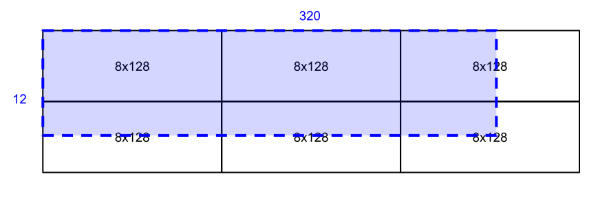

Writing TPU kernels with Pallas
===============================

This page focuses on the details that are important when attempting to run
Pallas kernels on Google TPUs. For one, the TPU backend is still in an
experimental phase, and only a subset of JAX NumPy will be accepted.
Furthermore, writing performant code for TPUs might require thinking carefully
about the native capabilities of the hardware. While many patterns that are
unnatural to the hardware will be accepted, they might end up requiring
software emulation, and can slow down the computation.

.. warning::
  This feature should still be considered experimental as work is still in
  progress (in particular on improving the error messages).

.. note::
  While all the features described here are experimental, we remain very serious
  about maintaining their correctness. As such, it might not be uncommon to
  see a "not implemented" error while attempting to write TPU kernels. But, if
  a kernel is accepted by the compiler, it *must* return the expected results.

  If you see unexpected outputs, please compare them against a kernel run with
  ``interpret=pltpu.InterpretParams()`` passed in to ``@pl.kernel``. If the
  results diverge, please file a `bug report <https://github.com/jax-ml/jax/issues/new/choose>`_.

What is a TPU?
--------------

.. image:: https://lh3.googleusercontent.com/PBWR5LFWaz8Nx4F7vRstDjt_nvUYdfxe9H3O9i3KMam_RmmwIOQMr1GAq3RUfowET2cK5kAcb_zGpw=e14-rw-lo-sc0xffffff-w2540
   :width: 400
   :align: center
   :alt: A TPUv4 board

A Tensor Processing Unit (TPU) is a hardware accelerator developed at Google
specifically for machine learning workloads. Unlike GPUs—which execute thousands
of scalar threads concurrently under a SIMT model—TPUs are highly sequential
machines built around wide 2D vector registers and systolic matrix units (closer
in control flow to a vectorized CPU). At the same time, a TensorCore schedules
key operations asynchronously in the background relative to its scalar
instruction stream:

* **DMA subunits** transfer blocks asynchronously between off-chip High
  Bandwidth Memory (``pltpu.HBM``) and fast on-chip SRAM—vector memory
  (``pltpu.VMEM``) and scalar memory (``pltpu.SMEM``)—because compute units
  cannot read or write ``HBM`` directly.
* **Matrix Multiply Units (MXUs)** execute high-throughput systolic matrix
  multiplications.
* **Vector Processing Units (VPUs)** and **Cross-Lane Units (XLUs)** execute
  2D vector arithmetic, reductions, transpositions, and lane permutations.
* **Scalar Units** manage control flow, loop counters, and dynamic address
  calculations out of ``SMEM``.

Modern TPU chips (such as TPU v5p, v6e, and v7) contain one or more dense
**TensorCores** and may also include **SparseCores** dedicated to irregular
gather/scatter workloads. For per-generation capacities, peak FLOP/s, and
runtime inspection via ``pltpu.get_tpu_info()``, see
:ref:`pallas_tpu_hardware_reference`.

If you're interested in learning more about the TPU architecture
in detail, we recommend reading a collection of papers published over the
years. While many of them talk about specific TPU generations, many of the
ideas described transfer to later generations as well.

* `A Domain-Specific Supercomputer for Training Deep Neural Networks <https://dl.acm.org/doi/10.1145/3360307>`_
* `The Design Process for Google's Training Chips: TPUv2 and TPUv3 <https://ieeexplore.ieee.org/document/9351692>`_
* `Ten Lessons From Three Generations Shaped Google's TPUv4i : Industrial Product <https://ieeexplore.ieee.org/document/9499913>`_
* `TPU v4: An Optically Reconfigurable Supercomputer for Machine Learning with Hardware Support for Embeddings <https://dl.acm.org/doi/abs/10.1145/3579371.3589350>`_

.. _pallas_tpu_noteworthy_properties:

Noteworthy properties and restrictions
--------------------------------------

Memory spaces, ``emit_pipeline``, and grid iteration
^^^^^^^^^^^^^^^^^^^^^^^^^^^^^^^^^^^^^^^^^^^^^^^^^^^^

Inputs and outputs of a ``@pl.kernel`` reside in ``pltpu.HBM`` by default (see
:ref:`pallas_refs`), which compute units cannot access directly and which is
much larger than on-chip ``pltpu.VMEM``. While small buffers can be staged with
``scratch_types`` and ``pltpu.sync_copy``, processing tiled blocks sequentially
stalls the TensorCore on high-latency ``HBM`` transfers, and writing a manual
double-buffered loop with async DMAs and semaphores is verbose and error-prone.

``pltpu.emit_pipeline`` automates software-pipelined double buffering (see
:ref:`pallas_tpu_pipelining`): given a ``grid`` and
:ref:`BlockSpecs <pallas_blockspec>`, every invocation of the pipeline body
receives ``pltpu.VMEM`` ``Ref``\s for the current block slices while the DMA
engine overlaps prefetching the next input blocks and draining completed output
blocks with compute.

.. note::
  Not all block shapes are supported. On TPU, only blocks with rank at least 1
    are supported. Furthermore, the last two dimensions of your block shape
    must be divisible by 8 and 128 respectively, or be equal to the respective
    dimensions of the overall array.

What's more, compared to GPUs, TPUs are actually highly sequential machines.
Ergo, the grid is generally not processed in parallel, but sequentially,
in lexicographic order (though see the `Multicore TPU configurations`_ section
for exceptions). This unlocks some interesting capabilities:

* When two (lexicographically) consecutive grid indices use the same slice of
  an input, the HBM transfer for the second iteration is skipped, as the data is
  already available.

* Multiple invocations of the pipeline body can write to the same slice of the
  output, without any risk of race conditions. However, we do require that all
  invocations that write to a particular slice are consecutive.

The "consecutive" restriction on the output usually means that some prefix
of the grid dimensions always varies the slice of the output an invocation needs
to access, while the output window remains constant for the remaining suffix.

For example, when implementing a Pallas TPU kernel for matrix multiplication,
one would generally use a 3 dimensional grid: the first two dimensions would
correspond to slicing along the first axis of the left operand and the second
axis of the second operand. The third and *last* grid axis would tile the
reduction dimension. The grid axis corresponding to the reduction dimension has
to be the last one, since the output window does not vary along this axis.
The output reference can be then used as an accumulator for partial results.

.. note::
  VMEM is fairly large for such a low-level memory hierarchy (16 MiB+ per
  TensorCore), making it possible to use large block sizes. Oftentimes, larger
  block sizes improve hardware utilization. However, specifying block sizes
  that (together with double-buffering slots and any spilled vector registers)
  exceed VMEM capacity will produce a compiler out-of-memory error.

Array Layouts
^^^^^^^^^^^^^

Dimension ordering of arrays is meaningful in Pallas. 
In JAX programs, the ordering of intermediate arrays inside ``jax.jit`` usually
has no impact on performance, as the compiler is free to rearrange them.
However, as Pallas is meant to expose lower-level capabilities, the dimension
order can have great impact on the quality of generated code.

TPUs perform the bulk of the computation on 2D vector registers, which are typically of
size 8x128 for 32-bit values (as of TPU v6).
When a vector value is loaded from VMEM into registers (e.g. ``x = x_ref[...]``),
the last two dimensions of the array will be tiled into the registers.
Pallas will only ever consider mapping the last two dimensions of
intermediate arrays to the 8x128 vector register dimensions (sublanes and lanes
respectively).

Here is a graphical example of how a 12x320 array can be tiled using 6 8x128
tiles:

Tiled layouts have several important ramifications for kernel writers:

* The last two axes of an array are treated differently than other
  axes. For example, reductions, reshapes, and transposes are generally
  more expensive when involving the last two axes. Some reshapes
  involving the last two dimensions are not supported and will result in a compiler
  error, but are "free" and performed at compile time for other dimensions.
* While sometimes unavoidable, it is generally wasteful to have singleton
  dimensions in the last two axes, since they will occupy 1 element out of
  the entire tile dimension. Consuming too many registers can
  also potentially cause register spills into VMEM which degrades kernel
  performance.
* Related to the above point, all vector computation is padded up to the tile
  size. Adding two 1x1 arrays costs as much as adding two 8x128 arrays, and
  adding two 8x128x1x1 arrays will be 1024 times as expensive as adding two
  8x128 arrays, since the 8x128x1x1 array will be padded to 8x128x8x128.

Multicore TPU configurations
^^^^^^^^^^^^^^^^^^^^^^^^^^^^

In newer TPU generations, the two cores on a chip are often abstracted as a
single device. Every ``@pl.kernel`` invocation requires a ``mesh``, and to
take advantage of multiple cores, Pallas has to break the sequential grid
execution guarantees and parallelize one of the grid axes over a multi-core
``TensorCoreMesh``. By default, ``pltpu.TensorCoreMesh(axis_name='core')``
spans all TensorCores on the TPU device (e.g. ``num_cores=2`` on dual-core
chips; pass ``num_cores=1`` for single-core execution). Pass
``core_axis_name`` and ``dimension_semantics`` to ``pltpu.emit_pipeline`` to
partition parallel grid axes across that mesh axis (or partition manually via
``jax.lax.axis_index('core')``):

.. code:: python

  @pl.kernel(
      out_type=jax.ShapeDtypeStruct.like(x),
      mesh=pltpu.TensorCoreMesh(axis_name='core', num_cores=2),
  )
  def multicore_kernel(x_hbm, o_hbm):
    pltpu.emit_pipeline(
        body,
        grid=(m_blocks, n_blocks, k_blocks),
        in_specs=[...],
        out_specs=...,
        core_axis_name='core',
        dimension_semantics=(
            pltpu.PARALLEL,
            pltpu.PARALLEL,
            pltpu.ARBITRARY,
        ),
    )(x_hbm, o_hbm)

``dimension_semantics`` is a tuple, with as many entries as there are axes in the
grid. Only ``PARALLEL`` dimensions can be partitioned over cores. As a rule of
thumb, the dimensions are ``PARALLEL``, unless the output window does not vary.
As such, ``dimension_semantics`` is always a number of ``PARALLEL`` axes
followed by a number of ``ARBITRARY`` axes.

While partitioning a kernel over a 2-core TPU device often leads to a 2x
speedup, it can be in fact significantly smaller. This is especially true if
different instances of the body have highly varying cost. If all of the expensive
steps get mapped to one core, but all cheap steps are assigned to the other, the
second core will be sitting idle until the first one completes its tasks.

Pallas TPU generally favors partitioning axes of a size that is a multiple of the
number of TPU cores, and prefers to partition leading grid axes.

Placing operands in SMEM
^^^^^^^^^^^^^^^^^^^^^^^^

Most of the compute on the TPU will happen on the vector unit. Still, there are
many cases where it is useful to perform a number of scalar operations, e.g., to
carry out control-flow. For that reason, TPUs come with a separate
scalar unit, and a separate scalar memory (``pltpu.SMEM``) attached to it.
As a rule of thumb, any data used to perform control-flow decisions should
be placed in SMEM.

SMEM is a low-latency memory that supports random access, but lets you only
read and write 32-bit values with a single instruction (very small compared to
the 4 KiB granularity of VMEM transactions, but much more flexible due to lack
of alignment requirements!).

The scalar memory is also very useful when implementing kernels that do not
access the tiles of inputs in a regular pattern, such as when writing
block-sparse kernels. In Pallas, allocate an ``SMEM`` buffer via
``scratch_types`` on ``@pl.kernel``, copy metadata from ``HBM`` into ``SMEM``
using ``pltpu.sync_copy``, and read from the ``SMEM`` ``Ref`` inside
``BlockSpec`` ``index_map`` closures passed to ``pltpu.emit_pipeline``:

.. code:: python

  @pl.kernel(
      out_type=jax.ShapeDtypeStruct((num_blocks * 8, 128), x.dtype),
      mesh=pltpu.TensorCoreMesh(axis_name='core', num_cores=1),
      scratch_types=dict(
          indices_smem=pltpu.SMEM((num_blocks,), jnp.int32),
      ),
  )
  def gather_blocks_kernel(indices_hbm, x_hbm, o_hbm, indices_smem):
    pltpu.sync_copy(indices_hbm, indices_smem)

    def copy_body(x_vmem, o_vmem):
      o_vmem[...] = x_vmem[...]

    pltpu.emit_pipeline(
        copy_body,
        grid=(num_blocks,),
        in_specs=[pl.BlockSpec((8, 128), lambda i: (indices_smem[i], 0))],
        out_specs=pl.BlockSpec((8, 128), lambda i: (i, 0)),
    )(x_hbm, o_hbm)

See :ref:`pallas_scalar_prefetch_guide` for examples on using this
feature.

Supported data types
^^^^^^^^^^^^^^^^^^^^

At the moment Pallas TPU supports the following data types:

* ``jnp.float32``
* ``jnp.bfloat16``
* ``jnp.int*``  (all precisions, except for ``jnp.int4`` in general arithmetic)
* ``jnp.uint*``  (all precisions)
* ``jnp.bool_``

Computation placement
^^^^^^^^^^^^^^^^^^^^^

All scalar (i.e. 0D) arrays will be stored in scalar registers, and operations
on them will be executed on the scalar core.  All other operations (even on
single-element, but 1D+ arrays) will be executed on the vector core.

Supported operations
--------------------

Matrix multiplication
^^^^^^^^^^^^^^^^^^^^^

Matrix multiplication always produces results in the float32 format.
If your inputs are not float32, we recommend using ``lax.dot`` with
``preferred_element_type`` set to ``jnp.float32``.

When using ``lax.dot_general``, it is possible to fuse transpositions of
the last two dimensions of matrix multiplication operands into the operation,
which can improve overall kernel performance.

Precision control
"""""""""""""""""

Pallas TPU lowering is aware of ``jax.default_matmul_precision``. For best
performance (and lowest precision), use ``bfloat16``. If you care about
numerical accuracy, you might want to set the precision to ``float32``.

.. warning::
  Even if you pass in 32-bit operands to a matrix multiplication, they will be
  rounded to ``bfloat16`` unless ``float32`` precision is requested.

Transposition
^^^^^^^^^^^^^

If the value has at least 4 dimensions, arbitrary transpositions of all but
the last two axes are free.
Otherwise, only the transposition of the last two axes is implemented.
Note that some transpositions of the last two dimensions can be fused into
matrix multiplication.

Accessing memory
^^^^^^^^^^^^^^^^

Arbitrary slices of references can be read or updated, subject to implementation
constraints. Currently, no restrictions are placed on inputs that are 32-bit wide,
but only some slicing patterns are supported for narrower types. Reads and
writes that are aligned to multiples of, and have a length that is a multiple
of 8 and 128 respectively in the last two dimensions are always supported.

Reads and writes to vector memory generally happen on tiles of shape ``(8, 128)``.
As such, when reading or writing to references that have at least two dimensions,
the best performance is achieved when the base offset of the memory access
has indices divisible by the tiling, and the size of the read region is a
multiple of the tile size.

Elementwise operations
^^^^^^^^^^^^^^^^^^^^^^

Many elementwise operations are supported. It is worth noting that the hardware
generally only supports elementwise computation using 32-bit types. When loading
operands that use lower-precision types, they should generally be upcast to a
32-bit type before applying elementwise ops.

It is worth noting that they can vary *significantly* in their cost. As such, we
outline three categories of supported operations: cheap (🟢), medium (🌕) and
expensive (🔴).

============================ ========
 Operation                    Cost
============================ ========
 ``jnp.add``, ``+``            🟢
 ``jnp.sub``, ``-``            🟢
 ``jnp.mul``, ``*``            🟢
 ``/``, ``//``, ``%``          🌕
 ``jnp.max``, ``jnp.min``      🟢
 ``jnp.where`` (select)        🟢
 ``jnp.abs``                   🟢
 ``|``, ``^``, ``&``, ``~``    🟢
 ``<<``, ``>>``                🟢
 Comparisons (``==``, ...)     🟢
 Type casts (``.astype``)      🟢
 ``jnp.exp``                   🌕
 ``jnp.tanh``                  🌕
 ``jnp.pow``                   🌕
 ``jnp.sin``                   🔴
 ``jnp.cos``                   🔴
============================ ========

* 🟢 **Cheap:** Native single-cycle or few-cycle vector ALU instructions.
* 🌕 **Medium:** Multi-cycle or software-emulated division, power, and transcendental approximations.
* 🔴 **Expensive:** Multi-cycle trigonometric approximations requiring polynomial evaluation.

Many JAX functions are implemented in terms of other JAX primitives, so this
list might not be comprehensive. For example, ``jax.nn.relu`` is implemented
in terms of comparisons and ``jnp.where`` and works in Pallas kernels too.

Array constructors
^^^^^^^^^^^^^^^^^^

All constant array constructors are supported (``jnp.ones``, ``jnp.zeros``,
``jnp.full``).

Reductions
^^^^^^^^^^

``sum``, ``max``, ``min`` (for floating point values) reductions are supported, as well
as ``any`` and ``all`` for boolean values. Integer reductions are not supported.

Reductions over the last array dimension are generally the slowest.
Reductions over the second last dimension are faster, but still slower than
over the leading dimensions.

Broadcasting
^^^^^^^^^^^^

The performance characteristics of broadcasting are very similar to those
of reductions. Broadcasting along all but the two trailing dimensions is
always supported and free. Broadcasting along the second to last dimension is
slower, while broadcasting along the last dimension is the slowest.

Reshapes
^^^^^^^^

As usual, reshapes in all dimensions but the last two dimensions are supported
and free.

The only two supported cases when a reshape can modify the last two dimensions
of an array are when (1) some leading dimensions are flattened onto the second
to last dimension, or (2) it adds a dimension that was just removed by a
reduction.

Random Number Generation
^^^^^^^^^^^^^^^^^^^^^^^^

Pallas supports the most commonly used functions from the ``jax.random`` module,
such as ``uniform``, ``normal``, and ``bernoulli``, using ``threefry2x32`` keys
(which can be passed into or generated inside a kernel), as well as dedicated
TPU hardware PRNG primitives. See :doc:`prng` for details and examples.

Control flow
^^^^^^^^^^^^

Supported control-flow primitives on TPU include ``jax.lax.cond`` (and the
``@pl.when`` decorator), ``jax.lax.fori_loop`` (and the ``@pl.loop`` decorator,
which accepts an optional ``unroll`` factor), and ``jax.lax.while_loop``.

Overusing control flow can lead to significant regressions in low-level code
generation, and it is recommended to try to squeeze as many computationally
expensive operations into a single basic block as possible.
