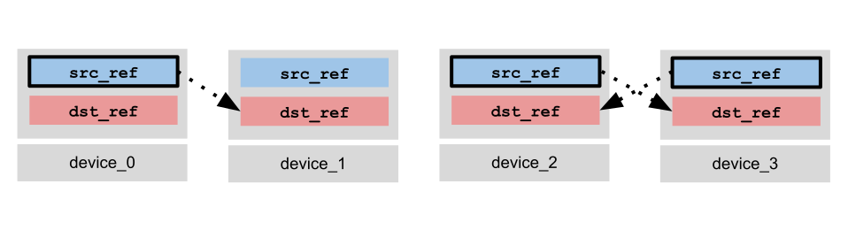
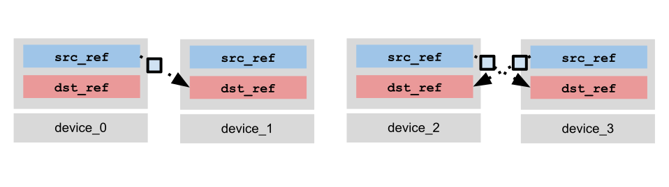
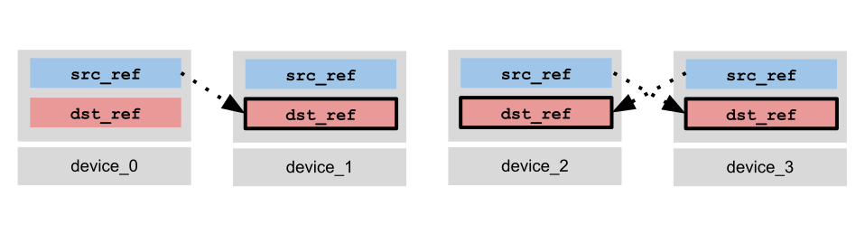
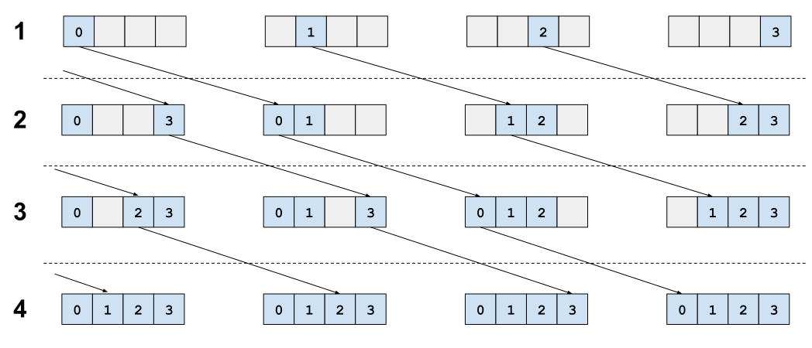
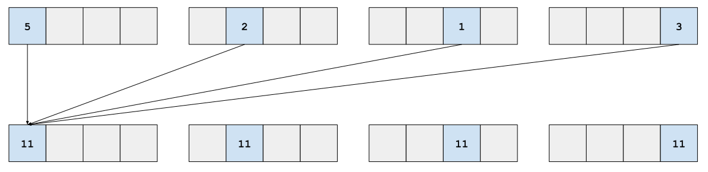
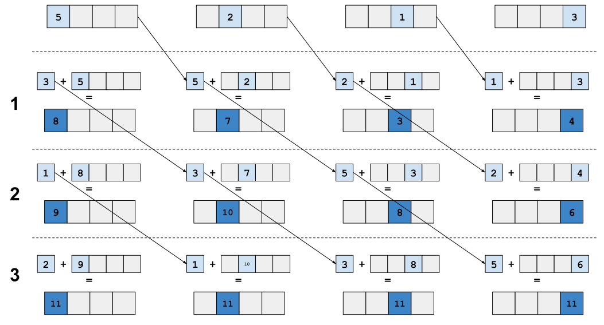
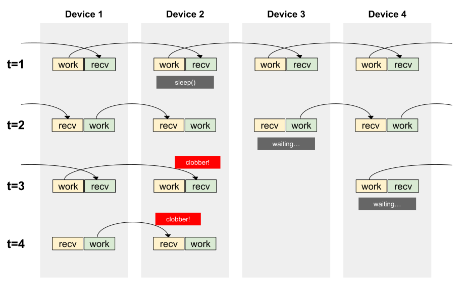
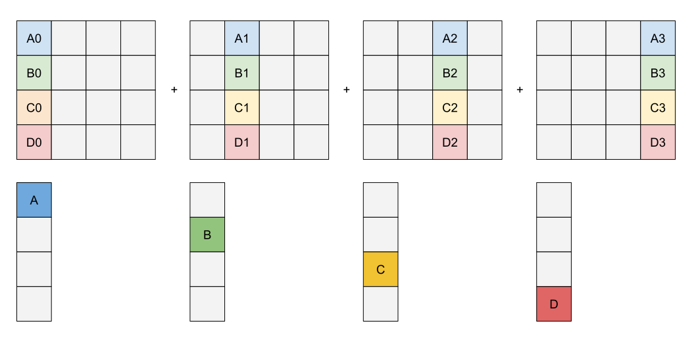
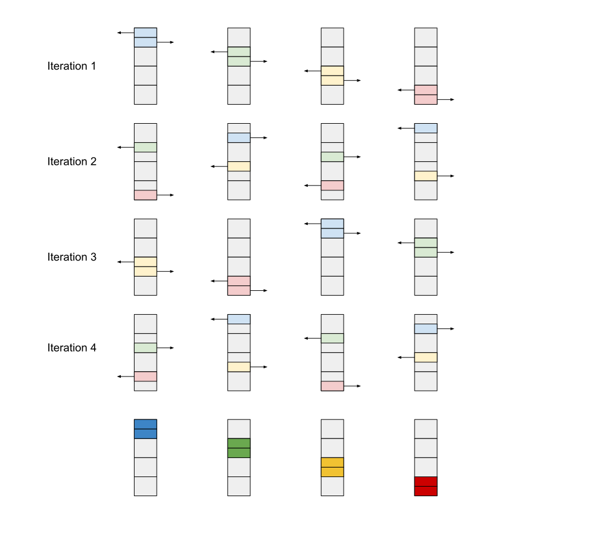

---
jupytext:
  formats: ipynb,md:myst
  main_language: python
  text_representation:
    extension: .md
    format_name: myst
    format_version: 0.13
    jupytext_version: 1.16.4
kernelspec:
  display_name: Python 3 (ipykernel)
  language: python
  name: python3
---

+++ {"id": "zSNjLhGQJMgq"}

# Distributed and Multi-Core Computing in Pallas for TPUs

In this guide, we cover distributed and multi-core computing in Pallas on TPUs using `pl.kernel` and `jax.shard_map`. We will learn about TPU topologies, communication using the remote DMA primitive (`pltpu.make_async_remote_copy`), calling distributed kernels from JAX using `jax.shard_map`, and programming multiple TensorCores and SparseCores within a single TPU device. We will also cover advanced kernel-writing techniques — including double-buffering, bi-directional bandwidth optimization, and nested pipelining with `pltpu.emit_pipeline` — by implementing collective operations from scratch (`lax.ppermute`, `lax.all_gather`, `lax.psum`, and `lax.psum_scatter`).

Some recommended readings beforehand:
 - [Pallas Pipelining on TPU](pallas_tpu_pipelining)
 - [Collectives with `jax.shard_map`](shard_map_collectives_tutorial)

```{code-cell} ipython3
---
executionInfo:
  elapsed: 52
  status: ok
  timestamp: 1744390458993
  user:
    displayName: Justin Fu
    userId: '17543197034567316452'
  user_tz: 420
id: PyAGnWc9yI8T
outputId: c5912653-c34b-4810-c373-4a2787691317
---
import functools
import jax
from jax import lax
from jax import numpy as jnp
from jax.experimental import pallas as pl
from jax.experimental.pallas import tpu as pltpu
from jax.experimental.pallas import tpu_sc as plsc
import numpy as np

P = jax.sharding.PartitionSpec

num_devices = jax.local_device_count()
assert num_devices > 1, "Please run this notebook with more than one device."
assert "TPU" in jax.devices()[0].device_kind, "Please run this notebook with TPU devices."
print(f"Running with {num_devices} {jax.devices()[0].device_kind} devices.")
```

+++ {"id": "DySMGNByclMi"}

## TPU Topologies

TPUs are typically deployed in pods of multiple devices connected via a high-bandwidth interchip interconnect (ICI) for communication within the pod that is much faster than a typical network connection. For example, the specifications sheet for a [TPU v5p](https://cloud.google.com/tpu/docs/v5p) states an ICI bandwidth of 4.8Tb/s per chip (for reference, TPU v5p also has 21Tb/s of *local* HBM bandwidth). The ICI allows us to implement fast and performant distributed kernels that require high-bandwidth communication within a pod, and use the datacenter network for parallelization over less bandwidth-intensive operations, such as data-parallelism over a batch dimension.

TPUs pods are typically arranged in an ND torus topology. The following graphic gives several examples of configurations of different sizes.


Flattened as a graph, the torus can be visualized as follows. Each edge (orange or black) is a bidirectional connection between two devices. You will commonly hear about rings in conjunction with discussion about device topologies — a key feature of a torus is that when taking a slice along an axis of the pod, such as the nodes `[(0,1), (1, 1), (2, 1), (3, 1)]` or `[(0, 1), (1, 1)]`, we have a ring of devices. This is a feature we can use to simplify communication patterns within the pod.


+++ {"id": "1Oc_WD1hChfN"}

## Remote Direct Memory Access (RDMA) Model

TPUs communicate via a push-only model known as a remote direct memory access (RDMA). A TPU is allowed to issue a copy instruction to push from a local buffer to any buffer on another device within the same pod (or another core on the same device) that executes asynchronously from the main program thread. However, a TPU core can only directly read data stored in its local memory. This is in contrast to traditional shared-memory multi-core programming.

### Async Remote Copy Operation
The `pltpu.make_async_remote_copy` function is used to create a remote DMA descriptor object which parameterizes both a "send" operation and a "receive" operation. Here's its signature:

```python
def make_async_remote_copy(
    src_ref: jax.Ref,
    dst_ref: jax.Ref,
    send_sem: jax.Ref[SemaphoreType],
    recv_sem: jax.Ref[SemaphoreType],
    device_id: dict[AxisName | tuple[AxisName, ...], int] | int | tuple[int, ...],
) -> AsyncCopyDescriptor:
```

- `src_ref` is the local `Ref` (in any memory space) containing the data you wish to send to `dst_ref` on another device or core.
- `dst_ref` is the remote `Ref` (in any memory space) at which data will be copied on the target device or core.
- `send_sem` is a DMA semaphore used to block until all data has been sent from `src_ref`.
- `recv_sem` is a DMA semaphore used to block until the expected number of bytes have been received at `dst_ref`. The sender of the DMA will write to the receiver's `recv_sem`.
- `device_id` identifies the target device and/or core along named mesh axes (e.g. `{'x': target_dev}` for an inter-device `shard_map` axis or `{'core': dst_core}` for an intra-device `TensorCoreMesh` axis).

`make_async_remote_copy` returns a descriptor object on which you use the `.start()` method to initiate the DMA, and `.wait_send()` to block on `send_sem` and `.wait_recv()` to block on `recv_sem` (or `.wait()` to block on both). If a device is only expected to send data, it is sufficient to only call `.start()` and `.wait_send()`, and likewise if a device is only receiving it is sufficient to only call `.wait_recv()`. If using an SPMD pattern where all devices execute the DMA, each device will generally call both `.start()` and `.wait()`.
```python
dma_descriptor = pltpu.make_async_remote_copy(src_ref, dst_ref, send_sem, recv_sem, device_id)
dma_descriptor.start()      # Initiate the DMA (non-blocking).
# ... do other work
dma_descriptor.wait_send()  # Block until all data has been sent.
dma_descriptor.wait_recv()  # Block until all data has been received.
```

As an example, let's visualize a DMA where we consider 4 devices (indexed 0, 1, 2, 3). We consider a scheme where device 0 copies to device 1, and devices 2 & 3 copy to each other. In practice, we can create such an asymmetric communication pattern by using `@pl.when` to branch on the device ID.

(1) Each device creates the DMA descriptor. Devices 0, 2, and 3 call `.start()` to initiate the DMA from `src_ref`. Device 1 skips `.start()` and does nothing, e.g. by using `@pl.when`.



(2) As `.start()` is non-blocking, each device is free to do other computation while the DMA is in flight. Devices 0, 2, and 3 call `.wait_send()` to wait on `send_sem` which blocks until all data has been sent.



(3) Finally, devices 1, 2, and 3 call `.wait_recv()` to wait on `recv_sem` until all data has arrived at `dst_ref`.



The above communication pattern can be written inside `pl.kernel` as follows:
```python
def example_kernel(input_ref, output_ref, send_sem, recv_sem):
  device_id = lax.axis_index('x')
  copy_0_to_1 = pltpu.make_async_remote_copy(
      src_ref=input_ref,
      dst_ref=output_ref,
      send_sem=send_sem,
      recv_sem=recv_sem,
      device_id={'x': 1},
  )
  copy_2_to_3 = pltpu.make_async_remote_copy(
      src_ref=input_ref,
      dst_ref=output_ref,
      send_sem=send_sem,
      recv_sem=recv_sem,
      device_id={'x': 3},
  )
  copy_3_to_2 = pltpu.make_async_remote_copy(
      src_ref=input_ref,
      dst_ref=output_ref,
      send_sem=send_sem,
      recv_sem=recv_sem,
      device_id={'x': 2},
  )
  @pl.when(device_id == 0)
  def _():
    copy_0_to_1.start()
    copy_0_to_1.wait_send()
  @pl.when(device_id == 1)
  def _():
    copy_0_to_1.wait_recv()
  @pl.when(device_id == 2)
  def _():
    copy_2_to_3.start()
    copy_2_to_3.wait_send()
    copy_3_to_2.wait_recv()
  @pl.when(device_id == 3)
  def _():
    copy_3_to_2.start()
    copy_3_to_2.wait_send()
    copy_2_to_3.wait_recv()
```

### DMA Semaphores

`send_sem` and `recv_sem` are instances of a special type of semaphore reserved exclusively for use with DMAs. They are allocated with `pltpu.SemaphoreType.DMA` in `scratch_types` on `pl.kernel`.

Internally, DMA semaphores can be thought of as integer-valued progress trackers. On DMA start, the local device will begin to increment the value of `send_sem` and the receiver's `recv_sem` asynchronously. Waiting on a semaphore will block until the value of the semaphore reaches the total bytes of data sent/received; when the value is reached, waiting threads are released and the semaphore's value is decremented by the same amount. This means that either all data has been sent (for `send_sem`) or all data has been received (for `recv_sem`). The value of the semaphore can be read with `pl.semaphore_read`, but note that the underlying semantics of the value could change between hardware generations (e.g. the value may not represent exactly the number of bytes sent, although this is a useful mental model to have when reasoning about the behavior of the semaphore).

### Routing

A sender is allowed to send data to any receiver within the same pod, even if they do not share a direct connection (the exception to this rule is for TPU v5e, where devices can only route to a power of 2 offset from themselves). TPUs have an internal routing mechanism which can pass data along to the next device on the path to the destination. However, communicating in this way is not recommended as you have no control over network contention as a kernel writer. The examples we will cover in this tutorial minimize inefficient communication by only transferring data to neighboring devices.

### Failure modes

If using remote DMAs incorrectly, you may encounter several failure modes which can be difficult to debug. The general symptoms of buggy DMA usage are crashes, hanging, or silent data corruption:
- If semaphores exit the program with an invalid non-zero value, Pallas will crash and exit the program.
- If semaphores are waited on but an insufficient number of bytes are received (i.e. there is no sender, or if the sent data is less than the size of `dst_ref` on the receiving device), the program may hang indefinitely waiting for bytes that are never sent. In this case the program would need to be restarted.
- If encountering a race condition, there could be silent data corruption if two simultaneous writes or a simultaneous read and write occur.

Some common causes of the above include:
- If a device calls `.wait_recv()` but no other device sends to it, the kernel may hang.
- If a device is sent more bytes than it expected to receive, it may crash due to non-zero semaphore states. If sent less, it may hang indefinitely.
- If DMAs are started but the semaphores are not waited on, the program may crash due to non-zero semaphore states.
- If two devices copy to the same destination, you may encounter non-deterministic results due to a race condition, or crashing due to non-zero semaphore states.

+++ {"id": "vpGSN1Sui0Bu"}

### Example: Right Permute (`lax.ppermute`)

Let's dive into a basic example. We will implement a kernel that performs a right permutation, where each device sends its slice of the data to its right neighbor.

Suppose we had an array with 512 elements, which we shard into slices of size 128 across 4 devices. Each device passes its slice to the next device, and the output consists of the same data with the slices rotated by 1. This is identical to `lax.ppermute` where the permutation is `(n, (n + 1) % 4)`.

To run the kernel in distributed mode, we wrap `pl.kernel` in `jax.shard_map`. Note that we pass `mesh=pltpu.TensorCoreMesh(axis_name='core', num_cores=1)` to `pl.kernel` so only a single TensorCore per device issues the HBM-to-HBM remote DMA. JAX collective primitives such as `lax.axis_index('x')` query the device ID along the `shard_map` mesh axis `'x'`.

```{code-cell} ipython3
---
executionInfo:
  elapsed: 152
  status: ok
  timestamp: 1744390459367
  user:
    displayName: Justin Fu
    userId: '17543197034567316452'
  user_tz: 420
id: YkyIKN2thZ-V
outputId: 26719bb9-87ff-46dd-af90-a114ce332417
---
partition = P(None, 'x')
mesh = jax.make_mesh((num_devices,), ('x',), axis_types=(jax.sharding.AxisType.Auto,))
sharding = jax.sharding.NamedSharding(mesh, partition)

# Create an input array that shards the last dimension across all devices.
input_arr = jax.random.uniform(jax.random.key(0), (8, 128 * num_devices))
input_arr = jax.device_put(input_arr, sharding)

tc_mesh_1 = pltpu.TensorCoreMesh(axis_name='core', num_cores=1)


def right_permute_kernel(input_ref, output_ref, send_sem, recv_sem):
  my_id = lax.axis_index('x')
  right_neighbor = lax.rem(my_id + 1, num_devices)
  remote_copy_op = pltpu.make_async_remote_copy(
      src_ref=input_ref,
      dst_ref=output_ref,
      send_sem=send_sem,
      recv_sem=recv_sem,
      device_id={'x': right_neighbor},
  )
  remote_copy_op.start()
  remote_copy_op.wait()


right_permute = pl.kernel(
    right_permute_kernel,
    out_type=jax.ShapeDtypeStruct((8, 128), jnp.float32),
    mesh=tc_mesh_1,
    scratch_types=[pltpu.SemaphoreType.DMA] * 2,
)

# Wrap the kernel within a shard_map to call.
pallas_result = jax.jit(
    jax.shard_map(
        right_permute,
        mesh=mesh,
        in_specs=partition,
        out_specs=partition,
        check_vma=False,
    )
)(input_arr)

# Compare Pallas result to XLA shard_map result.
perm = tuple((src, (src + 1) % num_devices) for src in range(num_devices))

xla_result = jax.jit(
    jax.shard_map(
        lambda x: lax.ppermute(x, 'x', perm),
        mesh=mesh, in_specs=partition, out_specs=partition)
)(input_arr)

print('Input = ', input_arr[0, ::128])
print('Pallas Result = ', pallas_result[0, ::128])
print('lax.ppermute Result = ', xla_result[0, ::128])
print(
    'Difference |Pallas - lax.ppermute| = ',
    jnp.mean(jnp.abs(pallas_result - xla_result)),
)
```

+++ {"id": "iyfhdGXuUnq2"}

### Example: All-gather (`lax.all_gather`)

In this next example we will implement the all-gather collective operation, which has a JAX equivalent in `lax.all_gather`. In contrast with the right-permute example from above which only involves a pair of source and destination neighbors, an all-gather operation requires communication between all devices and therefore we must think about how data is routed between them.

#### Ring Communication Pattern

We will write our kernel assuming a ring topology. Rings are a natural fit for TPUs as slicing along any dimension of a torus produces a ring. When writing collectives, we often only need to think about 1D slices of our torus at a time because the different dimensions of the torus are reserved for different types of parallelism (data vs. model, for example).

The strategy we will use is to write a looped kernel (`@pl.loop(0, num_devices - 1)`), where on each step a device receives one slice of the sharded array from its left neighbor and forwards the previously received slice to its right neighbor. After `num_devices - 1` steps, each device has a copy of the entire array in its local HBM:



```{code-cell} ipython3
---
executionInfo:
  elapsed: 209
  status: ok
  timestamp: 1744390459789
  user:
    displayName: Justin Fu
    userId: '17543197034567316452'
  user_tz: 420
id: ojQEZB5mBRqM
outputId: 3a4373f8-1fb5-4a6b-b88e-3461c2609021
---
partition = P('x', None)
mesh = jax.make_mesh((num_devices,), ('x',), axis_types=(jax.sharding.AxisType.Auto,))
sharding = jax.sharding.NamedSharding(mesh, partition)

# Create an input array that shards the first dimension across all devices.
input_arr = jax.random.uniform(jax.random.key(0), (8 * num_devices, 128))
input_arr = jax.device_put(input_arr, sharding)


def all_gather_kernel(
    input_ref,
    output_ref,
    local_copy_sem,
    send_sem,
    recv_sems,
):
  my_id = lax.axis_index('x')
  right_neighbor = lax.rem(my_id + 1, num_devices)

  # Initialize our own slot locally in HBM.
  pltpu.async_copy(input_ref, output_ref.at[my_id], local_copy_sem).wait()

  @pl.loop(0, num_devices - 1)
  def _(outer_step):
    copy_slot = lax.rem(my_id - outer_step + num_devices, num_devices)
    # Copy to our right neighbor while receiving at `copy_slot - 1` from left.
    remote_copy_op = pltpu.make_async_remote_copy(
        src_ref=output_ref.at[copy_slot],
        dst_ref=output_ref.at[copy_slot],
        send_sem=send_sem,
        recv_sem=recv_sems.at[outer_step],
        device_id={'x': right_neighbor},
    )
    remote_copy_op.start()
    remote_copy_op.wait()


all_gather = pl.kernel(
    all_gather_kernel,
    out_type=jax.ShapeDtypeStruct((num_devices, 8, 128), jnp.float32),
    mesh=tc_mesh_1,
    scratch_types=[
        pltpu.SemaphoreType.DMA,  # local_copy_sem
        pltpu.SemaphoreType.DMA,  # send_sem
        # Allocate one receive semaphore per step so multiple in-flight DMAs
        # from faster senders never collide on the same receive semaphore.
        pltpu.SemaphoreType.DMA((num_devices - 1,)),
    ],
)

# Wrap the kernel within a shard_map to call.
pallas_result = jax.jit(
    jax.shard_map(
        all_gather,
        mesh=mesh,
        in_specs=partition,
        out_specs=partition,
        check_vma=False,
    )
)(input_arr)

# Compare Pallas result to XLA shard_map result.
xla_result = jax.jit(
    jax.shard_map(
        lambda x: lax.all_gather(x, 'x'),
        mesh=mesh, in_specs=partition, out_specs=partition
    )
)(input_arr)

print('Input: ', input_arr.shape, input_arr[::8, 0])
print('Pallas Result: ', pallas_result.shape, pallas_result[:, 0, 0])
print('lax.all_gather Result: ', xla_result.shape, xla_result[:, 0, 0])
print('Difference |Pallas - lax.all_gather| = ',
      jnp.mean(jnp.abs(pallas_result - xla_result)))
```

+++ {"id": "KgU7HI2pS4om"}

A detail worth mentioning here is the use of multiple receive semaphores. Because we only block on the receiving device, it is still possible for a sender to have sent multiple DMAs in flight before the receiver has finished processing the first one (see the next section and reduce-sum example which discusses race conditions in more detail). In this situation we may hit a situation where the same semaphore is being used for multiple DMAs occurring simultaneously. To avoid this, we allocate `num_devices - 1` semaphores so there is no risk of reuse.

+++ {"id": "EDCmAaHVtY7x"}

## Advanced Distributed Techniques

Now that we have seen how to write basic distributed kernels using remote DMA operations, we will go over advanced techniques for synchronization and writing high-throughput collective kernels.

+++ {"id": "8M_kdl0FCtrL"}

### Synchronization: Regular and Barrier Semaphores

The examples we implemented above write to disjoint buffers and need no extra inter-device handshakes. More complex communication patterns require explicit synchronization primitives to avoid race conditions: regular and barrier semaphores.

#### Regular Semaphores

Regular semaphores are the standard tool used to synchronize across multiple devices or cores. Semaphores are fundamentally counters — they can be incremented by any device or core, after which the target blocks until the semaphore reaches a specific value (and then decrements it).

The three main operations on regular semaphores are signal, wait, and read:
```python
def semaphore_signal(
    sem: jax.Ref[SemaphoreType],
    inc: int = 1,
    *,
    device_id: dict[AxisName | tuple[AxisName, ...], int] | int | tuple[int, ...] | None = None,
) -> None:
  ...  # Increments `sem` on `device_id` by `inc`.

def semaphore_wait(
    sem: jax.Ref[SemaphoreType],
    value: int = 1,
) -> None:
  ...  # Blocks until local `sem` reaches `value`, then decrements by `value`.

def semaphore_read(
    sem: jax.Ref[SemaphoreType],
) -> jax.Array:
  ...  # Returns the current value of `sem` as an `int32[]`.
```

Regular semaphores are allocated via `pltpu.SemaphoreType.REGULAR` in `scratch_types` on `pl.kernel`.

Semaphores must be zero at the end of a Pallas program to complete successfully:
 - If a semaphore is over-signaled, the program ends with a non-zero (`> 0`) semaphore and crashes upon completion.
 - If a semaphore is over-waited, the program hangs on `semaphore_wait` waiting for an increment that never arrives.

#### Barrier Semaphores

Barrier semaphores are globally-allocated semaphores used to synchronize devices (or cores) across an entire XLA program and ensure that all communicating peers have entered the Pallas kernel before issuing local or regular-semaphore signals.

They are obtained inside a kernel by calling `pltpu.get_barrier_semaphore()`, paired with `compiler_params=pltpu.CompilerParams(collective_id=0)` on `pl.kernel`:

```python
@pl.kernel(
    out_type=...,
    mesh=tc_mesh_1,
    compiler_params=pltpu.CompilerParams(collective_id=0),
)
def example_kernel(...):
  barrier_sem = pltpu.get_barrier_semaphore()
  # Increment the semaphore of your right neighbor.
  pl.semaphore_signal(barrier_sem, 1, device_id={'x': right_neighbor})
  # Wait until your left neighbor has incremented your semaphore.
  pl.semaphore_wait(barrier_sem, 1)
  ...
```

A TPU has a small, fixed number of barrier semaphores available (typically 20–30), so only kernels that share the same communication pattern should share a `collective_id`; kernels synchronizing along different mesh axes must use distinct `collective_id`s.

+++ {"id": "zy20AxN5TSLA"}

### Double-buffering

To avoid reading from a local `Ref` while a neighbor is simultaneously writing into it, allocate a double-buffered `Ref` with leading dimension `2` (`[2, ...]`). On each iteration `iteration`, designate `working_slot = lax.rem(iteration, 2)` and `receiving_slot = 1 - working_slot`: read locally from `working_slot` while pushing remote DMAs into your neighbor's `receiving_slot`, alternating roles every step:

```python
@pl.loop(0, num_steps)
def _(iteration):
  working_slot = lax.rem(iteration, 2)
  receiving_slot = 1 - working_slot

  local_copy_op = pltpu.make_async_copy(
      src_ref=dst_ref.at[working_slot],
      dst_ref=local_scratch_ref,
      sem=local_copy_sem,
  )
  local_copy_op.start()
  remote_copy_op = pltpu.make_async_remote_copy(
      src_ref=src_ref,
      dst_ref=dst_ref.at[receiving_slot],
      send_sem=send_sem,
      recv_sem=recv_sem,
      device_id=target_device,
  )
  remote_copy_op.start()

  local_copy_op.wait()
  # ... do work on local_scratch_ref while remote_copy_op is in flight
  remote_copy_op.wait()
```

+++ {"id": "Or0Itv72No5d"}

### Example: All-Reduce Sum (`lax.psum`)

We will now implement an all-reduce sum kernel (`lax.psum`) using HBM double-buffering and a `REGULAR` capacity semaphore for backpressure:



On each step around the ring, each device copies the partial value in its `working_slot` into VMEM to accumulate into `acc_vmem_ref` while forwarding that `working_slot` over ICI into its right neighbor's `receiving_slot`:



```{code-cell} ipython3
---
executionInfo:
  elapsed: 248
  status: ok
  timestamp: 1744390460289
  user:
    displayName: Justin Fu
    userId: '17543197034567316452'
  user_tz: 420
id: XrY5bMlvBroQ
outputId: 9216e749-48d2-43ff-d64b-bd419acf3e11
---
partition = P(None, 'x')
mesh = jax.make_mesh((num_devices,), ('x',), axis_types=(jax.sharding.AxisType.Auto,))
sharding = jax.sharding.NamedSharding(mesh, partition)

input_arr = jax.random.uniform(jax.random.key(0), shape=(8, 128 * num_devices))
input_arr = jax.device_put(input_arr, sharding)


def local_barrier(left_neighbor, right_neighbor, double_barrier=True):
  """Performs a barrier with neighbors on the global barrier semaphore."""
  barrier_sem = pltpu.get_barrier_semaphore()
  for neighbor in [left_neighbor, right_neighbor]:
    pl.semaphore_signal(barrier_sem, inc=1, device_id={'x': neighbor})
  pl.semaphore_wait(barrier_sem, 2)
  if double_barrier:
    @functools.partial(pl.run_scoped, second_barrier=pltpu.SemaphoreType.REGULAR)
    def _(second_barrier):
      for neighbor in [left_neighbor, right_neighbor]:
        pl.semaphore_signal(second_barrier, inc=1, device_id={'x': neighbor})
      pl.semaphore_wait(second_barrier, 2)


def all_reduce_kernel(
    x_hbm_ref,
    out_refs,
    copy_sem,
    remote_recv_sem,
    remote_send_sem,
    capacity_sem,
    acc_vmem_ref,
    receive_scratch,
):
  o_hbm_ref, hbm_scratch = out_refs
  my_id = lax.axis_index('x')
  right_neighbor = lax.rem(my_id + 1, num_devices)
  left_neighbor = lax.rem(my_id - 1 + num_devices, num_devices)

  # Prologue: barrier with neighbors, zero accumulator, and send initial shard.
  local_barrier(left_neighbor, right_neighbor)
  acc_vmem_ref[...] = jnp.zeros_like(acc_vmem_ref)
  initial_copy = pltpu.make_async_remote_copy(
      src_ref=x_hbm_ref,
      dst_ref=hbm_scratch.at[0],
      send_sem=remote_send_sem,
      recv_sem=remote_recv_sem,
      device_id={'x': right_neighbor},
  )
  initial_copy.start()
  initial_copy.wait()

  @pl.loop(0, num_devices)
  def _(outer_step):
    working_slot = lax.rem(outer_step, 2)
    receiving_slot = 1 - working_slot

    # Signal to our left neighbor that our receiving_slot is free.
    pl.semaphore_signal(capacity_sem, inc=1, device_id={'x': left_neighbor})

    # Copy working_slot into VMEM while forwarding it to our right neighbor.
    local_copy = pltpu.make_async_copy(
        src_ref=hbm_scratch.at[working_slot],
        dst_ref=receive_scratch,
        sem=copy_sem,
    )
    local_copy.start()

    pl.semaphore_wait(capacity_sem, 1)
    remote_copy = pltpu.make_async_remote_copy(
        src_ref=hbm_scratch.at[working_slot],
        dst_ref=hbm_scratch.at[receiving_slot],
        send_sem=remote_send_sem,
        recv_sem=remote_recv_sem,
        device_id={'x': right_neighbor},
    )
    remote_copy.start()
    local_copy.wait()
    acc_vmem_ref[...] += receive_scratch[...]
    remote_copy.wait()

  pltpu.sync_copy(acc_vmem_ref, o_hbm_ref)


out_type = (
    jax.ShapeDtypeStruct((8, 128), jnp.float32),
    # Allocate the double-buffer as an output so it resides in HBM.
    jax.ShapeDtypeStruct((2, 8, 128), jnp.float32),
)

all_reduce = pl.kernel(
    all_reduce_kernel,
    out_type=out_type,
    mesh=tc_mesh_1,
    scratch_types=[
        pltpu.SemaphoreType.DMA,
        pltpu.SemaphoreType.DMA,
        pltpu.SemaphoreType.DMA,
        pltpu.SemaphoreType.REGULAR,        # capacity_sem
        pltpu.VMEM((8, 128), jnp.float32),  # acc_vmem_ref
        pltpu.VMEM((8, 128), jnp.float32),  # receive_scratch
    ],
    compiler_params=pltpu.CompilerParams(collective_id=0),
)

pallas_result = jax.jit(
    jax.shard_map(
        all_reduce,
        mesh=mesh,
        in_specs=partition,
        out_specs=partition,
        check_vma=False,
    )
)(input_arr)
pallas_result = jax.block_until_ready(pallas_result)[0]

xla_result = jax.jit(
    jax.shard_map(
        lambda x: lax.psum(x, 'x'),
        mesh=mesh, in_specs=P(None, 'x'), out_specs=P(None, 'x'),
    )
)(input_arr)

print('Input = ', input_arr[0, ::128])
print('Pallas result = ', pallas_result[0, ::128])
print('lax.psum result = ', xla_result[0, ::128])
difference = jnp.mean(jnp.abs(pallas_result - xla_result))
print('Difference |Pallas - lax.psum| = ', difference)
```

+++ {"id": "d8bsZAzQreC_"}

### Run-ahead and Race Conditions

As a general rule of thumb, to maximize performance we want to allow a device to run ahead of other devices without synchronization as much as possible without sacrificing correctness. Enforcing a global barrier at every step bottlenecks the program to the slowest device on each loop; relaxing synchronization lets a device that lags on one iteration catch up on the next.

However, because an RDMA has no built-in sender handshake — only the receiver blocks on `.wait_recv()` — without backpressure a fast sender could run multiple iterations ahead of a stalled neighbor and overwrite its active `working_slot`:



Signaling `capacity_sem` from receiver back to sender caps run-ahead to `< 1` iteration between adjacent neighbors while keeping non-adjacent devices decoupled.

+++ {"id": "UD8lNrqsUeXy"}

### Bi-directional Communication

ICI links are bi-directional: communicating in only one direction leaves half of the interconnect bandwidth unused. Next, we send data in both directions simultaneously around the ring.

+++ {"id": "4KjakLhbBk73"}

### Example: Bi-directional Reduce-Scatter (`lax.psum_scatter`)

A reduce-scatter reduces along one axis while scattering blocks along another:



To saturate both ICI directions, we split each block in half: the top half circulates right-to-left (`LEFT = 0`) and the bottom half circulates left-to-right (`RIGHT = 1`), passing partial sums around the ring:



```{code-cell} ipython3
---
executionInfo:
  elapsed: 362
  status: ok
  timestamp: 1744390460871
  user:
    displayName: Justin Fu
    userId: '17543197034567316452'
  user_tz: 420
id: nRauUAxNHg28
---
partition = P(None, 'x')
mesh = jax.make_mesh((num_devices,), ('x',), axis_types=(jax.sharding.AxisType.Auto,))
sharding = jax.sharding.NamedSharding(mesh, partition)

# Half-slice is (8, 128), matching a single VREG tile.
block_size = (16, 128)
input_arr = jax.random.uniform(
    jax.random.key(0),
    shape=(block_size[0] * num_devices, block_size[1] * num_devices),
)
input_arr = jax.device_put(input_arr, sharding)

LEFT = 0
RIGHT = 1


def mod(x, n):
  return lax.rem(x + n, n)


def signal(left_or_right, semaphore):
  my_id = lax.axis_index('x')
  neighbor = (
      mod(my_id - 1, num_devices)
      if left_or_right == LEFT
      else mod(my_id + 1, num_devices)
  )
  pl.semaphore_signal(semaphore, inc=1, device_id={'x': neighbor})


def reduce_scatter_kernel(
    x_hbm_ref,
    out_refs,
    local_copy_sem,
    left_recv_sem,
    left_send_sem,
    right_recv_sem,
    right_send_sem,
    left_capacity_sem,
    right_capacity_sem,
    x_vmem_ref,
    o_vmem_ref,
    accum_scratch,
):
  o_hbm_ref, hbm_scratch = out_refs
  pltpu.sync_copy(x_hbm_ref, x_vmem_ref)

  my_id = lax.axis_index('x')
  right_neighbor = mod(my_id + 1, num_devices)
  left_neighbor = mod(my_id - 1, num_devices)
  left_copy_slice = pl.ds(0, block_size[0] // 2)
  right_copy_slice = pl.ds(block_size[0] // 2, block_size[0] // 2)

  @pl.loop(0, num_devices)
  def _(outer_step):
    @pl.loop(0, 2)
    def _(phase):
      is_start = (outer_step == 0) & (phase == 0)
      last_iteration = outer_step == (num_devices - 1)
      working_slot = lax.rem(outer_step, 2)
      receiving_slot = 1 - working_slot

      left_copy_device = mod(my_id + outer_step + 1, num_devices)
      right_copy_device = mod(my_id - outer_step - 1, num_devices)
      current_phase_slice = pl.ds(phase * (block_size[0] // 2), block_size[0] // 2)

      initial_left_copy = pltpu.make_async_remote_copy(
          src_ref=x_vmem_ref.at[my_id, left_copy_slice],
          dst_ref=hbm_scratch.at[working_slot, left_copy_slice],
          send_sem=left_send_sem,
          recv_sem=left_recv_sem,
          device_id={'x': left_neighbor},
      )
      initial_right_copy = pltpu.make_async_remote_copy(
          src_ref=x_vmem_ref.at[my_id, right_copy_slice],
          dst_ref=hbm_scratch.at[working_slot, right_copy_slice],
          send_sem=right_send_sem,
          recv_sem=right_recv_sem,
          device_id={'x': right_neighbor},
      )
      left_copy = pltpu.make_async_remote_copy(
          src_ref=hbm_scratch.at[working_slot, left_copy_slice],
          dst_ref=hbm_scratch.at[receiving_slot, left_copy_slice],
          send_sem=left_send_sem,
          recv_sem=left_recv_sem,
          device_id={'x': left_neighbor},
      )
      right_copy = pltpu.make_async_remote_copy(
          src_ref=hbm_scratch.at[receiving_slot, right_copy_slice],
          dst_ref=hbm_scratch.at[working_slot, right_copy_slice],
          send_sem=right_send_sem,
          recv_sem=right_recv_sem,
          device_id={'x': right_neighbor},
      )

      @pl.when(is_start)
      def _():
        local_barrier(left_neighbor, right_neighbor)
        o_vmem_ref[...] = jnp.zeros_like(o_vmem_ref)
        accum_scratch[...] = jnp.zeros_like(accum_scratch)
        initial_left_copy.start()
        initial_left_copy.wait()
        initial_right_copy.start()
        signal(LEFT, right_capacity_sem)
        signal(RIGHT, left_capacity_sem)

      @pl.when(~is_start)
      def _():
        @pl.when(phase == LEFT)
        def _():
          pl.semaphore_wait(right_capacity_sem, 1)
          right_copy.start()

        @pl.when(phase == RIGHT)
        def _():
          pl.semaphore_wait(left_capacity_sem, 1)
          left_copy.start()

      pltpu.async_copy(
          hbm_scratch.at[working_slot, current_phase_slice],
          accum_scratch,
          local_copy_sem,
      ).wait()

      @pl.when(~last_iteration)
      def _():
        @pl.when(phase == LEFT)
        def _():
          accum_scratch[...] += x_vmem_ref[left_copy_device, left_copy_slice]

        @pl.when(phase == RIGHT)
        def _():
          accum_scratch[...] += x_vmem_ref[right_copy_device, right_copy_slice]

      pltpu.async_copy(
          accum_scratch,
          hbm_scratch.at[working_slot, current_phase_slice],
          local_copy_sem,
      ).wait()

      @pl.when(is_start)
      def _():
        initial_right_copy.wait()

      @pl.when(~is_start)
      def _():
        @pl.when(phase == LEFT)
        def _():
          right_copy.wait()
          signal(LEFT, right_capacity_sem)

        @pl.when(phase == RIGHT)
        def _():
          left_copy.wait()
          signal(RIGHT, left_capacity_sem)

      @pl.when(last_iteration)
      def _():
        @pl.when(phase == LEFT)
        def _():
          o_vmem_ref[left_copy_slice, ...] = accum_scratch[...]
          pl.semaphore_wait(right_capacity_sem, 1)

        @pl.when(phase == RIGHT)
        def _():
          o_vmem_ref[right_copy_slice, ...] = accum_scratch[...]
          pl.semaphore_wait(left_capacity_sem, 1)

  pltpu.sync_copy(o_vmem_ref, o_hbm_ref)


def pallas_reduce_scatter(input_arr):
  input_arr = input_arr.reshape(num_devices, block_size[0], block_size[1])
  out_type = (
      jax.ShapeDtypeStruct((block_size[0], block_size[1]), jnp.float32),
      jax.ShapeDtypeStruct((2, block_size[0], block_size[1]), jnp.float32),
  )
  return pl.kernel(
      reduce_scatter_kernel,
      out_type=out_type,
      mesh=tc_mesh_1,
      scratch_types=(
          [pltpu.SemaphoreType.DMA] * 5
          + [pltpu.SemaphoreType.REGULAR] * 2
          + [
              pltpu.VMEM.like(input_arr),
              pltpu.VMEM((block_size[0], block_size[1]), jnp.float32),
              pltpu.VMEM((block_size[0] // 2, block_size[1]), jnp.float32),
          ]
      ),
      compiler_params=pltpu.CompilerParams(collective_id=0),
  )(input_arr)[0]


pallas_result = jax.jit(
    jax.shard_map(
        pallas_reduce_scatter,
        mesh=mesh,
        in_specs=P(None, 'x'),
        out_specs=P('x', None),
        check_vma=False,
    )
)(input_arr)
pallas_result = jax.block_until_ready(pallas_result)
```

```{code-cell} ipython3
---
executionInfo:
  elapsed: 917
  status: ok
  timestamp: 1744390461967
  user:
    displayName: Justin Fu
    userId: '17543197034567316452'
  user_tz: 420
id: E-NMh-_teoi4
outputId: 6c8b82bc-ed64-4cc1-8c5f-65e29cdb333c
---
# Compare our result to XLA.
def lax_reduce_sum_scatter(x):
  x = x.reshape(num_devices, block_size[0], block_size[1])
  return lax.psum_scatter(x, 'x')


xla_result = jax.jit(
    jax.shard_map(
        lax_reduce_sum_scatter,
        mesh=mesh,
        in_specs=P(None, 'x'),
        out_specs=P('x', None),
    )
)(input_arr)

print('Input:', input_arr.shape, input_arr[::4, 0])
print('Pallas Result:', pallas_result.shape, pallas_result[::4, 0])
print('lax.psum_scatter Result:', xla_result.shape, xla_result[::4, 0])
print(
    'Difference |Pallas - lax.psum_scatter|:',
    jnp.max(jnp.abs(pallas_result - xla_result)),
)
```

+++ {"id": "ThKas40r40Ji"}

### Nested Remote and Local DMA Pipelines

When outer blocks transferred over ICI are too large to fit entirely in VMEM (for example `(4096, 4096)` tiles in a distributed matmul or reduce-scatter), nest `pltpu.emit_pipeline` inside the outer communication loop in `pl.kernel`: the outer `@pl.loop` manages HBM-to-HBM remote DMAs across devices, while the inner `pltpu.emit_pipeline` streams `(128, 128)` VMEM tiles from HBM! See {ref}`pallas_tpu_emit_pipeline` for an overview of `pltpu.emit_pipeline`.

```python
@pl.kernel(out_type=..., mesh=tc_mesh_1, scratch_types=[...])
def outer_kernel(x_hbm_ref, o_hbm_ref, ...):
  @pl.loop(0, num_outer_steps)
  def _(outer_step):
    # ... start remote HBM-HBM transfers for next outer step ...

    def inner_body(in_vmem_ref, out_vmem_ref):
      ...

    pltpu.emit_pipeline(
        inner_body,
        grid=inner_grid,
        in_specs=...,
        out_specs=...,
    )(x_hbm_ref.at[...], o_hbm_ref.at[...])

    # ... await remote HBM-HBM transfers ...
```

+++ {"id": "DzFeQjYaasX5"}

### Example: Reduce-Scatter with Large HBM Blocks

Here we scale `outer_block_size` to `(4096, 4096)` in HBM and replace the manual VMEM accumulation copies with an inner `pltpu.emit_pipeline` over `(128, 128)` VMEM tiles:

```{code-cell} ipython3
---
executionInfo:
  elapsed: 997
  status: ok
  timestamp: 1744390463178
  user:
    displayName: Justin Fu
    userId: '17543197034567316452'
  user_tz: 420
id: 27jni-pSartL
---
partition = P(None, 'x')
mesh = jax.make_mesh((num_devices,), ('x',), axis_types=(jax.sharding.AxisType.Auto,))
sharding = jax.sharding.NamedSharding(mesh, partition)

outer_block_size = (4096, 4096)
inner_block_size = (128, 128)
input_arr = jax.random.uniform(
    jax.random.key(0),
    shape=(
        outer_block_size[0] * num_devices,
        outer_block_size[1] * num_devices,
    ),
)
input_arr = jax.device_put(input_arr, sharding)

inner_grid = (
    outer_block_size[0] // inner_block_size[0] // 2,
    outer_block_size[1] // inner_block_size[1],
)
inner_block_spec = pl.BlockSpec(
    index_map=lambda i, j: (i, j),
    block_shape=inner_block_size,
    memory_space=pltpu.VMEM,
)


def reduce_scatter_large_kernel(
    x_ref,
    out_refs,
    left_recv_sem,
    left_send_sem,
    copy_sem,
    right_recv_sem,
    right_send_sem,
    left_capacity_sem,
    right_capacity_sem,
):
  o_ref, hbm_scratch = out_refs
  my_id = lax.axis_index('x')
  right_neighbor = mod(my_id + 1, num_devices)
  left_neighbor = mod(my_id - 1, num_devices)
  left_copy_slice = pl.ds(0, outer_block_size[0] // 2)
  right_copy_slice = pl.ds(outer_block_size[0] // 2, outer_block_size[0] // 2)

  def inner_kernel(input_ref, accum_in_ref, accum_out_ref):
    accum_out_ref[...] = accum_in_ref[...] + input_ref[...]

  accum_pipeline = pltpu.emit_pipeline(
      inner_kernel,
      in_specs=[inner_block_spec, inner_block_spec],
      out_specs=inner_block_spec,
      grid=inner_grid,
  )

  @pl.loop(0, num_devices)
  def _(outer_step):
    @pl.loop(0, 2)
    def _(phase):
      is_start = (outer_step == 0) & (phase == 0)
      last_iteration = outer_step == (num_devices - 1)
      working_slot = lax.rem(outer_step, 2)
      receiving_slot = 1 - working_slot

      left_copy_device = mod(my_id + outer_step + 1, num_devices)
      right_copy_device = mod(my_id - outer_step - 1, num_devices)
      current_phase_slice = pl.ds(
          phase * (outer_block_size[0] // 2), outer_block_size[0] // 2
      )

      initial_left_copy = pltpu.make_async_remote_copy(
          src_ref=x_ref.at[my_id, left_copy_slice],
          dst_ref=hbm_scratch.at[working_slot, left_copy_slice],
          send_sem=left_send_sem,
          recv_sem=left_recv_sem,
          device_id={'x': left_neighbor},
      )
      initial_right_copy = pltpu.make_async_remote_copy(
          src_ref=x_ref.at[my_id, right_copy_slice],
          dst_ref=hbm_scratch.at[working_slot, right_copy_slice],
          send_sem=right_send_sem,
          recv_sem=right_recv_sem,
          device_id={'x': right_neighbor},
      )
      left_copy = pltpu.make_async_remote_copy(
          src_ref=hbm_scratch.at[working_slot, left_copy_slice],
          dst_ref=hbm_scratch.at[receiving_slot, left_copy_slice],
          send_sem=left_send_sem,
          recv_sem=left_recv_sem,
          device_id={'x': left_neighbor},
      )
      right_copy = pltpu.make_async_remote_copy(
          src_ref=hbm_scratch.at[receiving_slot, right_copy_slice],
          dst_ref=hbm_scratch.at[working_slot, right_copy_slice],
          send_sem=right_send_sem,
          recv_sem=right_recv_sem,
          device_id={'x': right_neighbor},
      )

      @pl.when(is_start)
      def _():
        local_barrier(left_neighbor, right_neighbor)
        initial_left_copy.start()
        initial_left_copy.wait()
        initial_right_copy.start()
        signal(LEFT, right_capacity_sem)
        signal(RIGHT, left_capacity_sem)

      @pl.when(~is_start)
      def _():
        @pl.when(phase == LEFT)
        def _():
          pl.semaphore_wait(right_capacity_sem, 1)
          right_copy.start()

        @pl.when(phase == RIGHT)
        def _():
          pl.semaphore_wait(left_capacity_sem, 1)
          left_copy.start()

      @pl.when(~last_iteration)
      def _():
        @pl.when(phase == LEFT)
        def _():
          accum_pipeline(
              x_ref.at[left_copy_device, left_copy_slice],
              hbm_scratch.at[working_slot, left_copy_slice],
              hbm_scratch.at[working_slot, left_copy_slice],
          )

        @pl.when(phase == RIGHT)
        def _():
          accum_pipeline(
              x_ref.at[right_copy_device, right_copy_slice],
              hbm_scratch.at[working_slot, right_copy_slice],
              hbm_scratch.at[working_slot, right_copy_slice],
          )

      @pl.when(is_start)
      def _():
        initial_right_copy.wait()

      @pl.when(~is_start)
      def _():
        @pl.when(phase == LEFT)
        def _():
          right_copy.wait()
          signal(LEFT, right_capacity_sem)

        @pl.when(phase == RIGHT)
        def _():
          left_copy.wait()
          signal(RIGHT, left_capacity_sem)

      @pl.when(last_iteration)
      def _():
        pltpu.async_copy(
            hbm_scratch.at[working_slot, current_phase_slice],
            o_ref.at[current_phase_slice],
            copy_sem,
        ).wait()

        @pl.when(phase == LEFT)
        def _():
          pl.semaphore_wait(right_capacity_sem, 1)

        @pl.when(phase == RIGHT)
        def _():
          pl.semaphore_wait(left_capacity_sem, 1)


def pallas_reduce_scatter(input_arr):
  input_arr = input_arr.reshape(
      num_devices, outer_block_size[0], outer_block_size[1]
  )
  out_type = (
      jax.ShapeDtypeStruct((outer_block_size[0], outer_block_size[1]), jnp.float32),
      jax.ShapeDtypeStruct((2, outer_block_size[0], outer_block_size[1]), jnp.float32),
  )
  return pl.kernel(
      reduce_scatter_large_kernel,
      out_type=out_type,
      mesh=tc_mesh_1,
      scratch_types=(
          [pltpu.SemaphoreType.DMA] * 5 + [pltpu.SemaphoreType.REGULAR] * 2
      ),
      compiler_params=pltpu.CompilerParams(collective_id=0),
  )(input_arr)[0]


pallas_result = jax.jit(
    jax.shard_map(
        pallas_reduce_scatter,
        mesh=mesh,
        in_specs=P(None, 'x'),
        out_specs=P('x', None),
        check_vma=False,
    )
)(input_arr)
pallas_result = jax.block_until_ready(pallas_result)
```

```{code-cell} ipython3
---
executionInfo:
  elapsed: 1132
  status: ok
  timestamp: 1744390464532
  user:
    displayName: Justin Fu
    userId: '17543197034567316452'
  user_tz: 420
id: cTEyiMDyx9Y0
outputId: 70ce154e-dab2-4ae0-e297-c4774d29da85
---
# Now we compare our result to XLA.
def lax_reduce_sum_scatter(x):
  x = x.reshape(num_devices, outer_block_size[0], outer_block_size[1])
  return lax.psum_scatter(x, 'x')


xla_result = jax.jit(
    jax.shard_map(
        lax_reduce_sum_scatter,
        mesh=mesh,
        in_specs=P(None, 'x'),
        out_specs=P('x', None),
    )
)(input_arr)

print('Input:', input_arr.shape, input_arr[::4, 0])
print('Pallas Result:', pallas_result.shape, pallas_result[::4, 0])
print('lax.psum_scatter Result:', xla_result.shape, xla_result[::4, 0])
print(
    'Difference |Pallas - lax.psum_scatter|:',
    jnp.max(jnp.abs(pallas_result - xla_result)),
)
```

+++ {"id": "core-specific-programming"}

## Intra-Device Multi-Core Programming (`pl.kernel` Meshes)

Modern TPUs often expose multiple cores within a single JAX device: dual TensorCores on Megacore chips (`v4`, `v5p`), and multiple [SparseCores](https://openxla.org/xla/sparsecore) (`v5p`, `v6e`, `7x`) each containing 16 vector subcores. While `jax.shard_map` maps across JAX devices, `pl.kernel(..., mesh=...)` maps per-core SPMD code across the physical cores inside each device.

```{code-cell} ipython3
device_mesh = jax.make_mesh((jax.device_count(),), ('device',))
tc_mesh = pltpu.TensorCoreMesh(axis_name='core')
num_cores = len(tc_mesh.devices)
print(f"There are {device_mesh.size} devices, and {num_cores} TensorCores each.")
```

### Inter-Core Communication Within a Device

Passing `device_id={'core': dst_core}` to `pltpu.make_async_remote_copy` performs an intra-device, inter-core VMEM-to-VMEM copy while holding outer `shard_map` device axes constant:

```{code-cell} ipython3
def swap_cores_kernel(
    in_hbm, out_hbm,
    in_vmem, scratch_vmem, out_vmem,
    sem, send_sem, recv_sem,
):
  core_index = jax.lax.axis_index('core')
  n_cores = jax.lax.axis_size('core')
  slc_size = in_hbm.shape[-1] // n_cores
  slc = pl.ds(core_index * slc_size, slc_size)

  # Copy in a core-dependent slice of the input.
  pltpu.async_copy(in_hbm.at[:, slc], in_vmem, sem).wait()

  # Barrier across TensorCores on this device before remote VMEM copy.
  dst_core = (core_index + 1) % n_cores
  sem0 = pltpu.get_barrier_semaphore()
  pl.semaphore_signal(sem0, 1, device_id={'core': dst_core})
  pl.semaphore_wait(sem0, 1)

  # Swap data between core 0 and core 1.
  the_copy = pltpu.make_async_remote_copy(
      in_vmem, scratch_vmem, send_sem, recv_sem, device_id={'core': dst_core}
  )
  the_copy.start()
  the_copy.wait()

  out_vmem[...] = scratch_vmem[...] * 2
  pltpu.async_copy(out_vmem, out_hbm.at[:, slc], sem).wait()


input_shape = (32, 256)
local_vmem_shape = (32 // device_mesh.size, 256 // num_cores)
in_spec = jax.P('device', None)


@jax.jit
@functools.partial(
    jax.shard_map, mesh=device_mesh, in_specs=in_spec, out_specs=in_spec, check_vma=False
)
def swap_cores(x):
  scratch_types = (
      [pltpu.VMEM(local_vmem_shape, x.dtype)] * 3
      + [pltpu.SemaphoreType.DMA] * 3
  )
  return pl.kernel(
      swap_cores_kernel,
      out_type=x,
      mesh=tc_mesh,
      scratch_types=scratch_types,
      compiler_params=pltpu.CompilerParams(collective_id=0),
  )(x)


x = jax.device_put(
    jax.random.normal(jax.random.key(0), input_shape, jnp.float32),
    jax.sharding.NamedSharding(device_mesh, in_spec),
)
y = swap_cores(x)
if num_cores == 2:
  np.testing.assert_array_equal(y[:, 128:], x[:, :128] * 2)
  np.testing.assert_array_equal(y[:, :128], x[:, 128:] * 2)
```

### Automatic vs. Manual Multi-Core Work Splitting

With `pltpu.emit_pipeline`, you can either split parallel grid dimensions automatically via `core_axis_name='core'` and `dimension_semantics=(pltpu.PARALLEL, ...)` (see {ref}`pallas_tpu_megacore`), or customize work assignment manually in `index_map` using `jax.lax.axis_index('core')` alongside SMEM scalar prefetch:

```{code-cell} ipython3
def add_one_body(in_vmem, out_vmem):
  out_vmem[...] = in_vmem[...] + 1


def indexed_add_one_kernel(x_hbm_ref, i_hbm_ref, o_hbm_ref, i_smem_ref):
  in_shape = x_hbm_ref.shape
  pltpu.sync_copy(i_hbm_ref, i_smem_ref)

  core_idx = jax.lax.axis_index('core')
  core_slc_size = in_shape[0] // num_cores
  i_map = lambda i: core_idx * (core_slc_size // 8) + i
  j_map = lambda j: i_smem_ref[0] // 128 + j

  pltpu.emit_pipeline(
      add_one_body,
      grid=(core_slc_size // 8, o_hbm_ref.shape[1] // 128),
      in_specs=[pl.BlockSpec((8, 128), lambda i, j: (i_map(i), j_map(j)))],
      out_specs=[pl.BlockSpec((8, 128), lambda i, j: (i_map(i), j))],
  )(x_hbm_ref, o_hbm_ref)


@jax.jit
@functools.partial(
    jax.shard_map,
    mesh=device_mesh,
    in_specs=(in_spec, jax.P()),
    out_specs=in_spec,
    check_vma=False,
)
def indexed_add_one(x, index):
  out_type = jax.ShapeDtypeStruct((x.shape[0], x.shape[1] // 2), x.dtype)
  return pl.kernel(
      indexed_add_one_kernel,
      out_type=out_type,
      mesh=tc_mesh,
      scratch_types=[pltpu.SMEM((1,), jnp.int32)],
  )(x, index)


xs = jax.device_put(
    jax.random.normal(jax.random.key(0), (1024, 1024), jnp.float32),
    jax.sharding.NamedSharding(device_mesh, in_spec),
)
idx = 256
y = indexed_add_one(xs, jnp.array([idx], dtype=jnp.int32))
np.testing.assert_array_equal(y, xs[:, idx : idx + 512] + 1)
```

## Mapping over SparseCores

The same `jax.shard_map` + `pl.kernel` model extends directly to SparseCores by passing `plsc.VectorSubcoreMesh(core_axis_name='core', subcore_axis_name='subcore')` as `mesh`. Here we split work manually across `(core, subcore)` in `index_map` (for full SparseCore coverage, see the {doc}`SparseCore guide <sparsecore>`):

```{code-cell} ipython3
sc_info = pltpu.get_tpu_info().sparse_core
assert sc_info is not None
sc_mesh = plsc.VectorSubcoreMesh(
    core_axis_name='core',
    subcore_axis_name='subcore',
    num_cores=sc_info.num_cores,
)
sc_num_cores = sc_info.num_cores
sc_num_subcores = sc_info.num_subcores
SC_REG_OP_SHAPE = (1, sc_info.num_lanes)


def sc_add_one_body(in_vmem, out_vmem):
  @pl.loop(0, in_vmem.shape[0], step=SC_REG_OP_SHAPE[0])
  def _reg_loop_0(c0):
    @pl.loop(0, in_vmem.shape[1], step=SC_REG_OP_SHAPE[1])
    def _reg_loop_1(c1):
      slc = (pl.ds(c0, SC_REG_OP_SHAPE[0]), pl.ds(c1, SC_REG_OP_SHAPE[1]))
      out_vmem[slc] = in_vmem[slc] + 1


def sc_add_one_kernel(x_hbm_ref, o_hbm_ref):
  in_shape = x_hbm_ref.shape
  core_idx = jax.lax.axis_index('core')
  subcore_idx = jax.lax.axis_index('subcore')
  cm_idx = core_idx * sc_num_subcores + subcore_idx
  slc_size = in_shape[0] // (sc_num_subcores * sc_num_cores)
  index_map = lambda i, j: (
      pl.ds(pl.multiple_of(cm_idx * slc_size + i * 8, 8), 8), j
  )

  pltpu.emit_pipeline(
      sc_add_one_body,
      grid=(slc_size // 8, in_shape[1] // 128),
      in_specs=[pl.BlockSpec((pl.BoundedSlice(8), 128), index_map)],
      out_specs=[pl.BlockSpec((pl.BoundedSlice(8), 128), index_map)],
  )(x_hbm_ref, o_hbm_ref)


@jax.jit
@functools.partial(
    jax.shard_map, mesh=device_mesh, in_specs=in_spec, out_specs=in_spec, check_vma=False
)
def sc_add_one(x):
  return pl.kernel(sc_add_one_kernel, out_type=x, mesh=sc_mesh)(x)


x_sc = jax.device_put(
    jax.random.randint(jax.random.key(0), (4096, 128), 0, 64, jnp.int32),
    jax.sharding.NamedSharding(device_mesh, in_spec),
)
np.testing.assert_array_equal(sc_add_one(x_sc), x_sc + 1)
```

+++ {"id": "zz5AFbriliyv"}

## Final Notes

### Megacore

On multi-TensorCore ([Megacore](pallas_tpu_megacore)) chips, when issuing inter-chip HBM-to-HBM remote DMAs, either pass `pltpu.TensorCoreMesh(axis_name='core', num_cores=1)` so a single core drives the RDMA engine (as in the collective examples above), or guard RDMA initiation inside a multi-core mesh with `@pl.when(lax.axis_index('core') == 0)` while using both TensorCores inside `pltpu.emit_pipeline(..., core_axis_name='core')` for compute!

### Interaction with XLA

In this guide we implemented several kernels replicating JAX collectives (`lax.all_gather`, `lax.psum`, `lax.psum_scatter`). Keep in mind that a custom Pallas kernel is opaque to XLA's high-level collective combiner and async collective scheduler, so always profile end-to-end step time when replacing XLA collectives with custom fused Pallas kernels.

### Next Steps

Excellent follow-up exercises for the reader include implementing a distributed matrix multiplication (all-gather matmul / matmul reduce-scatter), implementing `lax.all_to_all`, and relaxing semaphore synchronization to allow multi-step run-ahead.
