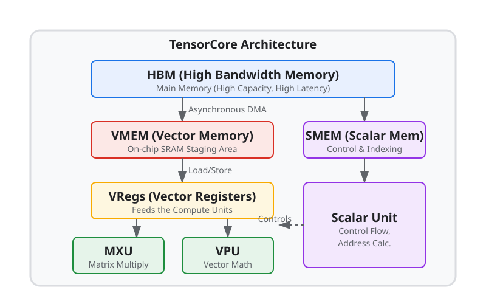
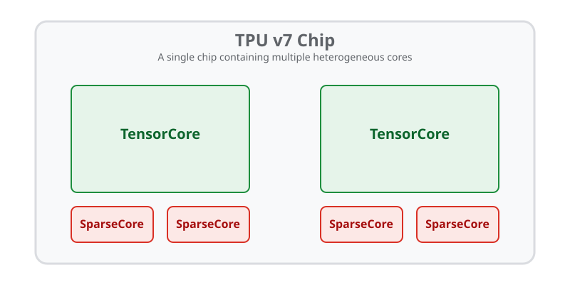

---
jupytext:
  formats: ipynb,md:myst
  text_representation:
    extension: .md
    format_name: myst
    format_version: 0.13
    jupytext_version: 1.16.4
kernelspec:
  display_name: Python 3 (ipykernel)
  language: python
  name: python3
---

+++ {"id": "7704d3bb"}

(pallas_tpu_pipelining)=

+++ {"id": "teoJ_fUwlu0l"}

# TPU Pipelining

<!--* freshness: { reviewed: '2026-11-11' } *-->

+++ {"id": "gAJDZh1gBh-h"}

This guide serves as a reference for TPU-specific pipelining concerns.
We'll review the memory hierarchy and compute units on TPUs, and TPU-specific features of the `pltpu.emit_pipeline` API inside `pl.kernel`. For a more general-purpose overview of pipelining, see {ref}`pallas_software_pipelining`.

```{code-cell} ipython3
---
executionInfo:
  elapsed: 54
  status: ok
  timestamp: 1744908474512
  user:
    displayName: Justin Fu
    userId: '17543197034567316452'
  user_tz: 420
id: ejAVO6ikUUuF
---
#@title Imports

import jax
from jax.experimental import pallas as pl
from jax.experimental.pallas import tpu as pltpu
import jax.numpy as jnp
import numpy as np
```

+++ {"id": "0e212a5e"}

(tpu_and_its_memory_spaces)=

## TPU and its memory spaces

+++ {"id": "NnWW9GV4kW6P"}

A TPU and its TensorCore consist of memory spaces (where arrays can reside),
registers (which temporarily store scalar and array values) and compute units
(that do computation with values in registers).
Below is a diagram of a TPU TensorCore and its memory hierarchy:



Let's talk about the components of this diagram in more detail:

* **Memory spaces**: A TPU has high-bandwidth memory (HBM) which is what we
  often think of as "device memory".
  There is also vector memory (VMEM),
  a cache meant for storing vector and array values, and scalar memory (SMEM),
  a cache designed to store scalar values.
* **Registers**: A TensorCore has two main types of registers: vector
  registers (VREGs) store array values, and scalar registers (SREGs) store
  scalar values.
  Values can be loaded into registers from their respective caches (VMEM for
  VREGs and SMEM for SREGs).
* **Compute units**: A TensorCore has a scalar unit, vector unit (VPU) and
  matrix unit (MXU) that can do numerical computation. Each of these compute units can operate asynchronously, but this is managed by the TPU compiler and thus from the programmer's perspective a TPU program is single-threaded.
  Compute units operate on values that live in SREGs and VREGs and output
  values into those registers as well.

+++ {"id": "8Tl3wt5Wk3Ek"}

## TPU-specific Pipelining Features

Pallas TPU supports the following platform-specific features.

+++ {"id": "1jg5WmExk47l"}

### TPU Memory Spaces

Pallas exposes all levels of the TPU memory hierarchy to users. The following table maps from Pallas TPU memory spaces to their standard memory types (DRAM/SRAM):

| Pallas Enum | TPU Memory Space | Type (DRAM/SRAM) |
| --- | --- | --- |
| `pltpu.HBM` / `pl.ANY` | HBM (usually) or VMEM | DRAM |
| `pltpu.VMEM` | VMEM | SRAM |
| `pltpu.SMEM` | SMEM | SRAM |
| `pltpu.SEMAPHORE` | Semaphore | SRAM |

- `pltpu.VMEM` denotes vector SRAM. It is the default memory space for `pltpu.emit_pipeline` block buffers if nothing is specified.
- `pltpu.SMEM` denotes scalar SRAM. Only scalar loads and stores can be performed to/from SMEM.
- `pltpu.HBM` (and `pl.ANY`, which lets XLA choose and typically places buffers in HBM) represents off-chip DRAM. Inputs and outputs passed into `pl.kernel` arrive as HBM `Ref`s and cannot be dereferenced directly using array indexing syntax (e.g. `x[...]`). Instead, values are copied into VMEM or SMEM buffers either automatically via `pltpu.emit_pipeline` or manually via `pltpu.sync_copy` / `pltpu.async_copy`.
- `pltpu.SEMAPHORE` is used to allocate semaphores for constructing barriers or tracking asynchronous operations. It is also possible to allocate top-level semaphore `Ref`s via `jax.new_ref(..., memory_space=pltpu.SEMAPHORE)` for asynchronous kernels; see {ref}`pallas_async` for more details.

Memory spaces can also be used to allocate scratch arguments to a kernel via the `scratch_types` argument on `pl.kernel`. Scratch buffers are allocated per core for the duration of the kernel and are useful for staging data from HBM or storing intermediate results such as partial accumulations and reductions across pipeline steps. A scratch buffer must reside in `VMEM`, `SMEM`, or `SEMAPHORE`.

As an example of manual memory space staging in `pl.kernel`, the following program copies a slice of an HBM input `x_hbm_ref` into VMEM scratch buffers, performs arithmetic, and copies the result into the output HBM `Ref`:

```{code-cell} ipython3
---
executionInfo:
  elapsed: 65
  status: ok
  timestamp: 1744908591430
  user:
    displayName: Justin Fu
    userId: '17543197034567316452'
  user_tz: 420
id: zcqz1CA_o50a
---
def hbm_vmem_kernel(x_hbm_ref, out_hbm_ref, in_vmem_ref, out_vmem_ref):
  pltpu.sync_copy(x_hbm_ref.at[0:1], in_vmem_ref)
  out_vmem_ref[...] = in_vmem_ref[...] + 1
  pltpu.sync_copy(out_vmem_ref, out_hbm_ref)

x = jax.random.uniform(jax.random.key(0), (8, 128), jnp.float32)
mesh = pltpu.TensorCoreMesh(axis_name='core', num_cores=1)
out = pl.kernel(
    hbm_vmem_kernel,
    out_type=jax.ShapeDtypeStruct((1, 128), jnp.float32),
    mesh=mesh,
    scratch_types=[
        pltpu.VMEM((1, 128), jnp.float32),
        pltpu.VMEM((1, 128), jnp.float32),
    ],
)(x)

np.testing.assert_allclose(out, x[0:1] + 1)
```

(pallas_tpu_copy_semaphores)=
### Copy semaphores

`pltpu.async_copy` starts a copy and returns a descriptor to await later. Its DMA semaphore follows two rules:

- **If you pass a semaphore, you must await it**.
- **If you pass `sem=None`, the copy will be tracked in bulk (if hardware supported)**: awaiting the copy performs a bulk wait rather than awaiting that copy alone, as with [SparseCore streams](https://docs.jax.dev/en/latest/pallas/tpu/sparsecore.html#dma-semaphores-on-sparsecore).

### Multiple Buffering

Multiple buffering can be specified on a per-argument basis to the pipeline via the `pipeline_mode` option on `pl.BlockSpec`. To do so, pass a `pl.Buffered` object to `pl.BlockSpec` specifying the number of buffers to allocate for this particular argument:

```python
pl.BlockSpec(
  pipeline_mode=pl.Buffered(buffer_count=buffer_count)
)
```

The default buffer count is 2 for inputs and outputs.

+++

(pallas_tpu_emit_pipeline)=

### `pltpu.emit_pipeline`

`pltpu.emit_pipeline` is the standard pipelining API on TPU. Called inside a `pl.kernel` body, it allocates multi-buffered VMEM scratch buffers, schedules asynchronous HBM–VMEM DMAs, and invokes `body` on VMEM `Ref`s at each grid step. It also supports:
- Constructing nested pipelines (for example, an outer loop that communicates between chips over ICI and an inner `pltpu.emit_pipeline` that performs local HBM–VMEM pipelining).
- TPU-specific scheduling features such as lookahead prefetch, dynamic block shapes, and automatic multi-core grid partitioning (covered below).

`pltpu.emit_pipeline` takes a step `body` function, a `grid`, and `in_specs` / `out_specs`:

```python
def emit_pipeline(
    body: Callable,
    *,
    grid: tuple[int | jax.Array, ...],
    in_specs: PyTree[BlockSpec] = (),
    out_specs: PyTree[BlockSpec] = (),
    core_axis: tuple[int, ...] | int | None = None,
    core_axis_name: tuple[str, ...] | str | None = None,
    dimension_semantics: tuple[GridDimensionSemantics, ...] | None = None,
) -> Callable:
  ...  # Returns a callable pipeline accepting HBM input and output Refs.
```

The `core_axis_name` (or `core_axis`) and `dimension_semantics` arguments partition parallel grid dimensions across cores in `mesh` (see {ref}`pallas_tpu_megacore` below).

+++

### Lookahead Prefetch

Lookahead prefetch is a pipelining feature where the pipeline will attempt to prefetch the next input block as soon as a buffering slot is available, rather than the iteration directly before it would be used. For example, if the kernel had a grid of `(8,)` and the block indices to fetch on each iteration were `0, 0, 0, 0, 1, 1, 1, 1`, then lookahead prefetch will begin fetching both blocks `0` and `1` on iteration 0, whereas the standard pipeline schedule would fetch block `0` on iteration 0 but not begin fetching block `1` until iteration 3. There is a small amount of control flow overhead in performing lookahead so it is disabled by default.

Lookahead is primarily useful when there is a variable amount of compute work in each block, such as when some blocks contain skipped or a reduced amount of work. In these cases, there may not be enough compute work in the iteration immediately preceding the step when the block is needed to fully overlap with the memory transfer. Therefore, we would like to begin fetching blocks earlier in the pipeline.

Lookahead prefetch can be used in conjunction with multiple buffering and can likewise be enabled by passing `pl.Buffered` into the `pipeline_mode` argument:
```python
pl.BlockSpec(
  pipeline_mode=pl.Buffered(buffer_count=buffer_count, use_lookahead=True)
)
```

+++

### Dynamic Block Shapes

`pltpu.emit_pipeline` supports pipelining over blocks with dynamic but bounded shapes. In order to specify such a block shape, the dynamic-sized dimension in the block should be marked with `pl.BoundedSlice(max_size)` rather than a static integer size, where `max_size` is the maximum size of the block. In addition, the corresponding index returned by `index_map` should be a dynamic slice constructed via `pl.ds(start, size)` where both `start` and `size` are _element_ indices (not block indices) and can be dynamic.

The following is an example for a block spec with a dynamic first dimension:

```python
pl.BlockSpec(
   block_shape=(pl.BoundedSlice(32), 256),
   index_map=lambda *grid_idxs: (pl.ds(start, size), 0),
)
```

```{code-cell} ipython3
# The following kernel copies `x` to the output in dynamic-sized chunks
# passed in via `slices`.

def dynamic_block_example_kernel(x_hbm, slices_hbm, o_hbm, slices_smem):
  pltpu.sync_copy(slices_hbm, slices_smem)  # Copy slices into SMEM.

  def pipeline_body(x_vmem, o_vmem):
    o_vmem[...] = x_vmem[...]

  def index_map(i):
    start = slices_smem[i, 0]
    size = slices_smem[i, 1] - slices_smem[i, 0]
    return (pl.ds(start, size), 0)

  block_spec = pl.BlockSpec(
      block_shape=(pl.BoundedSlice(8), 128),
      index_map=index_map,
  )
  pltpu.emit_pipeline(
      pipeline_body,
      grid=(slices_hbm.shape[0],),
      in_specs=[block_spec],
      out_specs=block_spec,
  )(x_hbm, o_hbm)

x = jax.random.uniform(jax.random.key(0), (8, 128), jnp.float32)
slices = jnp.array([[0, 2], [2, 3], [3, 5], [5, 8]], dtype=jnp.int32)

mesh = pltpu.TensorCoreMesh(axis_name='core', num_cores=1)
out = pl.kernel(
    dynamic_block_example_kernel,
    out_type=jax.ShapeDtypeStruct((8, 128), jnp.float32),
    mesh=mesh,
    scratch_types=[pltpu.SMEM(slices.shape, jnp.int32)],
)(x, slices)

np.testing.assert_allclose(x, out)
```

+++ {"id": "KvPFez9N8cKJ"}

(pallas_tpu_megacore)=

### TPUs in Megacore configuration

+++ {"id": "0f4HAVzQ8n71"}

Some TPU chips (such as TPU v4, TPU v5p, and logical dual-core chips) have two TensorCores that appear as one device to JAX users (historically called "Megacore"; on TPU 7x the two TensorCores are exposed as separate JAX devices).
Dual TensorCores on a single chip have their own separate VMEM, VREGs, SMEM, SREGs, and compute units, while sharing HBM:



Conceptually, a dual-TensorCore TPU device behaves like a two-thread processor.
How do we modify our kernels to utilize all TensorCores on the device simultaneously?

Create a `pltpu.TensorCoreMesh(axis_name='core')`, pass it to `pl.kernel(..., mesh=mesh)`, and pass `core_axis_name='core'` alongside `dimension_semantics` to `pltpu.emit_pipeline` to partition parallel grid dimensions across TensorCores:

```{code-cell} ipython3
---
executionInfo:
  elapsed: 106
  status: ok
  timestamp: 1744910274556
  user:
    displayName: Justin Fu
    userId: '17543197034567316452'
  user_tz: 420
id: nQNa8RaQ-TR1
outputId: 29c0b574-3528-49a5-8a88-b6987efc69ce
---
def add_matrices_body(x_vmem_ref, y_vmem_ref, z_vmem_ref):
  # Load x and y from VMEM into VREGs
  x_vregs = x_vmem_ref[:, :]
  y_vregs = y_vmem_ref[:, :]
  # Execute a vectorized add
  z_vregs = x_vregs + y_vregs
  # Store the output values in VREGs back into VMEM
  z_vmem_ref[:, :] = z_vregs

def add_matrices_pipelined_megacore(x: jax.Array, y: jax.Array) -> jax.Array:
  mesh = pltpu.TensorCoreMesh(axis_name='core')
  block_spec = pl.BlockSpec((256, 512), lambda i: (i, 0))

  @pl.kernel(out_type=jax.ShapeDtypeStruct.like(x), mesh=mesh)
  def kernel(x_hbm_ref, y_hbm_ref, z_hbm_ref):
    pltpu.emit_pipeline(
        add_matrices_body,
        grid=(x.shape[0] // 256,),
        in_specs=[block_spec, block_spec],
        out_specs=block_spec,
        core_axis_name='core',
        dimension_semantics=('parallel',),
    )(x_hbm_ref, y_hbm_ref, z_hbm_ref)

  return kernel(x, y)

x, y = jnp.ones((512, 512)), jnp.ones((512, 512))
add_matrices_pipelined_megacore(x, y)
```

+++ {"id": "xG51AiUC-8cl"}

`dimension_semantics` should be a tuple of the same length as `grid` where each
entry is either `"parallel"` (`pltpu.PARALLEL`) or `"arbitrary"` (`pltpu.ARBITRARY`). `"parallel"` indicates to Pallas that iterations along that grid dimension can execute independently across cores without affecting correctness. `"arbitrary"` indicates that no independence assumptions can be made about that dimension (for example, a contracting reduction axis) and it therefore cannot be partitioned across cores.

By passing `mesh=pltpu.TensorCoreMesh(axis_name='core')` to `pl.kernel` and `core_axis_name='core'` with `dimension_semantics` to `pltpu.emit_pipeline`, Pallas automatically splits the parallel grid work across available TensorCores on multi-core chips (`v4`, `v5p`, etc.) while safely running on single-TensorCore devices (`v5e`, `v6e`, etc.) with zero code changes:

```python
mesh = pltpu.TensorCoreMesh(axis_name='core')

@pl.kernel(out_type=..., mesh=mesh)
def kernel_body(x_hbm_ref, o_hbm_ref):
  def inner_pipeline_body(x_vmem_ref, o_vmem_ref):
    ...

  pltpu.emit_pipeline(
      inner_pipeline_body,
      grid=(4, 4),
      in_specs=[...],
      out_specs=...,
      core_axis_name='core',
      dimension_semantics=('parallel', 'arbitrary'),
  )(x_hbm_ref, o_hbm_ref)
```
