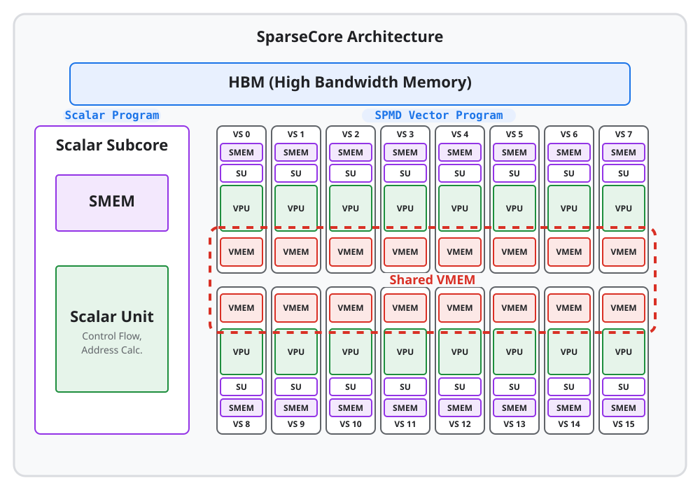
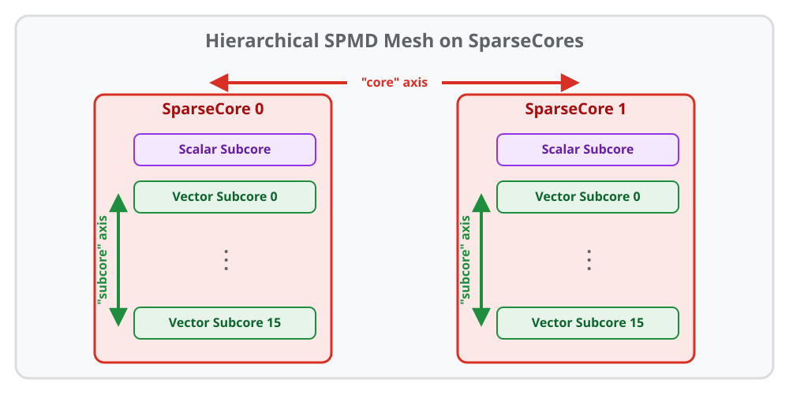

---
jupytext:
  formats: ipynb,md:myst
  text_representation:
    extension: .md
    format_name: myst
    format_version: 0.13
    jupytext_version: 1.16.4
kernelspec:
  display_name: Python 3 (ipykernel)
  language: python
  name: python3
---

# SparseCore Kernel Writing

[SparseCores](https://openxla.org/xla/sparsecore) specialize in sparse memory
access and operations, and have been an essential part of modern TPUs across
multiple generations. While most of the matmul and heavy-compute work happens
on TensorCores, offloading irregular or gather/scatter-heavy computation to
SparseCores can significantly improve overall performance.

This guide gives an overview of SparseCore architecture and shows how to write
Pallas kernels that run on TPU SparseCores.

```{code-cell}
import jax
from jax.experimental import pallas as pl
from jax.experimental.pallas import tpu as pltpu
from jax.experimental.pallas import tpu_sc as plsc
import jax.numpy as jnp
import numpy as np

assert pltpu.get_tpu_info().sparse_core is not None, "No SparseCore found"
```

## Hardware overview

Depending on the version, a TPU chip may have 2 or 4 SparseCores. A SparseCore
consists of multiple subcores, each having its own VMEM space. Below is a
diagram for a SparseCore inside the TPU:



A walkthrough on each of the components:

*   **Vector subcore (tiles)**: The vector processing subcores of a SparseCore.
    Each subcore has its own memory, so the data flow is independent.

*   **Lanes (SIMD width)**: An SC vector subcore does computation on size-N
    vectors in a "single instruction multiple data" (SIMD) fashion. Computations
    will happen on all the numbers in a lane in a single instruction.

*   **Scalar subcore**: The scalar processing subcore of a SparseCore. It is
    capable of scalar operations, dynamic indexing as well as initiating DMAs
    and streams.

*   **Memory spaces**: Each vector subcore has its own VMEM and SMEM (omitted in
    the graphic) space. They also have access to a shared VMEM space. The scalar
    subcore has its own SMEM. All these spaces connect with the TPU's HBM.

    *   In Pallas, the VMEM spaces are denoted as `pltpu.VMEM` and
        `pltpu.VMEM_SHARED`, and SMEM is denoted as `pltpu.SMEM`.

    *   In other documentation, the shared VMEM is often called "SPMEM" and the
        per-subcore VMEM is called "TileSPMEM" or "local SPMEM".

Actual specs vary by TPU version. Here are some published TPU specs:

| Attribute | TPU v4 | TPU v5p | TPU v6e (Trillium) | TPU 7x (Ironwood) |
| :-------- | :----- | :------ | :----------------- | :---------------- |
| SparseCores / Chip | 4 | 4 | 2 | 2 (4 physical cores) |
| Vector subcores / SparseCore | 16 | 16 | 16 | 16 |
| SIMD Width | 8 | 8 | 8 (F32)<br>16 (BF16) | 16 (F32)<br>32 (BF16) |
| HBM Capacity | 32 GB | 96 GB | 32 GB | 192 GB |

You can also use `pltpu.get_tpu_info()` to quickly obtain specs for your current
hardware.

```{code-cell}
# Quick way to query basic SC info

assert (sc_info := pltpu.get_tpu_info().sparse_core)
print(f"SparseCore info for TPU {pltpu.get_tpu_info().chip_version}:")
print(sc_info)
```

```
SparseCore info for TPU 7x:
SparseCoreInfo(num_cores=2, num_subcores=16, num_lanes=16, dma_granule_size_bytes=64)
```

## Operations and workloads

A SparseCore consists of 16 smaller processing units, each with its own data
flow. That makes it good for workloads that have the following characteristics:

*   Highly parallel and irregular

*   Random data access

*   Medium-to-low amount of computation

*   Frequent data communications

Some of the useful operations on SparseCore are:

*   Small vector arithmetics

*   Gather and scatter (indexed fetch & send)

*   Sorting, unique, counts, histograms

*   Ragged operations

## Express SparseCore hardware

Similar to in TensorCore, Pallas uses mesh to express the compute units in
SparseCore. Depending on the processing unit you want to use, create a
`ScalarSubcoreMesh` or a `VectorSubcoreMesh`.

Note that a `VectorSubcoreMesh` has two dimensions - `core` for the different
SparseCores, and `subcore` for the multiple subcores on each SparseCore:



This allows you to apply the same programming model of TensorCores to write
collectives on SparseCores. Check out our
{doc}`distributed & multi-core guide <distributed>`
if you want to learn more.

```{code-cell}
scalar_mesh = plsc.ScalarSubcoreMesh(axis_name="core",
                                     num_cores=sc_info.num_cores)
print(scalar_mesh)

vector_mesh = plsc.VectorSubcoreMesh(
    core_axis_name="core", subcore_axis_name="subcore"
)
print(vector_mesh)
```

```
ScalarSubcoreMesh(axis_name='core', num_cores=2)
VectorSubcoreMesh(core_axis_name='core', subcore_axis_name='subcore', num_cores=2, num_subcores=16)
```

## A basic SparseCore kernel

See below for a simple scalar subcore kernel that includes DMAs, per-core
customizing and compute operations. Note that the scalar subcore can only do
scalar operations.

```{code-cell}
@jax.jit
def cumsum(x):
  @pl.kernel(out_type=x, mesh=scalar_mesh,
             scratch_types=[pltpu.SMEM((x.shape[1],), x.dtype),
                            pltpu.SemaphoreType.DMA])
  def kernel(x_ref, o_ref, tmp_ref, sem):
    idx = jax.lax.axis_index('core')
    pltpu.async_copy(x_ref.at[idx], tmp_ref, sem).wait()

    @pl.loop(1, x.shape[1])
    def _(i):
      tmp_ref[i] += tmp_ref[i - 1]

    pltpu.async_copy(tmp_ref, o_ref.at[idx], sem).wait()

  return kernel(x)

x_shape = (sc_info.num_cores, sc_info.num_lanes)
x = jax.random.randint(jax.random.key(0), x_shape, 0, 64, jnp.int32)
np.testing.assert_array_equal(cumsum(x), jnp.cumsum(x, axis=1))
```

## DMA semaphores on SparseCore

On SparseCore, local copies between certain memory space pairs (including
scatters and gathers) run as *streams* and differ slightly from the typical
`pltpu.async_copy` semantics ({ref}`pallas_tpu_copy_semaphores`): on a
**push stream**, the hardware individually tracks only the source read, while on
a **pull stream**, it individually tracks only the destination write:

*   **Push streams** (on the **vector subcore**, `plsc.VectorSubcoreMesh`):
    *   `pltpu.VMEM` to `pltpu.HBM`
    *   `pltpu.VMEM` to `pltpu.VMEM_SHARED`
    *   `pltpu.VMEM` to `pltpu.SMEM`
*   **Pull streams** (on the **vector subcore**, `plsc.VectorSubcoreMesh`):
    *   `pltpu.HBM` to `pltpu.VMEM`
    *   `pltpu.VMEM_SHARED` to `pltpu.VMEM`
    *   `pltpu.SMEM` to `pltpu.VMEM`
    *   `pltpu.VMEM_SHARED` to `pltpu.SMEM`

Other copies on SparseCore (such as non-stream DMAs like in `cumsum` above, and
remote copies) follow the standard `pltpu.async_copy` semantics and always
require a semaphore (`sem=None` is not supported).

### Push streams

Tracking destination writes with an individual semaphore (`sem`) is **not
supported** on push streams: the semaphore only tracks when the source buffer
has been read, not when the destination write has completed. A `sem` is ignored
when specified; pass `sem=None` instead.

Calling `.wait()` or `.wait_write()` is the only way to wait for destination
write completion on a push stream, and it **blocks until all in-flight
push-stream writes to that destination memory space have completed**
(implemented as a memory fence), not just the individual copy:

```python
# Pass sem=None; .wait() / .wait_write() blocks until all in-flight push-stream
# writes to o_ref's memory space have completed.
pltpu.async_copy(vmem_ref, o_ref, sem=None).wait()
```

Source read completion (so the source buffer is safe to overwrite) *can* be
tracked per copy by passing `src_sem` and calling `.wait_read()`, which avoids
blocking on all in-flight destination writes until you need the destination data
(calling `.wait()` when `src_sem` is set runs `.wait_read()` followed by
`.wait_write()`):

```python
copy = pltpu.async_copy(vmem_ref, o_ref, sem=None, src_sem=src_sem)
copy.wait_read()   # Blocks only until vmem_ref has been read.
copy.wait_write()  # Blocks until all push-stream writes to o_ref's space complete.
```

Passing `src_sem=None` on a push stream tracks source reads in bulk, so
`.wait_read()` performs a bulk wait until all in-flight push streams without
`src_sem` have finished reading their sources.

### Pull streams

Pull streams track destination writes with `sem` as usual (`src_sem` and
`.wait_read()` are not supported, as `.wait()` or `.wait_write()` already
guarantees both read and write completion). Passing `sem=None` tracks pull
streams in bulk, so `.wait()` or `.wait_write()` performs a bulk wait until all
in-flight pull streams without `sem` have completed.

## Pipelining in SparseCore kernels

You can use `pltpu.emit_pipeline` to write pipelined SparseCore kernels. The
`core_axis_name` and `dimension_semantics` arguments to `emit_pipeline` enable
partitioning the pipeline across SparseCores and vector subcores.

```{code-cell}
SC_REG_OP_SHAPE = (1, sc_info.num_lanes)
dma_block = (8, 128)

@jax.jit
def sc_add_one(x):
  @pl.kernel(out_type=x, mesh=vector_mesh, scratch_types=[])
  def sc_add_one_kernel(x_hbm_ref, o_hbm_ref):
    in_shape = x_hbm_ref.shape

    def sc_add_one_body(in_vmem, out_vmem):
      @pl.loop(0, in_vmem.shape[0], step=SC_REG_OP_SHAPE[0])
      def _(c0):
        @pl.loop(0, in_vmem.shape[1], step=SC_REG_OP_SHAPE[1])
        def _(c1):
          slc = (pl.ds(c0, SC_REG_OP_SHAPE[0]), pl.ds(c1, SC_REG_OP_SHAPE[1]))
          out_vmem[slc] = in_vmem[slc] + 1

    pltpu.emit_pipeline(
        sc_add_one_body,
        grid=(in_shape[0] // dma_block[0], in_shape[1] // dma_block[1]),
        in_specs=[pl.BlockSpec(block_shape=dma_block,
                               index_map=lambda i, j: (i, j))],
        out_specs=[pl.BlockSpec(block_shape=dma_block,
                                index_map=lambda i, j: (i, j))],
        core_axis_name=('core', 'subcore'),
        dimension_semantics=(pltpu.PARALLEL, pltpu.PARALLEL),
    )(x_hbm_ref, o_hbm_ref)
  return sc_add_one_kernel(x)

x = jax.random.randint(jax.random.key(0), (4096, 128), 0, 64, jnp.int32)
y = sc_add_one(x)
np.testing.assert_array_equal(y, x + 1)
```

Alternatively, you can use `jax.lax.axis_index` to compute the core and subcore
indices and split up work manually across subcores (see the
{doc}`distributed & multi-core guide <distributed>` for an example).

## Overlapping TensorCore and SparseCore

It is very simple to overlap kernels written in TensorCore vs SparseCore: just
put them together inside a `jax.jit`. The XLA compiler will handle their
scheduling.

```{code-cell}
@jax.jit
def tc_add_one(x):
  return x + 1
np.testing.assert_array_equal(tc_add_one(x), jnp.add(x, 1))

@jax.jit
def two_add_ones(x):
  return sc_add_one(x), tc_add_one(x)
jax.tree.map(np.testing.assert_array_equal, two_add_ones(x), (x + 1, x + 1));
```

A benchmark here shows the total time is less than the two functions combined.

```{code-cell}
%timeit sc_add_one(x).block_until_ready()
%timeit tc_add_one(x).block_until_ready()

%timeit jax.block_until_ready(two_add_ones(x))
```

```
120 µs ± 2.46 µs per loop (mean ± std. dev. of 7 runs, 10000 loops each)
113 µs ± 5.61 µs per loop (mean ± std. dev. of 7 runs, 10000 loops each)
199 µs ± 2.24 µs per loop (mean ± std. dev. of 7 runs, 10000 loops each)
```

## Gather and scatter

SparseCore has specific optimized ops for indexed retrievals and updates. Given
an input or output ref in HBM (named `data`) and an array of indices in VMEM
(named `indices`), it can quickly read from ("gather") or write to ("scatter")
`data[indices]`.

We can use these gather/scatter by indexing a Ref with an indices Ref as part of
an `async_copy` or `sync_copy`. For example,
`sync_copy(data_ref.at[indices_ref], target_ref)` will trigger a gather.

Below is a kernel that pipelines loading indices into a vector subcore's VMEM.
In the body, we execute a gather using those indices.

```{code-cell}
batch_size = 4096
value_dim = 128
gather_window_size = 128
num_steps = 1024
sc_num_cores, sc_num_subcores = sc_info.num_cores, sc_info.num_subcores
num_indices = gather_window_size * sc_num_cores * sc_num_subcores * num_steps
x = jnp.arange(batch_size * value_dim).reshape(batch_size, value_dim)
indices = jax.random.randint(jax.random.key(0), (num_indices,), 0, batch_size,
                             jnp.int32)


@jax.jit
def gather(x, indices):
  indices = indices.reshape((1, num_indices))
  @pl.kernel(out_type=jax.ShapeDtypeStruct((num_indices, value_dim), x.dtype),
             mesh=vector_mesh)
  def kernel(x_hbm, i_hbm, o_hbm):
    def body(i_vmem, o_vmem):
      pltpu.sync_copy(x_hbm.at[i_vmem.at[0]], o_vmem)  # The gather op

    pltpu.emit_pipeline(
        body,
        grid=(num_indices // gather_window_size,),
        in_specs=[pl.BlockSpec((1, gather_window_size),
                               index_map=lambda i: (0, i))],
        out_specs=[pl.BlockSpec((gather_window_size, value_dim),
                                index_map=lambda i: (i, 0))],
        core_axis_name=('core', 'subcore'),
        dimension_semantics=(pltpu.PARALLEL,),
    )(i_hbm, o_hbm)

  return kernel(x, indices)

out = gather(x, indices)
np.testing.assert_array_equal(out, jnp.take(x, indices, axis=0))
```

A scatter (indexed overwrite) is the opposite of a gather. See an example kernel
below.

```{code-cell}
@jax.jit
def scatter(x, indices):
  indices = indices.reshape((1, num_indices))
  @pl.kernel(out_type=jax.ShapeDtypeStruct((batch_size, value_dim), x.dtype),
             mesh=vector_mesh, scratch_types=[])
  def kernel(x_hbm, i_hbm, o_hbm):
    def body(x_vmem, i_vmem):
      pltpu.sync_copy(x_vmem, o_hbm.at[i_vmem.at[0]])  # The scatter op

    pltpu.emit_pipeline(
        body,
        grid=(num_indices // gather_window_size,),
        in_specs=[pl.BlockSpec((gather_window_size, value_dim),
                               index_map=lambda i: (i, 0)),
                  pl.BlockSpec((1, gather_window_size,),
                               index_map=lambda i: (0, i))],
        out_specs=[],
        core_axis_name=('core', 'subcore'),
        dimension_semantics=(pltpu.PARALLEL,),
    )(x_hbm, i_hbm)

  return kernel(x, indices)

gathered = jnp.take(x, indices, axis=0)
out = scatter(gathered, indices)
np.testing.assert_array_equal(out, x)
```

## Benchmark against TensorCore

Sparsecores are particularly good at gather and scatter operations. We can
implement the same using vanilla JAX APIs, which by default run on TensorCore,
and compare the results.

```{code-cell}
%timeit jax.block_until_ready(gather(x, indices))

gather_tc = jax.jit(lambda x, i: jnp.take(x, i, axis=0))
gather_tc(x, indices).block_until_ready()

%timeit jax.block_until_ready(gather_tc(x, indices))
```

```
4.05 ms ± 2.02 µs per loop (mean ± std. dev. of 7 runs, 100 loops each)
18.1 ms ± 5.24 µs per loop (mean ± std. dev. of 7 runs, 100 loops each)
```

## Gathering and scattering 16-bit dtypes

SparseCore DMA hardware natively supports only 32-bit transfers (`int32`, `float32`, `uint32`). You cannot directly gather 16-bit types like `bfloat16` or `float16`.

To gather 16-bit data, you can pack pairs of rows into 32-bit words in HBM, issue the gather with halved indices, and unpack the target row in VMEM:

1. Pair adjacent rows along the last dimension and view them as `int32`. A table of shape `(batch_size, value_dim)` in `bfloat16` becomes `(batch_size // 2, value_dim)` in `int32`.
2. Gather using `index // 2` (via `pltpu.sync_copy`, or `pl.Indirect` on the data table). Each 32-bit row fetched contains both row `2*i` and row `2*i + 1`.
3. In VMEM, view the buffer back as `bfloat16` and select the requested row based on whether the original index was even or odd (`index % 2`).

Below is an example gathering `bfloat16` values with packed rows:

```{code-cell}
x_bf16 = x.astype(jnp.bfloat16)


@jax.jit
def gather_bf16_packed(x, indices):
  packing = 32 // 16  # 2
  # Pack adjacent 16-bit rows (2*i, 2*i+1) into 32-bit int32 words on HBM
  x_packed = x.reshape(batch_size // packing, packing * value_dim).view(
      jnp.int32
  )

  @pl.kernel(
      out_type=jax.ShapeDtypeStruct((num_indices, value_dim), x.dtype),
      mesh=vector_mesh,
      scratch_types=dict(
          gather_vmem=pltpu.VMEM((gather_window_size, value_dim), jnp.int32)
      ),
  )
  def kernel(x_packed_hbm, i_hbm, o_hbm, *, gather_vmem):
    def body(idx_vmem, o_vmem):
      # Issue indirect 32-bit DMA gather using halved index
      pltpu.sync_copy(
          x_packed_hbm.at[jax.lax.div(idx_vmem, packing)], gather_vmem
      )
      # Vectorized pair selection across the gathered window
      pairs = gather_vmem.view(jnp.bfloat16).reshape(-1, packing, value_dim)
      is_odd = (idx_vmem % 2)[:, None]
      o_vmem[...] = jnp.where(is_odd == 1, pairs[:, 1], pairs[:, 0])

    pltpu.emit_pipeline(
        body,
        grid=(num_indices // gather_window_size,),
        in_specs=[
            pl.BlockSpec((gather_window_size,), index_map=lambda i: (i,))
        ],
        out_specs=[
            pl.BlockSpec(
                (gather_window_size, value_dim), index_map=lambda i: (i, 0)
            )
        ],
        core_axis_name=('core', 'subcore'),
        dimension_semantics=(pltpu.PARALLEL,),
    )(i_hbm, o_hbm)

  return kernel(x_packed, indices)


out = gather_bf16_packed(x_bf16, indices)
np.testing.assert_array_equal(out, jnp.take(x_bf16, indices, axis=0))
```
