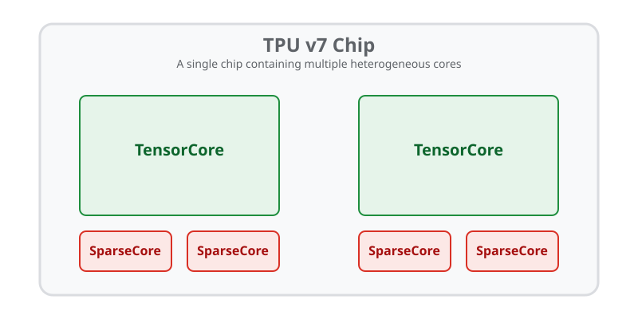
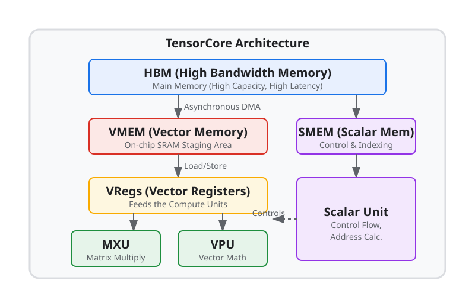

---
jupytext:
  formats: ipynb,md:myst
  text_representation:
    extension: .md
    format_name: myst
    format_version: 0.13
    jupytext_version: 1.16.4
kernelspec:
  display_name: Python 3 (ipykernel)
  language: python
  name: python3
---

(pallas-tpu-tutorial-01-tpus)=
# Chapter 1: TPUs

<!--* freshness: { reviewed: '2026-11-08' } *-->

To write high-performance custom kernels, we first need to understand the
hardware we are programming. A Tensor Processing Unit (TPU) is a custom
accelerator designed by Google specifically for machine learning workloads.

## What's in a TPU Chip?

While it's common to casually refer to a TPU as a single compute unit, **a TPU
chip is actually a collection of one or more cores**. Historically, a TPU chip
centered on **TensorCores** as the primary dense compute units on the chip. In
recent generations (like TPU v5p and v7), a TPU chip combines multiple
TensorCores with a specialized type of core called a **SparseCore**.

For example, a modern TPU v7 chip contains two TensorCores and four SparseCores
(with two SparseCores located near each TensorCore).



*(Note: This diagram illustrates the logical compute units on the chip. We will
dive into how memory fits into this picture shortly.)*

You can query information about the TPU chip your code is currently running on
using the `pltpu.get_tpu_info()` API:

```{code-cell}
from jax.experimental.pallas import tpu as pltpu

tpu_info = pltpu.get_tpu_info()
print(f"TPU Chip Version: {tpu_info.chip_version}")
print(f"TensorCores per logical device: {tpu_info.num_cores}")
```

## TensorCore Architecture

Most of the focus in kernel writing on TPUs centers on the TensorCore, because
that is where the vast majority of the FLOPs reside. So, we will first dive into
the architecture of the TensorCore and its memory hierarchy.



While it's common to think of TPUs as just "Google's version of a GPU," the
architecture of a TensorCore differs significantly from a GPU. A GPU is built
around the concept of Single Instruction, Multiple Threads (SIMT), utilizing
thousands of lightweight threads running concurrently. In contrast,
**TensorCores are highly sequential machines with very wide vector
registers**—conceptually closer to a highly specialized CPU than a GPU.

Inside a standard TensorCore are three main compute units:

1.  **Matrix Multiply Unit (MXU):** The powerhouse of the TPU, designed to do
    one thing incredibly fast: multiply matrices.
2.  **Vector Processing Unit (VPU):** Handles all non-matrix math, such as
    element-wise operations, reductions, and activations.
3.  **Scalar Unit:** Handles control flow, loop counting, and address
    calculations.

### The TensorCore Memory Hierarchy

To keep these fast compute units fed, the TensorCore uses a specialized memory
hierarchy. When you write a Pallas kernel, you are explicitly managing data
movement between these layers:

*   **HBM (High Bandwidth Memory):** The main memory of the TPU (analogous to
    DRAM on a GPU). It has high capacity (tens of gigabytes) but high latency.
    In Pallas, the global arrays you pass into your kernel reside here.
*   **VMEM (Vector Memory):** A fast, on-chip SRAM (Static RAM) that acts as a
    staging area. VMEM is fairly large for such low-level memory (often
    16 MiB+). Your kernel's primary job is to fetch chunks of data from HBM into
    VMEM via asynchronous DMA operations.
*   **VRegs (Vector Registers):** These are the actual registers that directly
    feed into the VPU and MXU. Data must be loaded from VMEM into VRegs before
    any vector or matrix math can be performed on it.
*   **SMEM (Scalar Memory):** A smaller, low-latency memory attached to the
    Scalar Unit. It lacks alignment requirements and allows for fast random
    access of 32-bit values. It is used for control flow, dynamic indexing, and
    managing scalar state.

Using the TPU info API, you can inspect the exact memory capacities available on
your hardware:

```{code-cell}
# Capacities are reported per TensorCore.
print(f"HBM Capacity: {tpu_info.hbm_capacity_bytes / (1024**3):.1f} GiB")
print(f"VMEM Capacity: {tpu_info.vmem_capacity_bytes / (1024**2):.0f} MiB")
print(f"SMEM Capacity: {tpu_info.smem_capacity_bytes / 1024:.0f} KiB")
```

Crucially, TPUs allow software to schedule memory operations in the background.
HBM accesses cannot be issued directly by the compute units; instead, they must
be fetched into VMEM or SMEM via asynchronous Direct Memory Access (DMA)
operations, allowing the TPU to compute and move memory simultaneously.

## SparseCore Architecture (High Level)

As machine learning models have evolved—particularly with the rise of massive
recommendation systems and language models—dense matrix multiplication is no
longer the only bottleneck. Operations like embedding lookups require gathering
scattered, unpredictable pieces of data from HBM, which is highly inefficient
for the dense TensorCore.

To solve this, newer TPU architectures (like v5p and v6e) include a second type
of core: the **SparseCore**.

*   **Dense vs. Sparse:** While the TensorCore is optimized for dense,
    predictable, and highly regular compute, the SparseCore is optimized for
    irregular, sparse memory access patterns.
*   **Subcores:** A SparseCore is not a monolith; it consists of many
    independent **subcores** (e.g., 16 subcores per SparseCore on TPU v5p).
    These subcores can issue many concurrent, small memory requests to HBM to
    efficiently gather embeddings without stalling the main dense compute.

You can check if the current TPU supports SparseCores and query its architecture
details:

```{code-cell}
if tpu_info.sparse_core is not None:
  sc_info = tpu_info.sparse_core
  print(f"SparseCores per logical device: {sc_info.num_cores}")
  print(f"Subcores per SparseCore: {sc_info.num_subcores}")
else:
  print("SparseCore is not available on this TPU version.")
```

## Programming the TPU with `pl.kernel`

The heterogeneous architecture of modern TPUs means that a single operation
might need to utilize different types of cores. The
{func}`pl.kernel <jax.experimental.pallas.kernel>` API in Pallas enables writing
custom kernels that can target a TensorCore individually, a SparseCore
individually, or target both at the same time for kernels that communicate with
each other.

In the following chapters, we will explore how to write programs for these cores
and explicitly orchestrate the memory movement that keeps them running at peak
performance.

```{seealso} Where to go deeper
* {doc}`Writing TPU kernels with Pallas </pallas/tpu/details>` — lookup
  reference for TPU `8×128` vector register tiling, alignment rules, and
  supported operations.
* {ref}`TPU Hardware Reference <pallas_tpu_hardware_reference>` — side-by-side
  MXU, VMEM, HBM, ICI, and SparseCore specifications across TPU generations.
* {doc}`SparseCore Kernel Writing </pallas/tpu/sparsecore>` — in-depth guide to
  programming SparseCore scalar and vector subcores.
```
