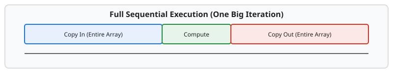
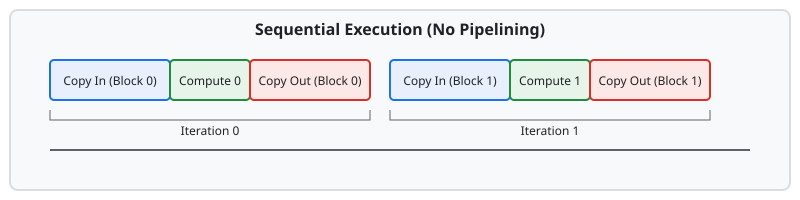
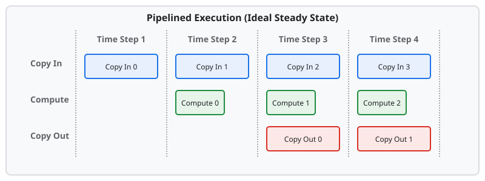

---
jupytext:
  formats: ipynb,md:myst
  text_representation:
    extension: .md
    format_name: myst
    format_version: 0.13
    jupytext_version: 1.16.4
kernelspec:
  display_name: Python 3 (ipykernel)
  language: python
  name: python3
---

(pallas-tpu-tutorial-03-pipelining)=
# Chapter 3: Pipelining and Asynchronous Transfers

<!--* freshness: { reviewed: '2026-11-11' } *-->

In the previous chapter, we saw how to write a complete kernel that manually
moves data from HBM to VMEM, performs a computation, and writes it back. While
that kernel is correct, it executes these steps *sequentially*. This leaves the
hardware heavily underutilized because the compute units sit idle while memory
is moving, and the memory system sits idle while computation is happening.

To get maximum performance out of a TPU, we need to overlap these operations.
This technique is known as **software pipelining**.

## The Motivation: Hiding Memory Latency

Recall the memory hierarchy from {ref}`Chapter 1 <pallas-tpu-tutorial-01-tpus>`:

*   **HBM** is large but slow (high latency).
*   **VMEM** is small but fast (low latency).

If we try to process a large array all at once, we are forced to copy the entire
array into VMEM, perform the computation, and then copy the entire result back
to HBM. This timeline is purely sequential:



Here, the compute units sit idle for a long time while the massive data transfer
takes place.

### Step 1: Carving into Blocks

How can we take advantage of the strengths of each form of memory in the
hierarchy, and be able to operate on large arrays stored in HBM while still
utilizing fast VMEM for compute?

Pipelining is the programming pattern that allows us to do exactly this, but it
requires transforming our problem into smaller sub-problems that can be
overlapped in parallel. The first step in pipelining is to divide our problem
into smaller subproblems (blocks) that can fit inside of VMEM.

For example, an elementwise operation can be trivially transformed by operating
on one slice of the source array at a time.

However, simply breaking the problem into blocks doesn't automatically save time
if we still execute them sequentially:



Even though we are processing smaller chunks, each block still goes through a
strict sequence of Copy In -> Compute -> Copy Out. The compute unit is still
active for only a fraction of the total time.

## Conceptual Pipelining

Pipelining takes the blocked execution a step further by overlapping the
execution of different stages for different blocks.

Consider an idealized pipeline with three stages:

1.  **Copy In:** Move a block from HBM to VMEM.
2.  **Compute:** Perform the operation on the block in VMEM.
3.  **Copy Out:** Move the result from VMEM back to HBM.

By overlapping these, we can achieve a "steady state" where all units are active
simultaneously:



In the steady state (Time Steps 3 and 4), we are simultaneously copying new data
in, computing on the previous block, and copying the result of the block before
that out. The cost of the memory transfers is effectively "hidden" behind the
computation.

## Double Buffering

To implement this without race conditions, we cannot use the same VMEM buffer
for reading and writing simultaneously. We need **multiple buffers**.

The most common pattern is **double buffering**. For each input and output, we
allocate *two* scratch buffers in VMEM (let's call them Buffer A and Buffer B).

*   On **Iteration 0**: The DMA engine starts filling Buffer A with data for
    Block 0.
*   On **Iteration 1**: The compute unit reads from Buffer A (Block 0) to
    perform computation. Simultaneously, the DMA engine starts filling Buffer B
    with data for Block 1.
*   On **Iteration 2**: The compute unit reads from Buffer B (Block 1).
    Simultaneously, the DMA engine starts filling Buffer A with data for Block 2
    (overwriting the now-stale Block 0 data).

This ping-ponging between buffers allows asynchronous memory operations to
happen in parallel with compute.

## Pipelining in Pallas with `pltpu.emit_pipeline`

Manually writing the loops to handle double buffering, prologues (filling the
pipeline), and epilogues (draining the pipeline) is tedious and error-prone.
This is where you can use a helper, `pltpu.emit_pipeline`, that encapsulates
most common pipelines.

To automate the double-buffering loop we described, Pallas requires you to
specify three main things:

1.  **The Grid:** A tuple of integers that defines the iteration space. If your
    grid is `(N, M)`, Pallas will execute the kernel `N * M` times, conceptually
    like a nested loop.
2.  **BlockSpecs:** For each input and output, you provide a `BlockSpec` that
    describes how to slice the large array into blocks. It contains:

    *   `block_shape`: The size of the block that fits in VMEM.
    *   `index_map`: A function that maps the current grid indices (e.g., `i,
        j`) to the block indices in HBM.

3.  **The Body Function:** The actual computation to perform on the blocks in
    VMEM.

To query which grid iteration the current program is executing, you can use
**`pl.program_id(axis: int)`**. This returns the index for the specified grid
dimension.

## Automating Pipelines with `emit_pipeline`

On TPUs, when using the {func}`pl.kernel <jax.experimental.pallas.kernel>` API
with a mesh, we can use `pltpu.emit_pipeline` inside our kernel to automatically
generate the double-buffered loop.

Here is an example of a pipelined matrix addition on a single TensorCore:

```{code-cell}
import jax
import jax.numpy as jnp
from jax.experimental import pallas as pl
from jax.experimental.pallas import tpu as pltpu


# 1. Define the core computation acting on VMEM blocks
def add_body(x_vmem: jax.Ref, y_vmem: jax.Ref, o_vmem: jax.Ref):
  o_vmem[...] = x_vmem[...] + y_vmem[...]


# 2. Define the kernel that emits the pipeline
def add_kernel(x_hbm: jax.Ref, y_hbm: jax.Ref, o_hbm: jax.Ref):
  # emit_pipeline handles the double buffering and async copies
  pltpu.emit_pipeline(
      add_body,
      grid=(x_hbm.shape[0] // 128, x_hbm.shape[1] // 128),
      in_specs=[
          pl.BlockSpec(block_shape=(128, 128), index_map=lambda i, j: (i, j)),
          pl.BlockSpec(block_shape=(128, 128), index_map=lambda i, j: (i, j)),
      ],
      out_specs=pl.BlockSpec(
          block_shape=(128, 128), index_map=lambda i, j: (i, j)
      ),
  )(x_hbm, y_hbm, o_hbm)
```

### Parallelizing Across Cores

If we run the above example on a multi-core TPU without partitioning, every core
executes the full pipeline redundantly. To parallelize the pipeline across
cores, we provide `core_axis_name` and `dimension_semantics` to `emit_pipeline`
to specify which dimensions of the grid can run in parallel.

Here is how we update the kernel to parallelize the first grid dimension across
cores:

```{code-cell}
def parallel_add_kernel(x_hbm: jax.Ref, y_hbm: jax.Ref, o_hbm: jax.Ref):
  pltpu.emit_pipeline(
      add_body,
      grid=(x_hbm.shape[0] // 128, x_hbm.shape[1] // 128),
      in_specs=[
          pl.BlockSpec(block_shape=(128, 128), index_map=lambda i, j: (i, j)),
          pl.BlockSpec(block_shape=(128, 128), index_map=lambda i, j: (i, j)),
      ],
      out_specs=pl.BlockSpec(
          block_shape=(128, 128), index_map=lambda i, j: (i, j)
      ),
      core_axis_name='core',
      dimension_semantics=(pltpu.PARALLEL, pltpu.ARBITRARY),
  )(x_hbm, y_hbm, o_hbm)
```

In this updated example:

*   `core_axis_name='core'` specifies the axis of the mesh that corresponds to
    the cores.
*   `dimension_semantics=(pltpu.PARALLEL, pltpu.ARBITRARY)` tells Pallas to
    parallelize the first grid dimension across the available TensorCores in the
    mesh (e.g., on a Megacore TPU).

And to expose this to JAX as a function acting on arrays:

```{code-cell}
def add(x: jax.Array, y: jax.Array) -> jax.Array:
  tc_mesh = pltpu.TensorCoreMesh(axis_name='core')

  return pl.kernel(
      parallel_add_kernel,
      out_type=jax.typeof(x),
      mesh=tc_mesh,
  )(x, y)
```

## Reductions and Accumulation

Reductions (like summing over a dimension) are a special case in pipelining
because they require both reading and writing to the same output buffer across
multiple iterations.

`emit_pipeline` handles this efficiently using a buffer reuse optimization
(sometimes called "immediate revisiting"). If the data slice for a buffer
between two consecutive iterations is the same, `emit_pipeline` will not issue a
new memory transfer for that buffer. Instead, it reuses the same VMEM buffer
from the previous iteration. This allows values accumulated in one iteration to
be visible in the next without going back to HBM.

To use this optimization correctly for reductions:

1.  *Grid order*: The reduction dimension(s) must be the minormost (last)
    dimension(s) of your grid. This ensures that we finish all accumulation for
    a block while it sits in VMEM, and only write it back to HBM once when the
    inner loop finishes.
2.  *Accumulator*: You must manually zero-out the accumulator on the first step
    of the reduction.

Here is an example of how to write a 3D-to-2D sum reduction kernel over the
trailing axis using `pl.kernel`:

```{code-cell}
def sum_body(x_vmem: jax.Ref, o_vmem: jax.Ref):
  k_idx = pl.program_id(2)  # Reduction is on grid axis 2

  # Initialize the output buffer to zero on the first step of the reduction
  @pl.when(k_idx == 0)
  def _():
    o_vmem[...] = jnp.zeros_like(o_vmem)

  # Accumulate over the trailing block axis
  o_vmem[...] += jnp.sum(x_vmem[...], axis=2)


def sum_kernel(x_hbm: jax.Ref, o_hbm: jax.Ref):
  bm, bn, bk = 128, 128, 128
  m_blocks = x_hbm.shape[0] // bm
  n_blocks = x_hbm.shape[1] // bn
  k_blocks = x_hbm.shape[2] // bk
  pltpu.emit_pipeline(
      sum_body,
      grid=(m_blocks, n_blocks, k_blocks),
      in_specs=[pl.BlockSpec((bm, bn, bk), lambda i, j, k: (i, j, k))],
      out_specs=pl.BlockSpec((bm, bn), lambda i, j, k: (i, j)),  # Ignores 'k'!
      core_axis_name='core',
      dimension_semantics=(pltpu.PARALLEL, pltpu.PARALLEL, pltpu.ARBITRARY),
  )(x_hbm, o_hbm)
```

Because `out_specs` ignores the `k` index, `emit_pipeline` sees that the same
output block is used across consecutive `k` iterations and keeps `o_vmem` in
VMEM until the final `k` iteration for that `(i, j)` block finishes.

```{warning}
If you put the reduction dimension on an outer axis of the grid, you risk
incorrectness. In general, `emit_pipeline` will not read outputs back from HBM;
all accumulation across loop iterations must happen on consecutive iterations.
```

In the next chapter, we will combine all of these ideas to write a matrix
multiplication kernel.

```{seealso} Where to go deeper
* {ref}`Software Pipelining <pallas_software_pipelining>`: Backend-agnostic overview of pipeline prologues, steady states, epilogues, and roofline bounds.
* {ref}`TPU Pipelining <pallas_tpu_pipelining>`: N-way multiple buffering (`pl.Buffered`), lookahead prefetch, and Megacore grid partitioning.
* {ref}`Grids and BlockSpecs <pallas_grids_and_blockspecs>`: Detailed reference on `grid`, `pl.program_id`, and `pl.BlockSpec` index maps.
```
