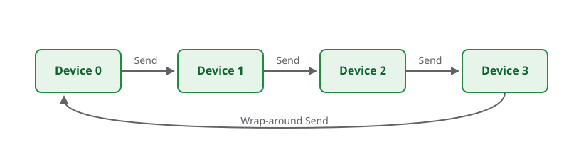
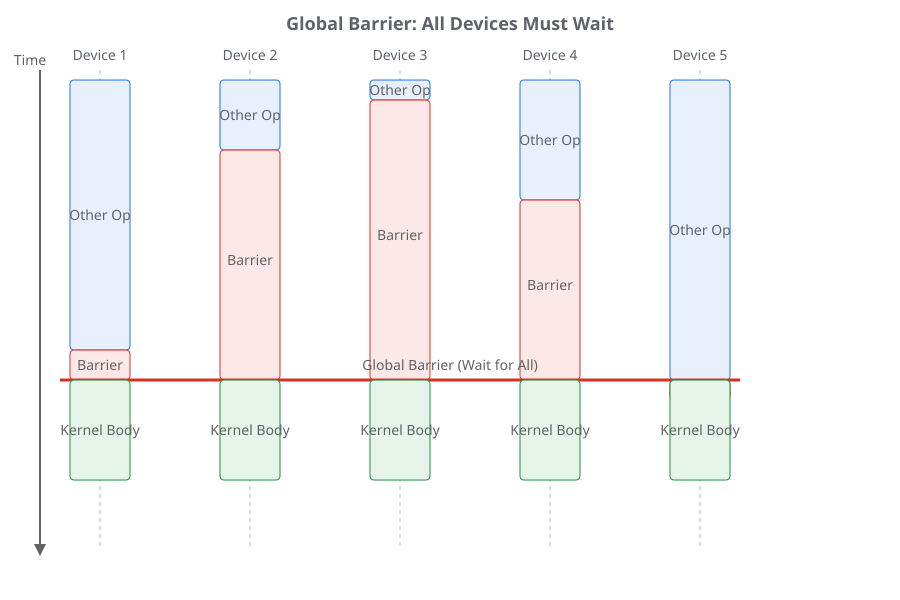
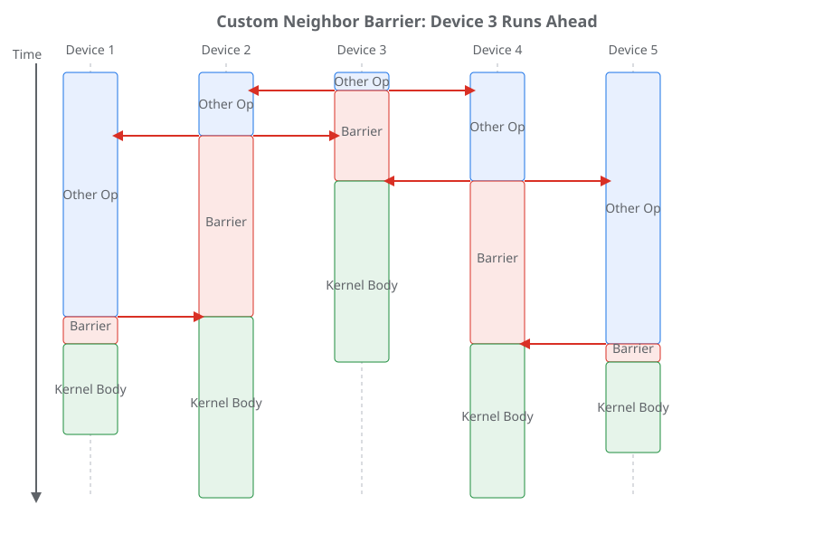

---
jupytext:
  formats: ipynb,md:myst
  text_representation:
    extension: .md
    format_name: myst
    format_version: 0.13
    jupytext_version: 1.16.4
kernelspec:
  display_name: Python 3 (ipykernel)
  language: python
  name: python3
---

(pallas-tpu-tutorial-07-manual-memory)=
# Chapter 7: Manual Control over Memory Movement

<!--* freshness: { reviewed: '2026-11-11' } *-->

To achieve peak performance on TPUs, we often need to go beyond the automated
pipelining provided by `emit_pipeline` and take explicit control over memory
transfers. This requires adopting a "two-threaded" mental model of the hardware.

## The "Two-Threaded" Mental Model

Imagine that the TPU has two main execution threads running in parallel:

1.  **The Compute Thread:** This is where your main kernel logic runs, executing
    vector and matrix operations.
2.  **The Memory (DMA) Thread:** This is a background thread dedicated solely to
    moving data between memory spaces.

The goal of explicit asynchronous copies is to keep both of these threads busy
simultaneously. While the compute thread is processing one block, the memory
thread should be fetching the next block.

## Semaphores: The Synchronization Primitive

To coordinate between these two threads, we need a way to signal when data is
ready or when a buffer is free to be overwritten. In Pallas, this is handled
using **Semaphores**.

A semaphore is essentially a counter that can be atomically incremented and
waited on. Before you can issue an asynchronous copy, you must allocate a
semaphore. In {func}`pl.kernel <jax.experimental.pallas.kernel>`, you can do
this by specifying `scratch_types` with `pltpu.SemaphoreType.DMA`.

## Explicit Async Copies

To perform a manual asynchronous copy, you use `pltpu.make_async_copy`. This
function takes the source and destination references and a DMA semaphore, and
returns a handle to the operation.

Here is the general API for using explicit async copies:

```{code-cell}
import jax
from jax import lax
from jax.experimental import pallas as pl
from jax.experimental.pallas import tpu as pltpu
import jax.numpy as jnp

tc_mesh = pltpu.TensorCoreMesh(axis_name='core', num_cores=1)


def fn(x: jax.Array) -> jax.Array:
  @pl.kernel(
      out_type=jax.typeof(x),
      mesh=tc_mesh,
      scratch_types=[
          pltpu.VMEM.like(x),
          pltpu.VMEM.like(x),
          pltpu.SemaphoreType.DMA,
      ],
  )
  def async_copy_kernel(
      x_hbm: jax.Ref,
      o_hbm: jax.Ref,
      x_vmem: jax.Ref,
      o_vmem: jax.Ref,
      sem: jax.Ref,
  ):
    # 1. Construct the async copy descriptor (does not start the copy yet)
    in_copy_desc = pltpu.make_async_copy(x_hbm, x_vmem, sem)

    # 2. Start the copy asynchronously
    in_copy_desc.start()

    # 3. Wait for the copy to complete before reading from x_vmem
    in_copy_desc.wait()

    # 4. Safe to use x_vmem now
    o_vmem[...] = x_vmem[...] + 1

    # 5. Copy result back to HBM
    out_copy_desc = pltpu.make_async_copy(o_vmem, o_hbm, sem)
    out_copy_desc.start()
    out_copy_desc.wait()

  return async_copy_kernel(x)
```

```{note}
It is perfectly fine to have multiple asynchronous copies in flight at the same
time. They can even share the same semaphore to signal completion. However, if
they share the same semaphore, you must wait on all of them simultaneously.
Pallas does not guarantee the order in which copies finish; they can be
interleaved or reordered. If you need to wait on copies independently, allocate
a separate semaphore for each copy.
```

## Example: Overlapping Write to a Separate Buffer with `emit_pipeline`

Let's write a kernel where we overlap writing a result to HBM with compute on
unrelated data, hiding the latency of the write operation. Here we overlap a
manual HBM-to-HBM async copy with a pipeline constructed via `emit_pipeline`
that performs an `add_one` operation:

```{code-cell}
def fn_overlap_pipeline(
    x: jax.Array, unrelated: jax.Array
) -> tuple[jax.Array, jax.Array]:
  @pl.kernel(
      out_type=(jax.typeof(x), jax.typeof(unrelated)),
      mesh=tc_mesh,
      scratch_types=[pltpu.SemaphoreType.DMA],
  )
  def overlap_pipeline_kernel(
      x_hbm: jax.Ref,
      unrelated_in_hbm: jax.Ref,
      o_hbm: jax.Ref,
      unrelated_out_hbm: jax.Ref,
      sem: jax.Ref,
  ):
    # 1. Start async write of unrelated data to HBM
    write_desc = pltpu.make_async_copy(
        unrelated_in_hbm, unrelated_out_hbm, sem
    )
    write_desc.start()

    # 2. Run emit_pipeline for the main task (add_one)
    def add_one_pipeline(x_vmem: jax.Ref, o_vmem: jax.Ref):
      o_vmem[...] = x_vmem[...] + 1

    block_size = 128
    grid_size = x_hbm.shape[0] // block_size

    pltpu.emit_pipeline(
        add_one_pipeline,
        grid=(grid_size,),
        in_specs=[pl.BlockSpec((block_size, x_hbm.shape[1]), lambda i: (i, 0))],
        out_specs=pl.BlockSpec((block_size, x_hbm.shape[1]), lambda i: (i, 0)),
    )(x_hbm, o_hbm)

    # 3. Wait for the write to finish
    write_desc.wait()

  return overlap_pipeline_kernel(x, unrelated)
```

## Distributed Communication

To achieve peak performance when scaling Pallas kernels across multiple TPUs, we
must understand how to communicate data between them. While JAX provides
high-level collectives like `lax.psum` and `lax.all_gather` through
`jax.shard_map`, Pallas allows you to write custom communication patterns using
lower-level primitives.

### TPU Topologies and JAX Meshes

Before we dive into how Pallas handles distributed communication, it is helpful
to understand how JAX represents multi-device hardware and maps computations to
it.

#### TPU Topologies: The Torus

TPU devices in a pod are typically connected in a multi-dimensional torus
topology. For example, a 2D torus of size `4×2` means there are 8 devices
arranged in a grid, with fast inter-chip interconnects (ICI) connecting
neighbors along both dimensions, including wrap-around connections at the edges.

This physical structure means that communication is much faster along the
connected dimensions than across arbitrary pairs of devices. To achieve peak
performance, algorithms should be designed to respect this topology, minimizing
communication across long distances or unconnected dimensions.

#### JAX Meshes and Axis Names

JAX abstracts this physical topology using `Mesh`es. A `Mesh` is a way of naming
the dimensions of the device grid, allowing you to write code that is
independent of the exact physical arrangement while still exploiting it.

For example, we can create a mesh for a `4×2` grid and name the axes `'x'` and
`'y'`:

```python
mesh = jax.make_mesh((4, 2), ('x', 'y'))
```

These **axis names** (`'x'` and `'y'`) are used in JAX to indicate communication
or shardings across sets of devices in a mesh. In `shard_map`, via
`PartitionSpec`s, they specify how arrays are partitioned across the devices.
When we say an array is sharded along axis `'x'`, we mean that different shards
of the array live on devices that differ in their `'x'` coordinate in the mesh.

Furthermore, these axis names are used in collective operations (like `lax.psum`
or `lax.all_gather`) to specify the dimension along which communication should
occur. For example, `lax.psum(x, 'x')` means sum the values of `x` across all
devices along the `'x'` axis of the mesh.

### The Distributed Context in Pallas

Distributed Pallas kernels run within a `jax.shard_map`. `shard_map` allows you
to write single-program multiple-data (SPMD) code where each device operates on
a shard of the global data.

Inside a `shard_map` and inside of a `pl.kernel`, you can use `lax.axis_index`
to find the ID of the current device along a specific mesh axis, and
`lax.axis_size` to find the total number of devices along that axis.

### Remote DMA: `make_async_remote_copy`

The core primitive for moving data between devices is Remote Direct Memory
Access (RDMA). In Pallas, this is exposed via `pltpu.make_async_remote_copy`.

Unlike local copies, a remote copy requires specifying the target device using a
`device_id` dictionary.

**SPMD Semantics and Bidirectional Communication**

When writing distributed kernels, we are in an SPMD (Single-Program
Multiple-Data) context. This means that every device is executing the *same*
code but on different shards of data.

An important consequence of this is that communication patterns are typically
symmetric. In the general case when you initiate a remote DMA to send data to a
neighbor, *every other device* is also doing the same thing. Therefore, while
you are sending a remote DMA to your neighbor, you are also receiving a remote
DMA from someone else.



**Synchronization: `wait_send` and `wait_recv`**

Because remote DMAs are asynchronous, we need a way to know when they are
finished. The descriptor returned by `make_async_remote_copy` provides three
methods for synchronization:

*   `.wait_send()`: Blocks until the local device has finished sending the data
    from the source reference. Once this unblocks, it is safe to overwrite the
    source buffer.
*   `.wait_recv()`: Blocks until the local device has finished receiving the
    data into the destination reference. Once this unblocks, it is safe to read
    from the destination buffer.
*   `.wait()`: A convenience method that calls both `.wait_send()` and
    `.wait_recv()`, waiting for both sending and receiving to complete.

It is crucial to understand that in an SPMD context where everyone is doing the
same operation, `.wait()` assumes that everyone is participating in the
communication at the same time.

### Pedagogical Example: Simple Collective Permute

Let's look at a complete example that implements a simple right permutation
(shifting data to the right neighbor):

```{code-cell}
# Assumes execution inside a jax.shard_map(..., check_vma=False) over axis 'x'.
@pl.kernel(
    out_type=jax.ShapeDtypeStruct((8, 128), jnp.float32),
    mesh=tc_mesh,
    scratch_types=[
        pltpu.SemaphoreType.DMA,  # For send tracking
        pltpu.SemaphoreType.DMA,  # For recv tracking
    ],
)
def collective_permute_simple_kernel(x_ref, y_ref, send_sem, recv_sem):
  my_id = lax.axis_index('x')
  num_devices = lax.axis_size('x')

  # Target is the right neighbor in a ring
  neighbor = lax.rem(my_id + 1, num_devices)
  device_id = {'x': neighbor}

  # Perform the remote copy asynchronously
  # Relies on the implicit global barrier at the start of the kernel
  remote_copy_op = pltpu.make_async_remote_copy(
      src_ref=x_ref,
      dst_ref=y_ref,
      send_sem=send_sem,
      recv_sem=recv_sem,
      device_id=device_id,
  )
  remote_copy_op.start()
  remote_copy_op.wait()  # Waits on both send and recv
```

In this example:

*   We use a dictionary for `device_id` to target a specific device in the mesh.
*   We use `pltpu.make_async_remote_copy` which returns a descriptor that we
    then `start()` and `wait()` on.

### Advanced Synchronization: Custom Barriers

While we write Single-Program Multiple-Data (SPMD) code that appears to execute
in parallel, the physical devices actually execute asynchronously. This means
they can easily become **desynchronized**, with some devices running faster than
others. This desynchronization creates a hazard when we attempt to communicate.
Since remote DMA operations "push" data directly into a remote device's memory,
the sending device must be sure that the receiving device is ready to receive
it. If a fast sender initiates a transfer before the slow receiver has even
entered the kernel and initialized its receive semaphores, the program will hang
or crash. To prevent this, we need a way to force devices to wait for each
other—a **barrier**.

By default, the compiler will insert a *global barrier* for any kernels that
have communication ops in them. While relying on the default global barrier is
fine for development and prototyping, in practice, it can be overkill. A global
barrier synchronizes *all* devices in the mesh, which can be slow if you only
need to communicate with a few neighbors.

To optimize performance, you can disable the default barrier and implement your
own custom barriers with the minimum set of devices possible.

| Global Barrier | Custom Neighbor Barrier |
| :---: | :---: |
|  |  |
| **Figure: Global Barrier with Skewed Arrival Times.** Devices arrive at the barrier at different times. Device 3 (entering earliest) must wait for all other devices, including the slowest Device 5, before proceeding to the kernel body. | **Figure: Custom Neighbor Barrier with Staggered Entry.** Devices 2, 3, and 4 enter earlier than Devices 1 and 5. Device 3 can proceed immediately once it receives signals from its neighbors (Devices 2 and 4). Barrier semaphores are globally visible across operations. |

Pallas provides **Barrier Semaphores** for this purpose. These are
globally-allocated semaphores used to synchronize devices across the entire
program.

Here is how to use `pltpu.get_barrier_semaphore()` to ensure all devices within
a mesh axis have entered the kernel:

```python
# Specify a collective_id when using barrier semaphores:
# pl.kernel(..., compiler_params=pltpu.CompilerParams(collective_id=0))

barrier_sem = pltpu.get_barrier_semaphore()

# Signal to everyone in our communication domain that we have entered the kernel
for i in range(lax.axis_size('x')):
  pl.semaphore_signal(barrier_sem, device_id={'x': i})

# Wait until we receive a signal from all participants
pl.semaphore_wait(barrier_sem, lax.axis_size('x'))
```

### Example with Custom Barrier

Here is a more advanced version of the collective permute example. It uses a
custom barrier to synchronize only with its neighbors. In kernels that perform
bidirectional communication, you should barrier with both neighbors.

```{code-cell}
@pl.kernel(
    out_type=jax.ShapeDtypeStruct((8, 128), jnp.float32),
    mesh=tc_mesh,
    scratch_types=[
        pltpu.SemaphoreType.DMA,  # For send tracking
        pltpu.SemaphoreType.DMA,  # For recv tracking
    ],
    compiler_params=pltpu.CompilerParams(collective_id=0),
)
def collective_permute_kernel(x_ref, y_ref, send_sem, recv_sem):
  my_id = lax.axis_index('x')
  num_devices = lax.axis_size('x')

  # Target is the right neighbor in a ring
  right_neighbor = (my_id + 1) % num_devices
  left_neighbor = (my_id - 1) % num_devices

  # 1. Custom Barrier Synchronization
  # Inform our left neighbor (who sends to us) that we are ready in the kernel.
  barrier_sem = pltpu.get_barrier_semaphore()
  pl.semaphore_signal(barrier_sem, device_id={'x': left_neighbor})
  # Wait until our right neighbor signals that it has entered the kernel.
  pl.semaphore_wait(barrier_sem, 1)

  # 2. Data Transfer
  remote_copy_op = pltpu.make_async_remote_copy(
      src_ref=x_ref,
      dst_ref=y_ref,
      send_sem=send_sem,
      recv_sem=recv_sem,
      device_id={'x': right_neighbor},
  )
  remote_copy_op.start()
  # 3. Wait to finish sending our data to our right neighbor.
  remote_copy_op.wait_send()
  # 4. Wait to finish receiving data from our left neighbor.
  remote_copy_op.wait_recv()
```

```{seealso} Where to go deeper
* {doc}`Distributed Computing in Pallas for TPUs </pallas/tpu/distributed>`: Ring All-Gather, Double-Barrier All-Reduce, Bi-directional Reduce-Scatter, intra-chip core-to-core DMA, and nested remote/local pipelines.
* {ref}`Copy semaphores <pallas_tpu_copy_semaphores>` and {ref}`TPU Pipelining <pallas_tpu_pipelining>`: Semaphore invariants and overlapping async DMA with compute.
* {ref}`Manual parallelism with shard_map <jax-201-shard-map>`: SPMD partitioning and collectives across JAX device meshes.
```
