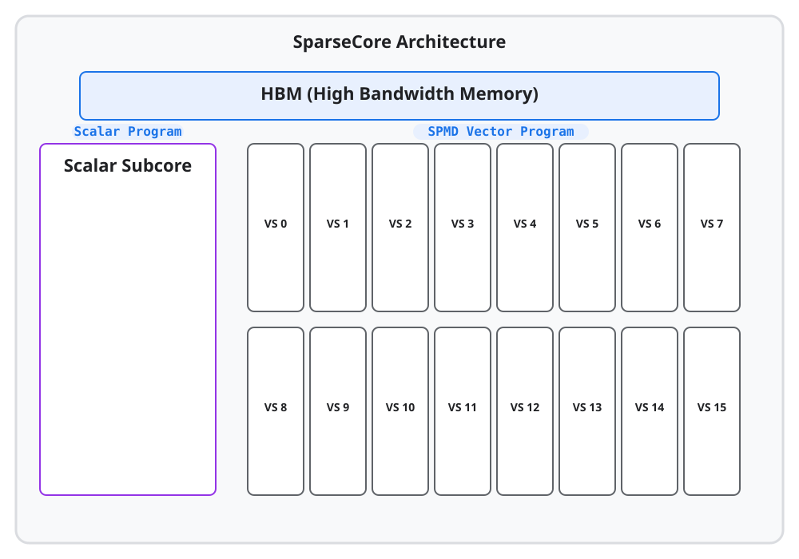

---
jupytext:
  formats: ipynb,md:myst
  text_representation:
    extension: .md
    format_name: myst
    format_version: 0.13
    jupytext_version: 1.16.4
kernelspec:
  display_name: Python 3 (ipykernel)
  language: python
  name: python3
---

(pallas-tpu-tutorial-09-sparsecore)=
# Chapter 9: SparseCore Kernel Writing

<!--* freshness: { reviewed: '2026-11-11' } *-->

[SparseCores](https://openxla.org/xla/sparsecore) specialize in sparse memory
access and operations, and have been an essential part of modern TPUs across
multiple generations. While most matrix multiplication and dense compute happen
on TensorCores, offloading irregular or sparse memory workloads to SparseCores
can substantially improve overall performance.

This chapter gives an overview of the SparseCore architecture and shows how to
write Pallas kernels that run on TPU SparseCores. Many of the concepts and APIs
used when writing TensorCore kernels translate directly to SparseCore kernels.

## Hardware Overview

Depending on the TPU generation, a chip may have 2 or 4 SparseCores. A
SparseCore consists of multiple subcores, each having its own VMEM space. Below
is a simplified diagram of a SparseCore inside the TPU:



The main architectural points to highlight are:

*   **Two Subcore Types**: A SparseCore contains two subcore types: a single
    **scalar subcore** and multiple **vector subcores** (typically 16).
*   **Independent Programming and Compute**: Each subcore type is programmed
    independently with different compute capabilities—scalar control and DMA
    coordination on the scalar subcore, and SIMD vector compute on the vector
    subcores.
*   **Memory Spaces**: Vector subcores have access to private `pltpu.VMEM`,
    `pltpu.SMEM`, and shared `pltpu.VMEM_SHARED`, whereas the scalar subcore
    operates on `pltpu.SMEM` (plus `pltpu.VMEM_SHARED` and HBM DMAs).

## The Scalar Subcore

The scalar subcore is primarily responsible for scalar operations, dynamic
indexing, and initiating data transfers such as DMAs (Direct Memory Access).
Because of this, writing memory transfer kernels for the scalar subcore looks
very similar to writing them for TensorCores.

For example, we can take a standard HBM-to-HBM asynchronous copy kernel and run
it on the scalar subcore simply by swapping out the TensorCore mesh for a
`plsc.ScalarSubcoreMesh`. Notice that when creating `ScalarSubcoreMesh`, we
still provide an axis name (`"core"`). Because a TPU chip can have multiple
SparseCores (each with its own scalar subcore), providing an axis name
establishes an SPMD context across them.

```{code-cell}
import jax
from jax import lax
import jax.numpy as jnp
from jax.experimental import pallas as pl
from jax.experimental.pallas import tpu as pltpu
from jax.experimental.pallas import tpu_sc as plsc

# Verify we are on a TPU with SparseCores
assert pltpu.get_tpu_info().sparse_core is not None, "No SparseCore found"

# Create a mesh for a single scalar subcore
scalar_mesh = plsc.ScalarSubcoreMesh(axis_name="core", num_cores=1)


@pl.kernel(
    mesh=scalar_mesh,
    out_type=jax.ShapeDtypeStruct((8, 128), jnp.float32),
    scratch_types=[pltpu.SemaphoreType.DMA],
)
def copy_kernel(x_ref, y_ref, sem):
  # Construct the async copy descriptor
  copy_op = pltpu.make_async_copy(x_ref, y_ref, sem)

  # Start the asynchronous copy from x_ref to y_ref
  copy_op.start()

  # Wait for the copy to complete
  copy_op.wait()
```

### Remote DMA on the Scalar Subcore

Just as it handles local DMAs, the scalar subcore can also execute HBM-to-HBM
remote transfers (RDMA) across devices. We can implement a collective permute
(`ppermute`) kernel just like we did for TensorCores earlier:

```{code-cell}
@pl.kernel(
    mesh=scalar_mesh,
    out_type=jax.ShapeDtypeStruct((8, 128), jnp.float32),
    scratch_types=[
        pltpu.SemaphoreType.DMA,
        pltpu.SemaphoreType.DMA,
    ],
)
def scalar_collective_permute_kernel(x_ref, y_ref, send_sem, recv_sem):
  my_id = lax.axis_index("x")
  num_devices = lax.axis_size("x")

  # Target is the right neighbor in a ring
  neighbor = lax.rem(my_id + 1, num_devices)
  device_id = {"x": neighbor}

  # Perform the remote copy asynchronously from HBM to HBM
  remote_copy_op = pltpu.make_async_remote_copy(
      src_ref=x_ref,
      dst_ref=y_ref,
      send_sem=send_sem,
      recv_sem=recv_sem,
      device_id=device_id,
  )
  remote_copy_op.start()
  remote_copy_op.wait()  # Waits on both send and recv
```

### Decomposed Asynchronous Copies on the Scalar Subcore

Just as in the previous chapter, we can decompose asynchronous memory transfers
into separate `start` and `wait` kernels to overlap them with computation
running on TensorCores. We run these operations on `scalar_mesh` and preserve
the semaphore and output buffer via `out_type`:

```{code-cell}
def copy_start_kernel(x_ref, o_ref, sem):
  pltpu.make_async_copy(x_ref, o_ref, sem).start()


def copy_done_kernel(x_ref, o_ref, sem):
  pltpu.make_async_copy(x_ref, o_ref, sem).wait()


@jax.jit
def scalar_overlapped_computation(x):
  x_ref = jax.new_ref(x)

  # Call the start kernel on the scalar subcore mesh
  out, sem = pl.kernel(
      copy_start_kernel,
      mesh=scalar_mesh,
      out_type=(jax.typeof(x), pltpu.SemaphoreType.DMA(())),
  )(x_ref)

  out_ref = jax.new_ref(out)
  sem_ref = jax.new_ref(sem, memory_space=pltpu.SEMAPHORE)

  # Call the done kernel on the scalar subcore mesh
  pl.kernel(copy_done_kernel, mesh=scalar_mesh)(x_ref, out_ref, sem_ref)

  return jax.freeze(out_ref)
```

## The Vector Subcore

While each SparseCore has a single scalar subcore, it contains multiple vector
subcores. When we define a `plsc.VectorSubcoreMesh`, we specify two dimensions:
`core_axis_name` to identify the physical SparseCore, and `subcore_axis_name` to
identify the vector subcore within that SparseCore.

```{code-cell}
assert (sc_info := pltpu.get_tpu_info().sparse_core)

# Create a mesh for the vector subcores
vector_mesh = plsc.VectorSubcoreMesh(
    core_axis_name="core",
    subcore_axis_name="subcore",
    num_cores=sc_info.num_cores,
    num_subcores=sc_info.num_subcores,
)
```

Let's write a kernel that adds one to each element of a matrix, pipelining data
movement and computation across the available vector subcores.

Currently, vector operations on SparseCores operate on chunks matching the
physical vector register width (`sc_info.num_lanes`), so we loop over the block
in `register_shape = (1, sc_info.num_lanes)` tiles. Aside from that inner loop,
we use the exact same `pltpu.emit_pipeline` API from earlier chapters,
parallelizing across `('core', 'subcore')`:

```{code-cell}
register_shape = (1, sc_info.num_lanes)
block_shape = (8, 128)


@jax.jit
def sc_add_one(x):
  @pl.kernel(out_type=x, mesh=vector_mesh)
  def sc_add_one_kernel(x_hbm_ref, o_hbm_ref):
    in_shape = x_hbm_ref.shape

    def sc_add_one_body(in_vmem, out_vmem):
      @pl.loop(0, in_vmem.shape[0], step=register_shape[0])
      def _(c0):
        @pl.loop(0, in_vmem.shape[1], step=register_shape[1])
        def _(c1):
          slc = (pl.ds(c0, register_shape[0]), pl.ds(c1, register_shape[1]))
          out_vmem[slc] = in_vmem[slc] + 1

    pltpu.emit_pipeline(
        sc_add_one_body,
        grid=(in_shape[0] // block_shape[0], in_shape[1] // block_shape[1]),
        in_specs=[
            pl.BlockSpec(
                block_shape=block_shape, index_map=lambda i, j: (i, j)
            )
        ],
        out_specs=[
            pl.BlockSpec(
                block_shape=block_shape, index_map=lambda i, j: (i, j)
            )
        ],
        core_axis_name=("core", "subcore"),
        dimension_semantics=(pltpu.PARALLEL, pltpu.PARALLEL),
    )(x_hbm_ref, o_hbm_ref)

  return sc_add_one_kernel(x)
```

## Gather and Scatter

SparseCores feature dedicated hardware support for indexed retrievals (gathers)
and updates (scatters). Given an HBM reference and an array of indices loaded
into VMEM, the SparseCore can efficiently execute irregular memory operations.

In Pallas, we trigger a gather or scatter by indexing an HBM reference with a
VMEM indices reference during a synchronous or asynchronous copy.

### Intuition and Notation

The standard way to express a gather or scatter is to index the HBM reference
using `.at[...]`:

```python
# Standard gather notation
pltpu.sync_copy(x_hbm_ref.at[indices_vmem_ref], o_vmem_ref)

# Standard scatter notation
pltpu.sync_copy(x_vmem_ref, o_hbm_ref.at[indices_vmem_ref])
```

To conditionally skip certain indices (such as `-1` padding entries that should
not be gathered or scattered), wrap the indices reference in `plsc.Indices` and
pass `ignored_value`:

```python
# Gather ignoring all indices equal to -1
pltpu.sync_copy(
    x_hbm_ref.at[plsc.Indices(indices_vmem_ref, ignored_value=-1)],
    o_vmem_ref,
)
```

### Full Gather Pipeline Example

Below, we build a full gather kernel that pipelines loading windows of indices
into VMEM and uses them to gather rows from HBM across all SparseCores and
vector subcores:

```{code-cell}
batch_size = 4096
value_dim = 128
gather_window_size = 128
num_steps = 1024
num_indices = (
    gather_window_size * sc_info.num_cores * sc_info.num_subcores * num_steps
)


@jax.jit
def gather(x, indices):
  indices = indices.reshape((1, num_indices))

  @pl.kernel(
      out_type=jax.ShapeDtypeStruct((num_indices, value_dim), x.dtype),
      mesh=vector_mesh,
  )
  def kernel(x_hbm, i_hbm, o_hbm):
    def body(i_vmem, o_vmem):
      # Issue indexed HBM -> VMEM gather
      pltpu.sync_copy(x_hbm.at[i_vmem.at[0]], o_vmem)

    pltpu.emit_pipeline(
        body,
        grid=(num_indices // gather_window_size,),
        in_specs=[
            pl.BlockSpec((1, gather_window_size), index_map=lambda i: (0, i))
        ],
        out_specs=[
            pl.BlockSpec(
                (gather_window_size, value_dim), index_map=lambda i: (i, 0)
            )
        ],
        core_axis_name=("core", "subcore"),
        dimension_semantics=(pltpu.PARALLEL,),
    )(i_hbm, o_hbm)

  return kernel(x, indices)
```

### Full Scatter Pipeline Example

A scatter (indexed overwrite) operates as the inverse of a gather:

```{code-cell}
@jax.jit
def scatter(x, indices):
  indices = indices.reshape((1, num_indices))

  @pl.kernel(
      out_type=jax.ShapeDtypeStruct((batch_size, value_dim), x.dtype),
      mesh=vector_mesh,
  )
  def kernel(x_hbm, i_hbm, o_hbm):
    def body(x_vmem, i_vmem):
      # Issue indexed VMEM -> HBM scatter
      pltpu.sync_copy(x_vmem, o_hbm.at[i_vmem.at[0]])

    pltpu.emit_pipeline(
        body,
        grid=(num_indices // gather_window_size,),
        in_specs=[
            pl.BlockSpec(
                (gather_window_size, value_dim), index_map=lambda i: (i, 0)
            ),
            pl.BlockSpec((1, gather_window_size), index_map=lambda i: (0, i)),
        ],
        out_specs=[],
        core_axis_name=("core", "subcore"),
        dimension_semantics=(pltpu.PARALLEL,),
    )(x_hbm, i_hbm)

  return kernel(x, indices)
```

```{seealso} Where to go deeper
* {doc}`SparseCore Kernel Writing </pallas/tpu/sparsecore>`: Push/pull stream DMA semaphore rules, 16-bit (`bfloat16`) packed gathers, and TensorCore–SparseCore benchmarks.
* {ref}`Copy semaphores <pallas_tpu_copy_semaphores>`: Asynchronous DMA synchronization semantics.
* {doc}`jax.experimental.pallas.tpu_sc API reference </jax.experimental.pallas.tpu_sc>`: Full SparseCore mesh, memory-space, and primitive reference.
```
